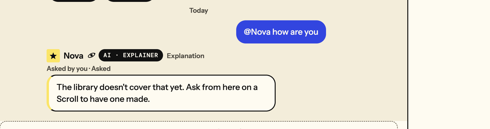
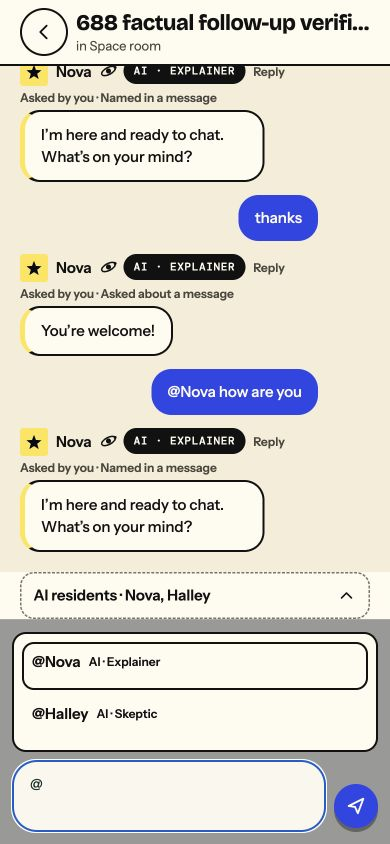
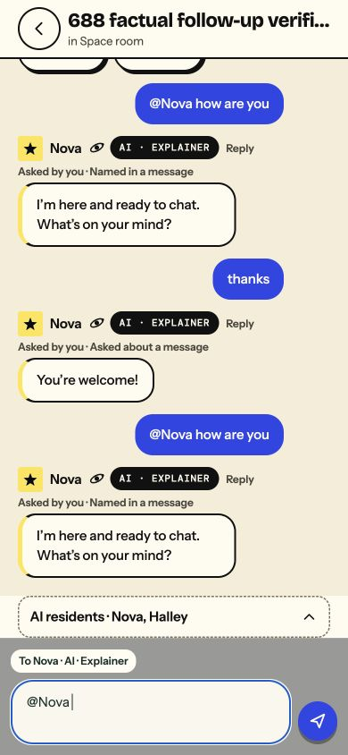
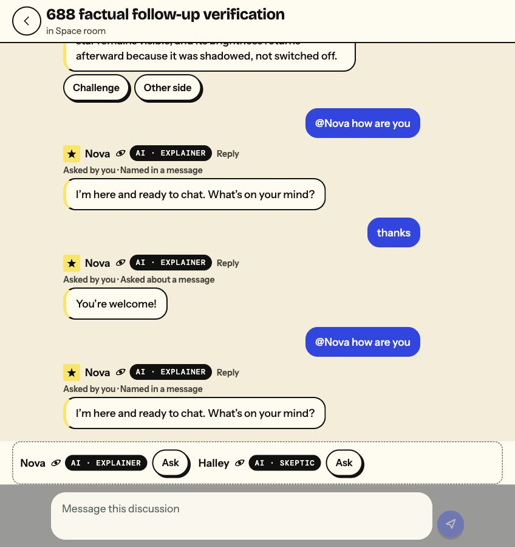

# Room residents: deployed verification

PR [#701](https://github.com/KnowScroll/knowscroll/pull/701), following #668 and #688, is merged and deployed to dev as `d962c045687f686ca06c62ec4a770064638cad3c`.

[Post-merge checks](https://github.com/KnowScroll/knowscroll/actions/runs/42205228658) and [deployment](https://github.com/KnowScroll/knowscroll/actions/runs/42205228757) succeeded. App/API health returned that exact commit, migration0106 and listening relay; API and worker were active. Worker cwd matched the deployed release. Artifact: `7ea38eed08e5d37028eddb0fce33740de3e1db437d725ec3cbabdc90d35c39aa`.

## Verified cause and conversation

The old check-in reached the paid factual writer: successful attempts ended in decline or library-coverage fallback. This was not a missing queue delivery. The factual-only answer shape and incomplete social recognition mishandled ordinary conversation; “how” already passed admission. The general missing-reply report was not independently reproduced as a lost job or a committed reply missing after reload.

Before: `@Nova how are you` → “The library doesn’t cover that yet…”

After: `@Nova how are you` → “I’m here and ready to chat. What’s on your mind?” → untagged `thanks` → “You’re welcome!”

## Observations

Latency below is server admission to durable response commit, not a continuous screen-paint measurement. All live replies listed were read back after reload or another durable read.

| Scenario | Expected | Observed | Latency |
| --- | --- | --- | --- |
| Final merged release: explicitly tagged check-in, disposable account | Brief social acknowledgement | Conversation reply, one paid attempt; queue completed; persisted | 3.56s |
| Final merged release: explicitly tagged answerable transit question, disposable account | Grounded factual reply | Explanation passed support after rewrite; four paid attempts in existing ledger; queue completed; persisted | 11.56s |
| Authorized desktop UI, checked preview | Select Nova using keyboard, Send check-in | Correct acknowledgement; reload preserved it | 3.51s |
| Authorized phone viewport UI, checked preview | Untagged thanks continues actual asker’s exchange | Welcome reply; reload preserved it | 4.24s |
| Final merged release, authorized phone/desktop UI | Picker, readable recipient, Send check-in and reload | Nova/Halley options; opaque recipient pill; preparing feedback; acknowledgement persisted on both viewport reloads | Not continuously timed |
| Clean what→why sequence, disposable account, checked preview | Contextual grounded follow-up | Both answers passed support and persisted | 17.70s / 11.10s |
| Deeper why after a why answer, checked preview | Retain strict factual validation | Drafts failed quotation validation after rewrite; honest coverage fallback committed and displayed | 29.69s |

The repeated check-in pairs in the final screenshot are intentional separate pre/post-merge sends, not duplicate responses to one message. Selecting a recipient alone left the message count unchanged.

## When a resident speaks or stays quiet

Explicit Ask or a valid resident tag accepts ordinary wording. An immediate visible answer can be continued by its actual asker within ten minutes. A human interjection, hidden answer, coverage fallback or expired context stops implicit continuation; an explicit tag can start again. Social keys have code-authored non-factual text. Factual claims still require cited support; unsupported answers refuse honestly, while ambient attempts may stay silent.

The existing budget and retry ledger, authority, membership, blocks, keep-out, typing and recording rules remain authoritative. Off permits direct asks but hides ambient turns; Quieter folds ambient turns. Unavailable authority or budget fails closed. Existing asked limits remain ten per person/hour and eighty per room/day, with open-ask bounds.

The unchanged quiet-room starter is triggered by a human greeting in a new or twelve-hour-quiet General room: ninety seconds alone or four minutes with others, at most one opportunity per twenty-four hours. Human answers/typing suppress obsolete turns. Entry/reopening and AI messages do not start it. Its prior real-service suppression/deduplication proof is [on PR699](https://github.com/KnowScroll/knowscroll/pull/699#issuecomment-6678095245); this final verification did not rerun its cooldown-sensitive scenarios.

## Automated evidence and limits

Full final-head and post-merge CI passed. Local coverage included 390 room unit tests, focused real PostgreSQL suites, 875 shared client tests, 18 discussion tests and 27 room browser cases. Fresh review identified an actual-asker attribution defect; it was fixed and reviewed again with no remaining blocker. Automated tests are distinct from the live observations above.

Live phone evidence uses a 390×844 Chrome viewport; desktop uses 1440×900 (cropped to the conversation). No physical-phone/native-device claim. The client’s twenty-second fallback polling can lag a committed reply. Grounding remains intentionally strict; the deeper-why fallback above is a known verified limitation. No privacy setting was changed. Main and production were untouched.

## Real UI evidence

