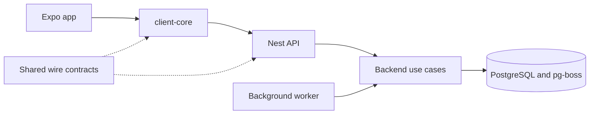

# KnowScroll

KnowScroll offers short Reels and interactive Scrolls. A person's universe grows from encounters
they actually explored. The repository contains one Expo app for web, Android and iOS, a NestJS
HTTP API, a background worker and their shared TypeScript packages. PostgreSQL holds application
state and pg-boss jobs.

## First visit

Read [the working agreement](AGENTS.md), then [the contributor workflow](docs/v2/engineering/contributing.md).
Start an issue branch from freshly fetched `origin/dev` in a dedicated worktree. PRs target `dev`;
merging starts the dev checks and deployment. The owner controls production.

Use Node `22.23.0` from `.nvmrc` and pnpm `10.34.7` from `package.json`. On the owner's Mac,
set the development-data root before installing so pnpm keeps its store on the SSD:

```sh
export KS_DEV_ROOT="/Volumes/Mrigesh SSD/knowscroll-dev/v2"
pnpm install --frozen-lockfile
pnpm issue-context new "short description of the problem"
```

On Windows, set `$env:KS_DEV_ROOT` to your dedicated development-data directory. The
[issue workflow](docs/v2/engineering/issue-context.md) also supports saved briefs and offline use.
For an existing issue, use `pnpm issue-context 679`, replacing 679 with its number.

## Follow one journey through the code

Start with [account deletion](packages/backend/src/modules/identity/README.md#account-deletion-d-043):
the app saves a receipt, the API accepts the request, the worker erases registered stores, and the
device checks progress after sign-out. It demonstrates the boundaries used elsewhere:



| Where to go | What you will find |
| --- | --- |
| [Client](apps/client/README.md) | File routes, screens, web/native adapters and device setup |
| [Client core](packages/client-core/README.md) | Account lifetime, requests, recovery and reading recorders |
| [UI](packages/ui/README.md), [design tokens](packages/design-tokens/README.md) | Rendering, interaction and visual rules |
| [Contracts](packages/contracts/README.md) | Public request, response and error schemas |
| [API](apps/api/README.md), [worker](apps/worker/README.md) | Process entry points and dependency wiring |
| [Backend](packages/backend/README.md) | Module ownership, public ports and store lifecycle |
| [Scroll model](packages/scroll-model/README.md), [scene core](packages/scene-core/README.md) | Shared document and scene rules |
| [Migrations](migrations/README.md) | Reviewed, forward-only schema changes |
| [Integration tests](tests/integration/README.md) | Disposable PostgreSQL and installed-release journeys |
| [Operations](ops/vps/README.md), [Reel pool](ops/pool/README.md) | Deployment recovery and shared spend ownership |

## Check a change

Run `pnpm format:check`, `pnpm lint`, `pnpm typecheck`, `pnpm knip` and `pnpm boundaries`
from the root. Each package README explains its focused checks. The hosted
[checks workflow](.github/workflows/checks.yml) also runs boundary probes, unit/component tests,
PostgreSQL integration tests, installed-release tests and web exports. Use disposable data for
destructive journeys; test results do not establish live behavior.

The [status page](docs/STATUS.md) records deployment evidence and known gaps. The
[design and architecture index](docs/v2/README.md) points to the blueprint, amendments and current
artboards. Historical content stays under [content](content/README.md), the
[documentation archive](docs/archive/README.md) and tag `legacy/v1-final`; it is not current product data.
