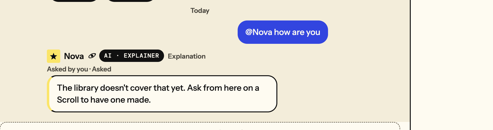
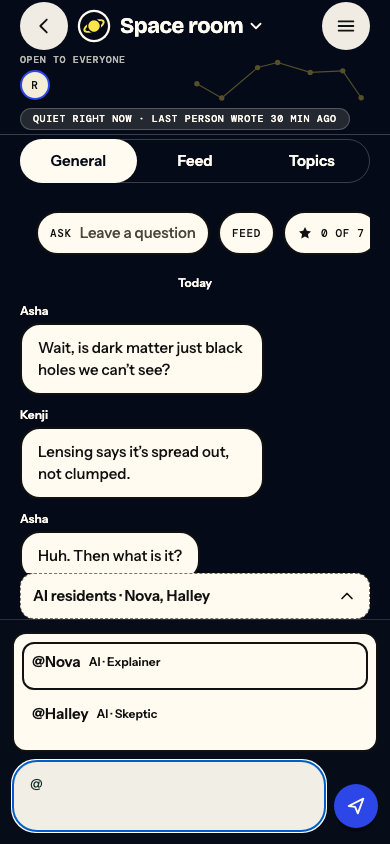
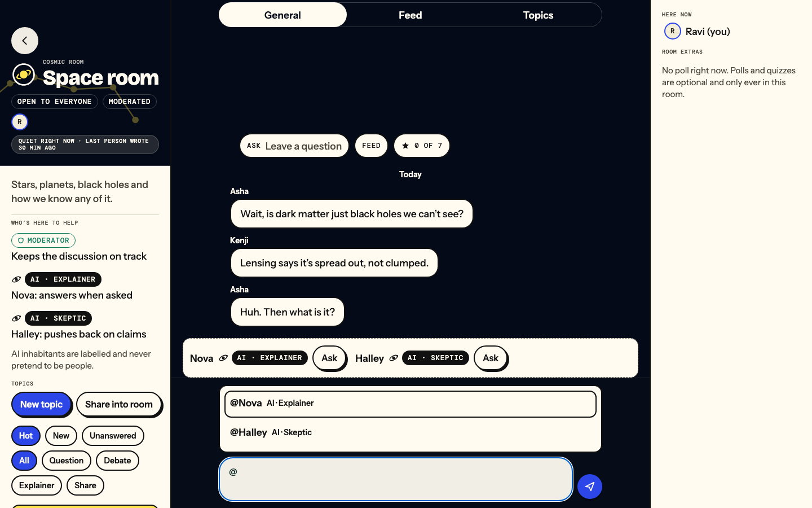

# Room mentions and social conversation: #668 / #688

Before: the owner-supplied screenshot shows `@Nova how are you` followed by the factual coverage line.
Read-only dev tracing on `e0d4f33a` confirmed a successful writer attempt ending in silence, then a later
successful Ask attempt ending `not_covered`. This was a factual-only writer outcome, not a lost job.
The social matcher also did not recognise that check-in. No private prompts or credentials are recorded here.

The after views below are **automated browser fixtures**, not live provider observations. Authored room
names/messages are labelled fixture data. They show the production export at 390×844 and 1440×900.
Typing @ displays the real supplied roster; typing more filters it. Pointer/touch or arrows plus Enter/Tab
insert the canonical name, and a recipient line confirms the target. Escape dismisses. Selection alone
sends no message. Off/unavailable residents show why. The normal Send command is used exactly once.

Regression evidence: the whole 27-case room browser suite passed, including open-menu/recipient Axe checks;
component coverage checks custom rosters, insertion, keyboard/Escape and disabled states. Real PostgreSQL
checks social replies with empty ground, ordinary contextual follow-ups, actual-asker attribution,
recording fencing and duplicate delivery. Factual checks and ambient starter regressions remain in place.
The PR handoff distinguishes final CI and later real-dev provider observations from these fixture results.
