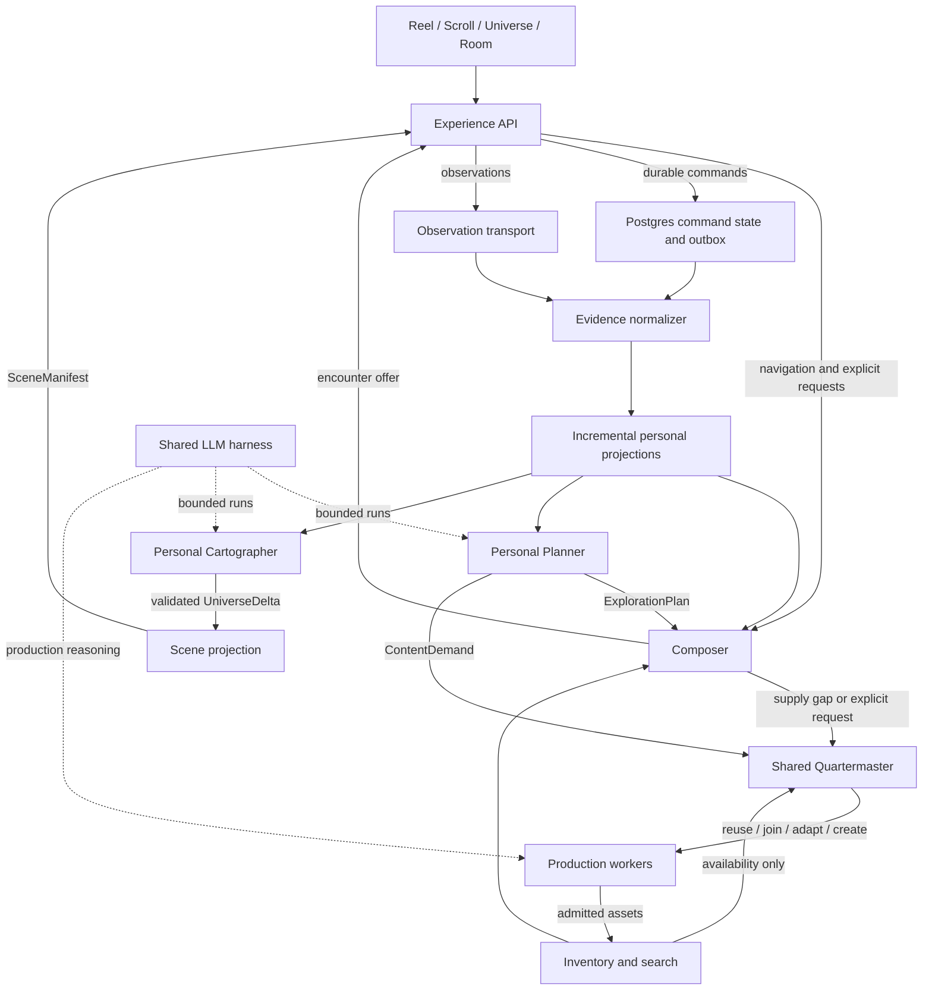

# Architecture: KnowScroll's personal universe

**Gate 2 proposal · 18 October 2026 · documentation only**

The design connects a fast encounter selector, a slower personal Planner, a shared content Quartermaster and a personal Cartographer. They exchange versioned records through an evidence pipeline and durable work queues. Planner and Cartographer use a shared LLM harness, with different permissions and independent validators. No loop can turn its own recommendation or generated content into evidence that a person explored something.

Read this document for the system; [02a-contracts.md](02a-contracts.md) for the messages; [02b-user-journey.md](02b-user-journey.md) for one person's full journey and stored records; [02c-harness.md](02c-harness.md) for memory, tools and model execution. [00-status.md](00-status.md) records approval and handoff state. All names, endpoints and schemas below are proposed unless explicitly labelled current.

## 1. Fit: what changes and what remains authoritative

### 

Inspected committed source at `e5fdc319ffac0292fb19020ccadca9ee2b254e2f`. This establishes source behavior, not what any deployment currently runs. Uncommitted edits in the original checkout and other worktrees were excluded.

| Current source | What this proposal changes |
|---|---|
| [Composer](../../../packages/core/src/composer/semantic.ts) is a pure, recorded ranking policy; its header explicitly excludes watch time. | Add qualified passive encounter features, mode-aware retrieval, conditional format preference and optional Jev judgments. Keep recorded decisions and deterministic final eligibility. |
| [Attention](../../../packages/core/src/semantic/attention.ts) aggregates episodes and voluntary marks; current anchoring requires voluntary activity. | Permit formation from sufficiently varied qualified passive encounters. Separate short-lived routing activity from persistent exploration structure. |
| [Personal model](../../../packages/db/src/semantic/personal-model.ts) recomputes from the universe's history within the evidence transaction. | Incrementally project bounded read models; run semantic planning and cartography asynchronously. |
| [Cartographer](../../../packages/core/src/atlas/cartographer.ts) produces places, regions, sightings and foundation relationships. [ADR-0037](../../decisions/0037-foundation-stars.md) treats a foundation as a property of a place, not a separate star. | Introduce organising stars and broad-topic systems. This is an explicit ontology change, requiring a successor ADR and migration interpretation. |
| [Quartermaster](../../../packages/core/src/inventory/quartermaster.ts) reuses Scrolls, joins requests or funds writing; adaptation is unavailable in v1. | Add format-aware reuse/adaptation, shared demand matching and Reel production through Cutroom. |
| [Supply worker](../../../apps/worker/src/scrolls/supply-worker.ts) already separates admission, a provider send and settlement. [Invocation](../../../apps/worker/src/reasoning/invoke.ts) records uncertain outcomes without blind retries. | Reuse these authority and accounting principles under the harness; do not replace them with an agent's internal retry loop. |
| [Ledger contracts](../../../packages/contracts/src/ledger.ts) include decision/exposure lineage and a strict Keep interaction. | Introduce a versioned observation vocabulary alongside explicit commands. Existing contracts do not silently acquire new meanings. |

[ADR-0048](../../decisions/0048-backend-module-boundaries.md) and the [module map](../../architecture/module-map.md) remain useful: contracts contain schemas; core contains pure rules; db owns SQL and transactions; API owns HTTP; workers own external calls. Logical loops do not each require a separately deployed service. The Experience API can initially be a coherent route/module boundary within the existing API process.

Changes to accepted product or architectural rules must be proposed explicitly before implementation:

| Decision area | Existing authority | Proposed successor decision |
|---|---|---|
| Signals and formation | ADR-0028, ADR-0032, ADR-0036 | Qualified passive evidence, incremental projections and formation independent of voluntary buttons. |
| Meaning of stars | ADR-0037 | Organising centre of a topic system; old explanatory links remain typed relations, not silently relabelled stars. |
| Supply and generated articles | ADR-0041, ADR-0046 | Canonical explanation packages, requested variants and common demand handling for Reel/Scroll. |
| Transport and privacy | ADR-0005, ADR-0009, ADR-0010, ADR-0030, ADR-0035 | Optional Kafka observation transport with an explicit deletion scope; preserve current command receipts and epoch checks. |
| Reasoning and dispatch | ADR-0012 through ADR-0019 | Shared harness behind existing admission, authority, accounting and reconciliation boundaries. |
| Rooms | ADR-0045; social work tracked separately in #137 | Shared human rooms, scoped membership, moderator and labelled AI inhabitants. This is a later capability, not implied present functionality. |

No accepted ADR, checkpoint or PROJECT-STATE is rewritten by this draft.

## 2. The connected loops



A projection is a prepared view derived from stored evidence. An outbox is a notification written in the same database transaction as the state it describes. These keep each request from reconstructing the entire history or depending on another loop being awake.

| Loop / owner | Trigger | Reads | Stores | Produces | Must not do |
|---|---|---|---|---|---|
| Experience API | App request | Current authority, session and relevant prepared view | Command receipt or broker acknowledgement; offer/decision records | Client response with revisions and honest ready/pending status | Call a model directly or trust a client-supplied owner. |
| Evidence pipeline | Accepted observations and committed actions | Exposure lineage, asset revision, telemetry policy | Deduplicated observations within retention; versioned EncounterEvidence | Evidence changes and projection work | Equate a queued item, automatic loop or raw duration with interest. |
| Personal projections | Evidence change | Previous evidence revision and affected topic rows | Topic/format aggregates, recent exploration, watermarks | ExperienceContext and ExplorationSnapshot | Assert belief, mastery or personality. |
| Composer | Navigate, explicit request, buffer refill | Context, thread, inventory, active plan hints | Candidate/selection decision and prepared offers | Small next-content buffer; supply-gap demand | Create planets or wait for a full Planner run. |
| Planner | Material new evidence, new thread, meaningful supply gap | Bounded exploration snapshot, existing plan, content coverage | Validated versioned plan and demand proposals | ExplorationPlan; admitted ContentDemand | Treat its plan as something the user did. |
| Quartermaster | New demand or supply change | Demand constraints, shared inventory, budget and open requests | Demand resolution, waiters, production reservation | Reuse binding, shared job, defer/refuse result | Share private context through a public generation request. |
| Production | Admitted supply job | Public brief or authorised private brief, research material | Evidence package, variants, validation and provider receipts | PublishedEncounter after admission | Publish unchecked prose/media or fabricate provenance. |
| Cartographer | New qualified evidence or correction | Personal exploration, shared concepts, current structure | Proposal, validation outcome, ordered structural deltas | UniverseDelta | Count planned content, recommendations or a model's confidence as encounter mass. |
| Scene projection | Applied structural delta or visual activity change | Stable object IDs, semantic structure, style family | Scene descriptors and versioned manifests | SceneManifest | Infer meaning from terrain or change semantic state for visual effect. |
| Room moderator / inhabitants | Human activity or bounded scheduled room task | Authorised room context | Attributed messages and moderation actions | Conversation, summaries and optional content demands | Inflate human activity or turn bot conversations into personal evidence. |

The **process layer** is the collection of normalisation, projections, jobs, harness execution and deterministic application. It is a boundary with clear owners, not another omniscient agent.

## 3. What algorithm each loop initially uses

### Composer: retrieve, assess, diversify, prepare

1. Resolve current intent: vertical discovery, horizontal continuation, explicit topic, same-explanation format switch, or return to an existing place. Explicit intent overrides inferred topic/format preferences for that request.
2. Retrieve bounded candidates from topic/lexical search, semantic embeddings, admitted concept relations, continuity links and a small exploration pool. Social candidates join only when that feature and sharing permission exist.
3. Apply hard gates: publication, current access, correction/withdrawal, requested format, language, thread scope and blocked content. A high model score cannot bypass a gate.
4. Compute transparent features for relevance, continuity, topic-conditioned format fit, novelty, recent repetition and content readiness. Optionally ask Jev to assess a small shortlist against specific semantic criteria.
5. Diversify the ordered set. In vertical mode, diversity spans subjects and perspectives. In horizontal mode it spans explanatory moves within the thread. A declared sequel is selected by its continuity contract before general diversity ranking.
6. Prepare two or three offers. Prepared does not mean displayed. Recheck eligibility when activating one. Record a real exposure only when the client reports that it became visible.

Provisional candidate limits: retrieve at most 100, assess 15–25, buffer 2–3. These are capacity experiment parameters, not validated optimal values.

An initial score can be expressed as:

`fit = a·intent + b·topic_activity + c·format_fit + d·continuity + e·semantic_fit − f·recent_repetition`

Then choose the next candidate using `lambda·fit − (1−lambda)·max_similarity_to_selected`. This is an adaptation of diversity reranking, not a learned probability. Each term must have a defined range, versioned coefficient and recorded inputs. The [MMR paper](https://www.cs.cmu.edu/afs/cs/Web/People/jgc/publication/MMR_DiversityBased_Reranking_SIGIR_1998.pdf) motivates balancing relevance and redundancy; KnowScroll's navigation constraints remain product-specific.

Jev fits the **semantic assessment slot**. It does not own authentication, candidate retrieval, queues, world formation or final application. Use a pinned model version, bounded parallel work in a fast worker pool, cached public content features and a strict deadline. On timeout, rank with the explicit features. Do not persist a provisional semantic judgment as user evidence. TypeSafe documents combining criterion-level scores; that supports this integration pattern, not a proven recommendation objective for KnowScroll. [Composite scoring](https://docs.typesafe.ai/patterns/composite-scoring)

Reserve an adjustable fraction of vertical slots for eligible exploration. Initially use seeded, logged random selection within that pool. Later a contextual bandit can learn which exploration choices work, using recorded selection probabilities and separate outcomes. Model confidence is not a selection probability. Do not claim offline replay proves a better counterfactual feed.

### Personal interest: several aggregates, not one personality score

For each topic, maintain qualified exposure, saving, sharing, continuation, deliberate return and dismissal as separate aggregates. Maintain format preference at topic × format, with shrinkage toward a neutral prior when evidence is sparse. Do not make one global video/text label.

For channel `k`, topic `t` and a new evidence contribution at time `now`:

`A[t,k] = A[t,k] · exp(−ln(2)·elapsed / half_life[k]) + contribution[t,k]`

Store the update time. Short-session intent and durable exploration counts are separate from this recency-weighted activity. For late events, apply their contribution decayed to the current projection time; revise old contributions by difference, rather than counting the encounter twice. Rebuild affected topics if a correction cannot be expressed safely as a delta.

A starting, explicitly unvalidated set of per-encounter contributions:

| Signal | Candidate contribution | Interpretation / guard |
|---|---:|---|
| Qualified visible consumption | 0–1 | Cohort-relative engagement; not understanding. Reels use active visible playback and unique coverage; Scrolls use visible sections, active dwell and interaction opportunities. |
| Like | +0.5 | Positive response to this encounter; not agreement with every claim. |
| Save | +1.5 | Intention to keep; not proof it was read. |
| Completed share action | +1.0 | Interest in sharing; opening the share sheet is insufficient. Do not record recipients in interest evidence. |
| Deliberate horizontal continuation | +1.5 | Immediate desire to continue the thread; attribute to the current encounter once. |
| Deliberate separated return | +2.0 | Return to the topic on a new encounter; restoring a parked reader is not a new return. |
| Quick skip | Separate weak dismissal channel | May reflect timing, already-known material or bad presentation. |
| Not interested / hide | Separate explicit constraint | Strong routing effect within its stated scope; not a negative belief claim. |

Cap combined positive activity at 3 per encounter and distribute topic contributions with normalised attribution weights. Keep the raw channels separately so the cap does not destroy evidence. Count semantic variety by distinct explanation units, facets and evidence families, not asset IDs: a Reel and its Scroll twin do not double the conceptual coverage. Saving without reading can affect routing, but cannot satisfy a qualified-consumption formation threshold.

For duration cohorts, start with format, length/read-size bucket and language; fall back to broader cohorts when sample counts are small. Do not manufacture precise percentiles from a handful of examples. [Counterfactual Watch Time](https://arxiv.org/abs/2406.07932) studies duration bias; using it to motivate cautious normalisation does not mean we have implemented or validated that paper's estimator.

### Planner: a bounded proposal about what could come next

Use a larger LLM when evidence has materially changed, a horizontal thread runs short, or a deliberate request needs a new explanation. Coalesce ordinary events into one job per person; prioritise direct requests. Do not run the LLM after every heartbeat or keep one indefinitely active agent per user.

The plan contains a few opportunities: continue this mechanism, show a concrete example, examine a limitation, offer a cross-topic connection, or prepare a requested format. Each has evidence references, thread constraints, an expiry and supply requirements. These are options for Composer and Quartermaster, not a curriculum or hidden obligation.

The deterministic validator checks referenced evidence, scope, freshness, privacy epoch, budget and whether the suggested relation is supported. Accepting a plan stores a plan. The only structural consequence is that Cartographer may later examine actual new encounters.

### Cartographer: semantic proposals plus stable formation rules

The LLM proposes how encountered concepts group and what labels or relations would make the map legible. Code decides whether an object can form. Baseline inputs are qualified EncounterEvidence, distinct explanation units, topic/facet coverage and already-admitted semantic relations.

For an initial policy experiment, compare planet formation at three versus five distinct qualified explanation units, with at least two facets. Repeated variants of one explanation cannot satisfy the count. No voluntary button is mandatory. The first qualified encounter can create transient dust; repeated evidence can create a protostar. A validated topic system may establish its organising star before any planet meets its stricter subtopic criterion. Exact dust/protostar/star thresholds remain review parameters; the example journey uses an explicitly illustrative policy.

Keep three states separate:

- **Activity:** recency-weighted prominence and motion; may settle when unused.
- **Structure:** stable systems, planets and regions grounded in accumulated encounters.
- **Validity:** whether evidence or semantic relations still stand after corrections or erasure.

Formation uses hysteresis: an established planet is not removed because activity drops below its creation threshold. Corrections can withdraw a relation or revise an object; inactivity does not destroy it. Merges and splits require explicit evidence-backed proposals, preserved historical object aliases and a legible transition. No supernova, collision or black hole is assigned to ordinary inactivity in this version.

### Quartermaster: deterministic routing with semantic assistance

Resolve each demand in order: exact eligible reuse; compatible existing variant; join an in-flight compatible job; adapt an existing explanation; generate new material; or defer/refuse with a reason. A semantic matcher can propose reuse candidates, but exact format, language, scope, freshness, truth and continuity constraints are checked by code.

A shared supply key contains public topic IDs, explanatory angle, depth, language, format, freshness class, continuity requirements and rights/privacy class. Keep personalised demand records separate from the shareable production brief. Similar embeddings alone are not sufficient to merge requests.

Bound generation by per-user and global budgets. Direct requests outrank speculative prefetch, with fair admission so one busy person cannot monopolise the queue. Cancellation removes that person's interest in a job; a shared job with other valid waiters need not stop. Before binding a result to any waiter, recheck that waiter's current authority and epoch.

## 4. Endpoints: the Experience API

These are proposed `/v2` routes, deliberately distinct from existing `/v1` behavior. The API derives the universe from authenticated authority. Client IDs in examples are tracing handles, never ownership claims.

| Method and route | Purpose and result |
|---|---|
| `POST /v2/experience/open` | Create or resume an encounter session; return context revision, active thread, eligible initial offers and telemetry capabilities. |
| `POST /v2/experience/navigate` | Commit a semantic navigation intent and return `ready`, `pending` or `exhausted`; can combine a bounded observation tail. |
| `POST /v2/experience/activate` | Validate a prepared offer against current authority/content status; return playback/render permission and an exposure token. Not itself proof of visibility. |
| `POST /v2/observations/batch` | Accept typed observations durably; return per-event acknowledgement and projected watermark separately. |
| `POST /v2/content-requests` | Request a topic, next explanation, real sequel or format variant; persist command plus demand and return a receipt. |
| `GET /v2/content-requests/{id}` | Read ready/pending/refused/cancelled status, without leaking another person's waiter or private brief. |
| `POST /v2/actions` | Idempotent Like/Unlike, Save/Unsave, Hide or continuation action with exposure lineage. Authoritative action outcome is synchronous. |
| `GET /v2/universe?afterRevision=...` | Return a permitted SceneManifest snapshot or contiguous deltas; stale cursors request a fresh snapshot. |
| `GET /v2/updates` | Authenticated reconnectable stream of revision/status invalidations; clients fetch canonical state. Never the sole durable delivery mechanism. |
| Existing privacy routes | Preserve their present retry contract until a reviewed successor explicitly expands erasure scope. |
| Later: room and sharing routes | Separate membership/share commands and revocable read capabilities; not enabled implicitly by a private personal map. |

Every mutating command carries an idempotency key. Reusing it with different canonical input returns conflict. A navigation retry returns its original receipt, not a fresh recommendation or generation charge. An expired or withdrawn prepared offer is revalidated and may be replaced with a new linked offer; the original decision is not rewritten.

Client responses contain content, capabilities, status and navigation affordances. Internal ranking rationale, model transcripts and research traces are not client fields. Content may naturally qualify a disputed explanation without exposing the production machinery.

### Gesture ownership

The navigation shell receives semantic gestures after the child surface resolves its own interactions:

| Gesture/context | Meaning |
|---|---|
| Vertical drag within a Scroll | Read the article. No next-encounter command. |
| Fresh deliberate gesture after the article boundary | Move vertically to another encounter; leftover momentum never triggers it. |
| Horizontal gesture on ordinary reading/player space | Follow or return along the current thread, with an axis lock. |
| Drag inside an interactive diagram/slider | The component owns the gesture from pointer-down through release. |
| Explicit next, back, continue or format control | Equivalent accessible command; useful for keyboards and assistive input. |
| OS back edge | Platform back behavior wins. |

Preserve article anchor, media position, asset revision and exposure identity when parking a surface. Format switching may create a new exposure to a sibling asset, but conceptual formation deduplicates by explanation unit. A saved-history read remains a read-only revisit under its existing contract; do not secretly redefine it as fresh exposure evidence. A later, separately activated encounter can be a deliberate return.

## 5. Data: bounded records with ownership

PostgreSQL remains the authority for commands, evidence, personal structure, publication and work state. Kafka transports observations; it is not the personal knowledge graph. Object storage holds media, larger article artifacts and permission-scoped research material. Start search with existing relational/text facilities and embeddings where measured useful; a separate graph database is not required by graph-shaped data.

The following are **logical storage families**, not a request to add every row as a new table. Gate 3 should map them onto existing tables and replace superseded paths rather than create a parallel legacy system.

| Family / sole writer | Key and bounded contents | Principal read/index outline |
|---|---|---|
| Command receipts / API transaction layer | `(universe, requestId)`, input hash, epoch, result reference | Exact receipt lookup before mutation; prune by reviewed retry horizon. |
| Decision and offer records / Composer persistence | decision ID, snapshot refs, candidate terms, policy/model versions; prepared offer IDs | Current session offers by status/expiry; history by decision ID. |
| Exposure / encounter admission | `(universe, clientExposureId)`, offer, content revision, activated/visible states | Lookup by exposure token; only actual visibility moves it to observed. |
| Observation inbox / evidence normalizer | event ID/hash, epoch, bounded typed payload, delivery metadata | Unique event ID plus payload hash; exposure and time range; retention partition. |
| Encounter evidence / evidence normalizer | `(exposure, evidenceRevision)`, qualified intervals/coverage, channel facts and references | Latest revision by exposure; changed evidence since projection checkpoint. |
| Topic aggregates / personal projector | `(universe, epoch, topic, channel, formatScope)`, weighted sums, counts, timestamps | Affected topic keys only; top current topics from prepared context. |
| Personal read models / each named projector | separate `ExperienceContext`, `ExplorationSnapshot`, `CartographySnapshot`, each with revision | Exact `(universe, epoch, modelKind)` lookup; no full-history join in navigation. |
| Plans and proposals / Planner and Cartographer respectively | owner role, run ID, base revisions, bounded JSON proposal, status | Active plan; pending proposals by role; evidence refs for invalidation. |
| Content demands / Quartermaster | person-private demand ID and public supply key, priority, state, waiter binding | Pending demands by state/priority; supply-key equality; waiter by request ID. |
| Supply and publication / production services | shared job, attempts, explanation package, variant and publication revision | Eligible inventory by topic/format/access; active job by compatible supply key. |
| Semantic substrate / admitted content semantics | stable concepts, typed relationships, claim/evidence refs | Bounded neighbours by concept and edge type; eligibility before traversal. |
| Personal geography / Cartographer applier | stable object IDs, parent/topic refs, structure revision and evidence references | Object subtree by system; deltas since revision; affected objects by evidence. |
| Scene views / scene projector | descriptor per object; manifest index and chunk versions | Manifest by universe/access scope; changed chunks by scene revision. |
| Durable work / admission and scheduler | job, lease/fence, attempt, budget, checkpoint, outbox/inbox dedupe | Ready jobs by queue and time; one active role job per universe/epoch. |
| Later rooms / room domain | room ID, memberships, attributed messages, moderation records | Messages by room/cursor after membership check; personal placement stored separately. |

Relational columns hold identities, epochs, statuses, ownership, foreign keys and frequently filtered values. Versioned JSONB holds small structured plans, manifests and evidence summaries. Large media and full research documents stay outside row blobs. PostgreSQL documents that updating a JSON document locks the row; one ever-growing universe JSON object would create contention, so object/chunk boundaries matter. [JSON types](https://www.postgresql.org/docs/current/datatype-json.html)

Example request access pattern: authenticate/lock and load a context snapshot; retrieve bounded eligible candidates; optionally obtain fast assessments outside the transaction; re-enter a short transaction, recheck authority/current intent and content eligibility, persist decision plus offers and receipt. No database lock spans model/network work. A changed session intent causes recomposition or a stale-result discard, not application to the wrong thread.

Example evidence access pattern: under the universe lock, insert unique observation; load only that exposure's current evidence; compute revised evidence; update affected aggregates; increment projection revision; enqueue outbox work; commit. Cartography may lag this transaction without delaying the next encounter.

### Concurrency and ownership

For person-scoped admission and application, discover work without row locks, acquire the universe lock, recheck session/epoch after waiting, and only then lock session, domain and job rows. Model and provider I/O happen after committing and releasing locks. A lease fence prevents a replaced worker from applying a late result.

For shared supply, private demand admission commits first. A separate global matching transaction claims a supply key/job and records candidate waiter bindings without holding a personal universe lock. A later person-scoped transaction rechecks that waiter’s authority and binds the result. Never hold a shared supply lock while acquiring a universe lock, and never lock several users just to combine their demand. Uniqueness on active compatible supply keys resolves concurrent creators; conflicts re-read the winning job. Revoked waiters cannot receive results even if the shared job continues.

Projection checkpoints advance only in the transaction that commits their effects. A notification is a hint to read canonical state, not authority to bypass epoch, publication or membership checks.

### Kafka observations and SQL commands

```mermaid
sequenceDiagram
    participant UI as Client
    participant API as Experience API
    participant PG as PostgreSQL
    participant K as Observation transport
    participant E as Evidence worker
    UI->>API: Navigate / save / request content
    API->>PG: Authority + command result + outbox in one transaction
    PG-->>API: Committed receipt
    API-->>UI: Immediate result or pending receipt
    UI->>API: Batched visibility / playback / reading observations
    API->>K: Validated observation batch
    K-->>API: Durable transport acknowledgement
    API-->>UI: Accepted IDs; projection may still lag
    K->>E: At-least-once delivery
    E->>PG: Dedupe + evidence + affected projections + outbox
    PG-->>E: Commit
    E->>K: Acknowledge processed offset
```

A Kafka deployment must set acknowledgement, replication and in-sync-replica policies deliberately. Ordering is per partition; key by a privacy-scoped opaque universe handle. This is append order, not proof of client-time causality. Deduplicate in the consuming transaction, then acknowledge the broker. Kafka's own transactional guarantees do not make a PostgreSQL write atomic with a broker offset. [Kafka design](https://kafka.apache.org/41/design/design/)

If the broker is unavailable, telemetry admission reports retryable failure and the bounded client queue retains the same event IDs. Commands can still succeed in PostgreSQL. A broker-accepted observation can still fail later evidence validation; admission and qualification are distinct states. Unknown exposure lineage is quarantined briefly for reordering, then rejected with a diagnostic; never invent a missing exposure.

A navigation request may include the current intent and a bounded observation tail. Composer uses the tail only as a provisional session overlay. Compare event IDs against projected receipts to avoid double counting. It never creates durable interest or planets until normalisation commits. A cursor/watermark is returned separately for each projection; do not advertise a single global "up to date" flag.

### Privacy determines which Kafka design is admissible

An epoch fence stops stale application; it does **not** delete retained personal data. Kafka compaction or expiry is not immediate per-person deletion. The proposed broker-first variant therefore requires a dedicated privacy design before launch: per-universe/epoch payload encryption, keys controlled outside recoverable event backups, key revocation/destruction with verified propagation, short broker retention, encrypted quarantine, and corresponding deletion of normalized evidence, projections, harness contexts and private objects. Opaque routing metadata has its own bounded retention and must not contain topic, content or account identifiers in clear text.

This is a design requirement, not a claim that crypto-erasure already meets the product's deletion promise. If the deployment cannot provide that guarantee, use **PostgreSQL intake plus outbox and payload-free broker notifications** first. It introduces a synchronous intake write but preserves the existing erasure boundary. Keep one transport interface and the same event contracts for both choices. Do not dual-write a command to PostgreSQL and Kafka without an outbox.

The architecture recommends the privacy-compatible SQL intake as the deployable fallback; Kafka-first remains a conditional option matching the user's desired deferred persistence. This choice must be resolved explicitly before the corresponding implementation slice. No privacy setting may silently mean a weaker guarantee because a broker was enabled.

## 6. Flow: what the person experiences

The [worked journey](02b-user-journey.md) follows Asha from a cold start through an ML Reel, a real sequel, an on-demand Scroll, a quick football detour, a later return and a formed ML system. Every step lists the command/observation, durable writes, outputs and what the UI shows.

Its essential order is:

1. Composer offers existing content from a diverse starter inventory. Nothing personal has formed yet.
2. Asha actually watches an ML explanation. Normalised evidence changes session routing quickly.
3. She continues horizontally. The declared Part 2 is used if available; otherwise a related continuation is labelled as such or the requested sequel becomes a pending demand.
4. She requests the same explanation as a Scroll. The command is durable immediately; Quartermaster reuses, joins or funds a real variant. Availability does not count as consumption.
5. The Planner uses accumulated evidence to suggest future opportunities. Composer may use them; Cartographer still waits for its own evidence criteria.
6. On later distinct encounters, a semantic grouping passes validation and formation rules. A stable star/planet structure is applied, then the scene projection produces its appearance.
7. A friend can visit a deliberately shared view. A shared room remains one room even when it appears between different local systems.
8. Time away calms activity. Privacy clearing invalidates old work and erases data within its explicit scope; no replay can restore it.

## 7. Scene and content rendering

### Meaning before appearance

The shared concept vocabulary supplies the meaning of ML, attention, inference and deployment. A personal exploration graph records which of those this person encountered, through which explanations and routes. A scene graph gives those objects stable positions and visual character. These three graphs must not be conflated.

A visual family for ML provides common material and shape constraints. A stable personal seed then varies landforms, palettes within the family, atmospheric motion and detail. Hashing `userId + topicId` alone would produce unrelated output; the common family/template parameters provide the resemblance. Keep identity seeds server-generated and opaque, not derived from publicly recoverable personal identifiers.

Use layered procedural noise for surface detail, after assigning semantic regions. Region boundaries and navigable routes come from meaning; noise must not decide what the person explored. Persist object ID, family ID, generator version, seed and layout anchors. Pin existing objects to their generator version so a software update does not unexpectedly remake a friend's planet. New growth can be additive; expensive mesh/texture work can be cached by descriptor and detail level.

The client renders validated descriptors with device-appropriate detail, reduced-motion alternatives and a static fallback. New planets should be spectacular without requiring fresh LLM calls on every frame or every visit. No visual score or mastery bar is implied by a larger star.

### Scrolls and Reels share explanations, not necessarily identical scripts

A canonical explanation package contains the angle, claim/evidence references, limitations, vocabulary, conceptual units and continuity promises. A Reel script and a Scroll article may be different expressions of that package. Only generate the variant needed by demand; do not double all production by default.

A Scroll is a versioned declarative article: prose, illustrations, timelines, comparisons and approved interactive components with typed data. The renderer validates component types, bounds, assets, accessibility text and gesture ownership. Do not execute arbitrary model-produced JavaScript in the initial design. New component types require an intentional renderer/schema addition.

Production follows research → evidence package → outline → composition → factual/argument review → rendering → publication admission. A valid JSON schema is necessary but does not establish factual quality. Content should explain a useful mechanism through specifics and indicate its limits naturally. The UI need not display research logs, sources or recommendation reasoning as compulsory panels. Internal provenance remains necessary for corrections and trustworthy production.

## 8. External dependencies and initial operating shape

| Dependency | Proposed role | Configuration names, no values |
|---|---|---|
| PostgreSQL | Authority and prepared read models | `DATABASE_URL` (existing); connection limits in deployment configuration |
| Observation transport | SQL intake initially or Kafka if privacy conditions pass | Proposed `OBSERVATION_TRANSPORT`, `KAFKA_BROKERS`, `KAFKA_OBSERVATION_TOPIC`, `KAFKA_AUTH_SECRET_REF` |
| Jev | Optional fast criterion assessment in workers | Proposed `TYPE_SAFE_API_KEY`, `JEV_MODEL_VERSION`, `JEV_DEADLINE_MS` |
| Main LLM provider | Planner, Cartographer semantic proposals and production writing | Existing provider credentials remain worker-owned; proposed `PLANNER_MODEL`, `CARTOGRAPHER_MODEL`, `HARNESS_MAX_TOKENS`, `HARNESS_MAX_STEPS` |
| Research/search | Worker-only source retrieval with bounded requests | Proposed `RESEARCH_PROVIDER`, `RESEARCH_SECRET_REF` |
| Cutroom HTTP service | Reel production; separate service | Reuse the existing certified Cutroom contract and configuration; inspect actual environment names at program design. |
| Media/object storage | Published assets and separately scoped private artifacts | Proposed `MEDIA_BUCKET`, `PRIVATE_ARTIFACT_BUCKET`, `OBJECT_STORE_SECRET_REF` |
| Privacy key service, if Kafka-first | Scope-bound keys and deletion lifecycle | Proposed `OBSERVATION_KEY_SERVICE`, `OBSERVATION_RETENTION_HOURS` |
| Pi adapter, optional | Embedded agent loop under KnowScroll admission | Pin the selected package/version in a future change; no runtime dependency added now. |

Keep API, normalisation and background reasoning as distinct worker pools so slow generation cannot exhaust navigation capacity. Start with existing deployable processes, one database and an object store; add process separation when independent scaling or failure isolation needs it. Use managed Kafka if chosen rather than treating a single development broker as production durability.

Illustrative capacity case, **not a measurement**: 1,000 daily users × 30 minutes × 2 aggregated telemetry records/minute is 60,000 records/day, under one/second on average. A 50× burst is roughly 35/second. At 1 KB per event that is about 60 MB/day before indexes, replication and research/media storage. This scale does not establish a need for Kafka. Continuous raw pointer/scroll/frame events would be a different and unnecessarily expensive contract.

No locally hosted recommendation model or GPU is required initially. Arithmetic aggregates and diversity ranking run on CPU; embeddings can be precomputed; Jev and the larger LLM can be hosted services. A small API/worker deployment and separately provisioned PostgreSQL are sufficient to begin benchmarking, but RAM/CPU claims require the actual corpus, concurrency and providers. Main LLM and video costs are controlled by coalescing, budgets and reuse, not only by model size.

Provisional service goals to measure: ready-content navigation p95 below 250 ms server time on the fallback path; optional fast-model work inside a bounded additional deadline; ordinary evidence projection within a few seconds; Planner/Cartographer convergence within tens of seconds under normal load. These are design targets, not vendor guarantees or observed latency. A pending generation receipt returns quickly even when the media takes minutes.

## 9. Failure behavior and review criteria

| Failure | Required outcome |
|---|---|
| Repeated event or command | Same durable result; no repeated weight, planet, save or provider charge. |
| Late/offline event | Validate current epoch and original lineage; correct evidence version; do not overwrite more recent explicit intent. |
| New device changes current intent | Session-local navigation wins for that session; shared long-term projections eventually merge valid evidence. |
| Jev or Planner unavailable | Ready inventory remains usable; deterministic ranking and last valid plan can serve. |
| Model returns malformed or unsupported proposal | Record rejection internally; bounded repair if admitted; no partial geography mutation. |
| Stale model completion | Revalidate affected references and base revisions; rebase only with explicit rules, otherwise discard/replan. |
| Uncertain provider send | Reconcile the original attempt; no unaccounted automatic retry. |
| Scene renderer too heavy | Use the same semantic objects with lower detail; no altered meaning. |
| No eligible horizontal continuation | Honest boundary, optional requested creation, or explicit vertical exit; no unrelated item disguised as a sequel. |
| Content correction | Withdraw/update eligibility, invalidate affected proposals and revise semantic links while preserving honest history within retention. |
| Privacy clear while a worker runs | Universe lock and epoch fence prevent application; revoke queued context and erase scoped artifacts. |

Historical reconstruction, derived-state rebuild and counterfactual policy evaluation are three different capabilities. Store decision inputs and versions to reconstruct what happened; store sufficient retained evidence to rebuild projections; log real random selection probabilities for later off-policy analysis. None reveals how a person would have reacted to content they never saw. Erased evidence remains unavailable to every form of replay.

Before implementation, resolve the transport/erasure option, approve the proposed star meaning, review passive formation policy and agree the harness evaluation. Program design then specifies code boundaries and the assertions for duplicate delivery, stale proposals, shared generation, privacy races and actual Reel/Scroll gestures. No test, deployment or user-journey success is claimed by this document.
