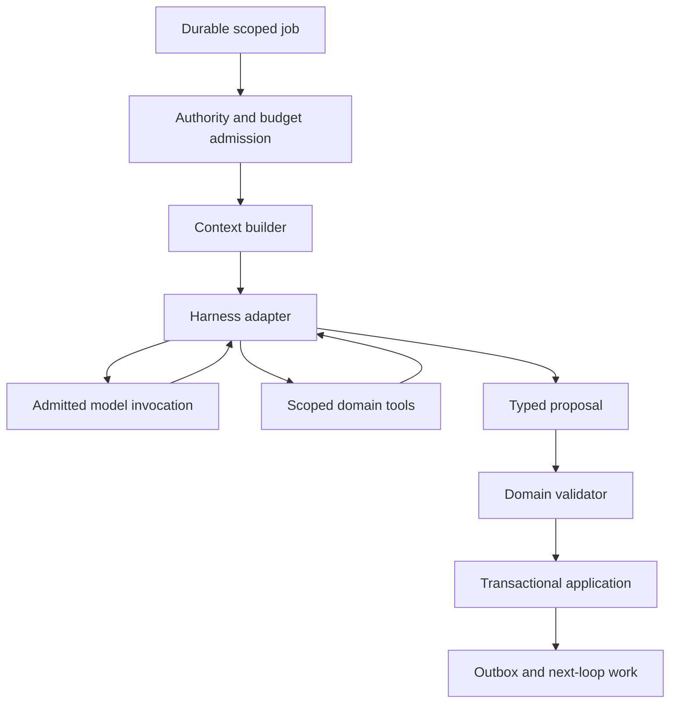

# Gate 2 harness: shared execution, separate authority

Companion to [the architecture](02-architecture.md). This document recommends a replaceable harness adapter for Planner and Cartographer. It does not install Pi, invoke a production model, or introduce PIO.

## 1. Recommendation

Use one **KnowScroll reasoning harness** for bounded model runs, context assembly, tool execution, budgets, structured output and observability. Keep domain memory and application decisions in KnowScroll. Initially evaluate Pi's lower-level agent runtime behind an adapter; do not fork an entire coding CLI merely to obtain a model loop.

As inspected on 18 October 2026, `badlogic/pi-mono` redirects to `earendil-works/pi`; current documentation uses `@earendil-works/pi-agent-core` and `@earendil-works/pi-ai`. Older discussions use different package names. Pin an evaluated release before implementation. The source reference for this review is `482c1381a00d8d00bc81697e4a980c593db6803e`.

Pi's agent-core documents custom tools, context transformation, provider streaming, tool preflight hooks and cancellation. These are useful adapter seams. This does not establish durable job recovery, privacy deletion or KnowScroll's authority model. [Agent-core documentation](https://github.com/earendil-works/pi/blob/482c1381a00d8d00bc81697e4a980c593db6803e/packages/agent/README.md)

The coding-agent SDK additionally offers sessions, compaction and resource loading, with default filesystem-backed settings/session behavior and configurable tools. Those defaults require explicit replacement in a multi-user service. Prefer agent-core unless SDK session features demonstrably remove more work than they introduce. [SDK documentation](https://github.com/earendil-works/pi/blob/482c1381a00d8d00bc81697e4a980c593db6803e/packages/coding-agent/docs/sdk.md)

This is a recommendation for a later integration experiment, not a chosen production dependency. The design must also work with a different runtime or a direct structured model call.

## 2. Boundary and call order

1. A scheduler discovers a candidate role-specific job without locking its row. One active Planner job and one active Cartographer job per universe/epoch are sufficient initially. New evidence coalesces into a desired revision; it does not start an agent per event.
2. Admission acquires the universe lock first, rechecks current recording policy, privacy epoch and authority after waiting, then locks the job and relevant domain rows. It checks role permission, budget and cancellation, leases the job with a fencing token and commits the reservation before releasing locks.
3. The context builder loads a bounded, versioned snapshot with relevant evidence and a permitted prior role summary. It records references, freshness and the exact submitted context hash.
4. The harness adapter runs the model with a strict step/token/time budget. Before every provider request and every sensitive tool action, recheck authority through KnowScroll's admission boundary. A tool loop cannot reuse one initial permission indefinitely.
5. Each actual provider attempt records its admitted request and outcome through the existing invocation/reconciliation pattern. Uncertain sends are not blindly repeated by runtime or SDK retries.
6. The harness returns a typed proposal. The role-specific validator checks schema, references, policy and current state. Invalid output can receive a bounded repair attempt if separately admitted; failure leaves the last valid state intact.
7. The applier reacquires the universe lock, checks epoch, lease fence and base revisions, then commits the state transition plus outbox notification. No model call occurs while a database lock is held.
8. The scheduler observes whether newer evidence requires another coalesced run. It terminates the current run rather than maintaining an indefinitely growing conversation.

## 3. One engine, different role profiles

| Profile | Relevant context | Permitted tools | Output | Forbidden authority |
|---|---|---|---|---|
| Planner | Recent qualified encounters, current intent, topic/format aggregates, existing plan, inventory coverage | Read scoped evidence; search eligible inventory; read admitted concept neighbours; stage a plan proposal | ExplorationPlan and candidate ContentDemands | Apply geography; publish content; write inferred belief as fact. |
| Cartographer | Qualified explanation units/facets, current structure, admitted concepts and relations, prior structural decisions | Read scoped evidence; read semantic neighbours; inspect current object hierarchy; stage a structural proposal | CartographyProposal, later validated into UniverseDelta | Generate encounter evidence; execute arbitrary terrain code; decide formation solely from model confidence. |
| Production researcher/writer | Sanitised demand brief, authorised source material, canonical explanation package | Bounded public research retrieval; read source fragments; stage claim package and article/script | Evidence package and content draft | Read personal history by default; publish without gates; change a person's universe. |
| Moderator, later | Authorised room messages and rules | Read room context; propose summary; execute specifically admitted moderation actions | Attributed moderation outcome | Impersonate members; alter private exploration state. |
| AI inhabitant, later | Room-visible context and explicit character/perspective specification | Read room; retrieve approved material; submit attributed message subject to room budget | Visible AI contribution | Hide AI status; create apparent human agreement or unrelated engagement loops. |

Most tools are reads. "Stage proposal" writes only a proposal associated with the run. The harness never receives a general SQL tool, shell, repository write tool, unrestricted filesystem access or arbitrary external code execution. Terrain generation uses validated descriptors and known renderers outside the agent loop.

Tool arguments cannot select an arbitrary universe. The execution context supplies scope; argument IDs are checked against it. Shared content search returns only public/admitted items or the caller's authorised private items. Retrieved articles and room messages are data, not instructions that can extend tool permission.

## 4. Memory is an application contract

Do not model memory as one giant chat history.

| Memory layer | Owner and storage | What it contains | What it cannot establish |
|---|---|---|---|
| Authoritative facts | Evidence and command stores | Actual observations, committed actions, content revisions and privacy scope | Why the person acted or what they believe. |
| Prepared personal context | Named projections | Recent topic activity, format preferences, visited units, structure and current intent | More evidence than the source records support. |
| Role working summary | Harness memory store, keyed by universe + epoch + role + summary version | Compact prior proposals, unresolved work and references to supporting facts | A new personal fact solely because the LLM wrote it. |
| Current run transcript | Short-lived private run artifact | Submitted messages, tool results and final proposal under retention controls | Durable authority or an independently trusted source. |
| Shared knowledge | Admitted semantic/content store | Concepts, supported relations and public evidence packages | Another user's private context. |

A summary includes `summaryId`, `role`, `privacyEpoch`, `sourceSnapshotRefs`, `coveredThroughRevision`, `createdAt`, `expiresAt`, `modelVersion` and a bounded body. Facts in it must retain resolvable source references. On source correction, clear/reset or expired provenance, rebuild it from surviving authoritative data; do not recursively summarise stale claims until their origin is lost.

Planner and Cartographer can share evidence references but have separate working summaries. The Planner remembers outstanding content opportunities; Cartographer remembers unresolved grouping proposals. The engine is shared; memory permissions are not.

Context assembly should start with a fixed role policy, immutable authority metadata, a bounded snapshot and narrowly retrieved evidence. Include prior narrative summary last and label it as fallible working memory. Set per-section token budgets so long content or a malicious source cannot crowd out scope/rules. Content identifiers and compact metadata usually belong in context; the entire person's history does not.

## 5. Harness contracts

### HarnessRun

- `runId`, `jobId`, `role`, `universeId` where private, and `privacyEpoch`.
- `triggerRefs`, `baseProjectionRevision`, `baseStructureRevision` where relevant.
- `leaseOwner`, `leaseFence`, cancellation state and deadlines.
- `contextBundleId`, `allowedToolProfile`, output contract version.
- Runtime adapter/version, model/version, prompt/version and policy/version.
- Step/token/cost limits and reservation reference.
- State: `queued → admitted → running → proposed → validated → applied`; alternative terminal states `rejected`, `stale`, `cancelled`, `failed`, or `unknown_external_outcome` requiring reconciliation.
- Attempt references and minimal operational outcome; no default unrestricted transcript logging.

`applied` is domain-specific. An applied Planner run stores a plan; an applied Cartographer run commits a delta. It never means "the user learned something."

### ContextBundle

- Stable ID and content hash, role, owner scope, privacy epoch and assembly version.
- Snapshot and evidence references with revision and correction status.
- Bounded typed fact sections, permitted summary reference and selected source excerpts.
- Allowed tools, output schema, budget and refusal conditions.
- Expiry and deletion class.

If snapshots are not transactionally co-created, record their separate revisions and verify their dependencies. A context assembled from a new topic view and an old structure view is usable only if the role's validator knows that relationship; do not label it an atomic universe snapshot.

### ProposalEnvelope

- `proposalId`, `runId`, `role`, base revisions and evidence references.
- A role-specific payload: ExplorationPlan proposal, CartographyProposal or content draft.
- Concise auditable decision fields, uncertainty and source references. No requirement to store hidden chain-of-thought.
- Validation status and reason codes, plus any accepted result IDs.

A CartographyProposal can suggest `attention` belongs under an ML system and identify encountered units supporting it. Only the validator/applier can issue a UniverseDelta that actually forms the planet. A Planner proposal containing "prepare an inference-cost Scroll" can become a ContentDemand after admission; it cannot pre-credit that future encounter.

## 6. Pi adapter responsibilities

Use Pi as an execution library, behind a small KnowScroll-owned boundary. Domain code should consume HarnessRun/ProposalEnvelope rather than Pi's internal message shapes.

| Concern | Pi/library assistance | KnowScroll still owns |
|---|---|---|
| Model turn and tool loop | Runtime streaming and loop mechanics | Admission for every actual attempt; fair scheduling and budgets. |
| Context shaping | Context transformation / request hooks | Retrieval permissions, immutable snapshot refs and evidence integrity. |
| Tool execution | Typed custom tools and preflight hooks | Per-call authorisation, scope isolation, idempotency and action receipts. |
| Session management | Optional SDK session/compaction support | Retention, erasure, canonical memory and multi-user separation. |
| Cancellation | Abort signals | Epoch fences, late-result refusal and already-sent provider reconciliation. |
| Structured output | Runtime/provider facilities where supported | Contract validation, bounded repairs and deterministic application. |

Do not accept a runtime whose automatic provider retries cannot be disabled or routed through admission. A transport error after dispatch is an unknown outcome, not proof the provider did nothing. Do not resume a persisted tool call merely because a transcript ends before its result; consult its durable operation receipt.

If using the higher-level coding SDK later, explicitly supply tool/resource/session/settings adapters, prohibit ambient project discovery and personal developer credentials, and isolate storage. Its convenience defaults are not service isolation guarantees. A fork should be considered only after an adapter cannot meet a specific requirement and the maintenance cost is justified.

## 7. Evaluation before choosing the runtime

A later isolated experiment should compare direct structured calls, Pi agent-core and any alternative against the same scenarios:

1. A Planner run reads bounded context and emits a valid plan and demand without irrelevant tools.
2. A Cartographer run proposes a grouping while deterministic checks reject insufficient evidence.
3. Clear/reset between model start and completion prevents proposal application and invalidates context storage.
4. Duplicate delivery or process crash cannot repeat a committed tool action or provider attempt.
5. A timeout with an uncertain provider result enters reconciliation without an automatic paid retry.
6. Long source content and injected instructions cannot change tool scope or cross user boundaries.
7. Cancellation, context size, run latency and provider cost remain bounded under concurrent users.

The winner should minimise custom orchestration work while satisfying these boundaries. No benchmark result or integration capability is claimed here.
