# KnowScroll: architecture and algorithms for a fresh TypeScript codebase

**Greenfield blueprint · updated 19 October 2026 · selected architecture with open design details · documentation only**

This is the standalone specification for the next KnowScroll design. It includes the product, algorithms, data contracts, UI, shared exploration, infrastructure choices and coding approach. A future session should understand the intended system from this document without reconstructing the conversation.

The owner requested a fresh codebase. Nothing here requires reusing the current application, database schema, package layout, mobile code or HTTP framework. Existing files and user data are preserved; starting a new implementation is a separate authorised step. PIO is excluded.

On 19 October the owner selected one Expo application with React Native Web, pnpm, PostgreSQL, Socket.IO, the discussed open-source building blocks and the modular onion approach. Initial media storage is a VPS folder behind a replaceable adapter. The owner requested comprehensive debugging and a design handoff that iterates the existing theme. These selections authorise documentation updates, not implementation. Exact versions, observability deployment sizing, numeric policies and visual mockups remain to be validated. The Software Factory workflow was explicitly retired; there are no required gates from that skill. Earlier documents preserve historical discussion only.

On 19 October, after reviewing the first design export, the owner selected integrated content threads for friends and idea rooms: friend selection, a horizontal episode navigator, contextual snippets and inline What-if continuations. The thread unifies the interface while conversation, scenario and personal playback records retain separate ownership. Sections 6, 14, 16–18 specify this revision; it supersedes the fragmented shared-exploration screen flow in the first design export.

On 19 October the owner also selected **NestJS as the application framework** and accepted the coding review with the refinements discussed together. Nest hosts HTTP, Socket.IO, configuration, lifecycle and dependency wiring; domain rules and application use cases stay framework-free. The selected layout retains all existing planned packages. The revision replaces generic outbox wording with transactional pg-boss work plus disposable live hints, separates execution records, and adopts Tier 0 observability. This is a documentation decision for the fresh project, not a migration of the running product. Review inputs: `KnowScroll blueprint changes for the architect.md` and `KnowScroll maintainable coding approach.md` in the owner's Desktop reports directory. Their exact version suggestions are research candidates, not a tested installation.

## Reading map

1. [Product and changes](#1-product-and-changes): what we are building and the meaning of the universe.
2. [System and stack](#3-system-and-deployment): how loops connect and what technology to start with.
3. [Data design](#5-data-design-without-the-old-complexity): ownership, documents, queries and transactions.
4. [Contracts and APIs](#6-contracts-between-components): what crosses each boundary.
5. [Algorithms](#8-algorithm-foundations): equations followed by simple explanations and examples.
6. [Harness and training](#15-llm-harness-memory-and-fine-tuning): what the model decides and how it becomes specialised.
7. [User journey](#16-ashas-complete-journey): concrete stored records from first Reel to shared scenarios.
8. [UI specification](#18-complete-ui-specification): every surface and its states, controls and telemetry.
9. [Reliability and privacy](#19-events-consistency-and-privacy): failures, ordering, correction and deletion.
10. [Code organisation and practice](#22-code-organisation-for-the-new-repository): the selected structure and how to write it.
11. [Observability and debugging](#26-observability-and-debugging): linked records, logs, traces, dashboards and retention.
12. [Design handoff](#27-design-handoff-and-visual-continuity): current theme, complete page coverage and Claude prompt.

## 1. Product and changes

KnowScroll helps a person discover themselves through the evolving way they encounter and understand the world. A person can enter casually, follow a compelling idea deeply, move elsewhere without effort, and gradually recognise their exploration in a personal universe.

The product should feel like engaging scrolling with unusually good content. It does not give compulsory tests, demand onboarding answers, score learning or announce what a person supposedly believes. A person who never presses Like can still develop a universe. Reels and Scrolls are equal consumption objects.

### The principles to carry into every implementation

- Adapt quickly to immediate intent and cautiously to lasting personal meaning.
- The universe creates an opportunity for self-recognition; it does not announce an interpretation of the person.
- A recommendation, generated asset, plan, chat message or AI conversation does not establish that a person encountered a Reel/Scroll.
- Planner proposes future possibilities. Cartographer applies its own formation criteria using actual evidence.
- Meaning and visual identity are separate. Visual richness should express exploration without becoming a public leaderboard.
- Keep entry easy, depth inviting and exits satisfying. No decay-based destruction, missed-reward pressure or attendance streak required for growth.
- Keep internal provenance, permissions and correction paths even when the reading UI has no source/reasoning panels.
- Model output is a proposal. Application code validates its structure, authority and allowed effects. Validation cannot guarantee semantic insight or factual truth by itself.

### What this blueprint changes from the earlier design discussion

| Area | New direction |
|---|---|
| Implementation | Start from a new TypeScript codebase; no legacy code or schema reuse requirement. |
| Client platforms | One Expo application: React Native on Android/iOS and React Native Web in the browser; share components and behaviour, with explicit platform adapters. |
| Backend framework | NestJS selected, using its Express adapter for HTTP and its application context for workers; plain TypeScript domain/application core. |
| Database | PostgreSQL selected, with bounded JSONB and prepared read models. MongoDB comparison is retained as rationale, not an open initial choice. |
| Recommendation | Qualified passive observations, topic-dependent format preferences, explicit navigation modes, optional Jev assessment and controlled exploration. |
| Planning | Per-person Planner runs through a shared harness and requests missing supply. |
| Universe | Topic systems, organising stars, subtopic planets, finer regions, stable seeds and persistent structure. |
| Sharing | Send exact Reels/Scrolls or anchored snippets to conversations; select friends to create a content thread; retain external sharing. |
| Collaborative exploration | One integrated content thread combines episode navigation, Reel/Scroll playback, messages, snippets and selected What-if/Another perspective branches. Reuse it inside idea-room discussions. |
| Model specialisation | Start with role instructions and prepared context, one bounded call per admitted attempt; no model-directed tool loops in v1. Fine-tuning comes only after reviewed examples and evaluation. |
| Code style | Domain modules with onion dependency boundaries: pure rules, application use cases and infrastructure adapters; explicit wiring, no generic repository hierarchy. |
| Realtime / storage | Socket.IO for live updates; VPS media folder first, replaceable by S3 through a media port. |
| Debugging | Correlated decision records, structured logs, traces and private operator dashboards; no sensitive payload dumping. |

### The universe vocabulary

| Object | Meaning | Initial appearance and change |
|---|---|---|
| Background | Decorative starting environment | Stable personal variation; no claim that background objects are explored topics. |
| Dust / protostar | An emerging cluster of actual exploration | Light, transient formation cues after qualified evidence; not a promised future planet. |
| Topic system | A broad explored domain, such as ML | A persistent container organising related worlds. |
| Organising star | The visible centre of a topic system | Forms when the system meets its formation rule. Brightness can express activity without implying mastery. |
| Planet | An explored subtopic, such as attention or inference | Forms from multiple distinct qualified explanatory units and conceptual variety. |
| Region | A finer area or perspective within a planet | Mechanisms, examples, limitations and other supported facets. |
| Route | A supported navigable relationship | Leads to an actual continuation, place or shared destination. |
| Room station | A shared discussion destination | Same room ID can have different personal map placements. |
| Moon, collision, supernova, black hole | Not assigned a semantic meaning in this version | Do not invent effects that imply forgotten topics or changed beliefs. |

Shared concept identities remain stable. Personal groupings and routes can vary when supported by evidence. How freely Cartographer may invent broader personal category names is a review parameter; the initial policy uses shared topic IDs with personal labels/groupings attached, never replacing canonical meaning with a free-form model label.

## 2. A short vocabulary for technical terms

| Term | Plain meaning |
|---|---|
| Contract | A precise agreement about a message's fields and meaning. |
| Command | An action someone asks the system to perform, such as Save or request a Scroll. |
| Observation | A report about what happened, such as visible playback. |
| Evidence | Checked observations and committed actions attached to a real encounter. |
| Projection / read model | A prepared summary that makes a common read fast and simple. |
| Job | Work that can happen in a worker after a request returns. |
| Transactional work outbox | Work stored with its associated change in one transaction. Here pg-boss supplies that durable work record; a Socket.IO hint is different and may be lost. |
| Idempotency | Retrying the same request does not repeat its effect. |
| Revision | A version number for a changing object or prepared view. |
| Epoch | A privacy/authority generation; old work cannot apply after the generation changes. |
| Harness | Controlled execution around model calls, prepared context, budgets and outputs. |
| Explanation unit | One conceptual explanation, possibly expressed as both Reel and Scroll. |
| Embedding | A numerical representation useful for finding semantically related material. Similarity is not proof that a claim is true. |
| Policy weight | A number we choose to express product priorities. |
| Model parameter | A number learned during model training. |

## 3. System and deployment

### Connected loops

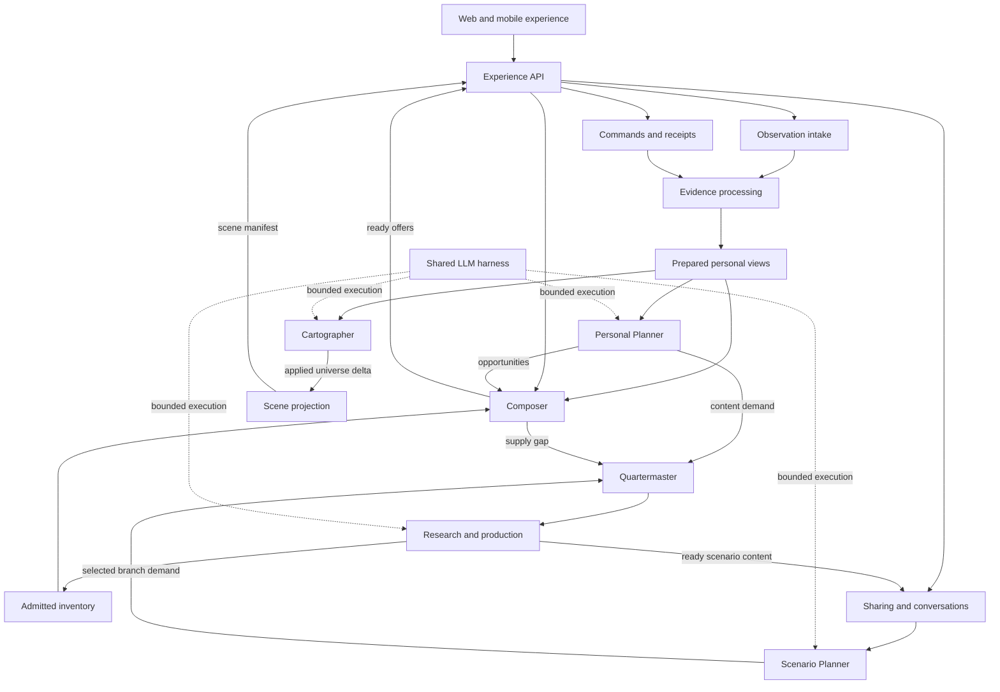

The evidence pipeline is arithmetic and validation. Composer selects available content. Personal Planner proposes future directions. Quartermaster resolves supply globally within permissions. Production creates content. Cartographer organises actual personal exploration. Scene projection turns established meaning into renderable descriptions. Scenario Planner manages a shared hypothetical exploration.

### Start as a modular Nest application

A module is a named area of responsibility; a process is something we actually run. Nest modules do not require separate microservices. Start with an API process and worker processes from the same monorepo, plus PostgreSQL, the persistent media folder and the separate Cutroom service.

- `apps/api`: a Nest application using the Express adapter, contract handlers, authentication and Socket.IO gateways. It invokes use cases and reads prepared state.
- `apps/worker`: a Nest standalone application context with an explicit pg-boss consumer registry. Interactive and background pools can use this same app with different queue/concurrency settings.
- `apps/client`: one Expo application for native and web.
- Backend modules contain Composer, Planner, Quartermaster, Cartographer, scenarios and production coordination. A thin HTTP handler does not mean a thin backend.

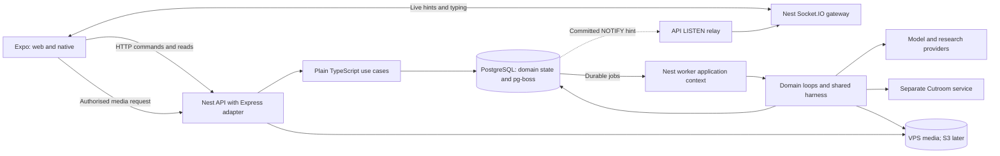

No model call occurs in an HTTP handler or while an HTTP request waits on a fast-model worker. Workers prepare offer buffers and optional semantic assessments ahead of time. On a cache miss, Composer ranks eligible content deterministically or returns a durable pending result. Provider credentials belong only to worker-side adapters.

Nest can host a standalone worker without network listeners. Its HTTP guards, pipes and interceptors do not run merely because the worker calls a provider method. Therefore use cases recheck membership, privacy epoch and mutation authority themselves. Framework configuration is not a substitute for those checks. [Nest standalone applications](https://docs.nestjs.com/standalone-applications)

Process startup validates configuration, constructs dependencies and registers routes/jobs explicitly. Shutdown stops admission and new job claims, drains bounded work, preserves uncertain external attempts, then closes listeners, queues and database connections. Framework lifecycle hooks are the integration points; our shutdown policy still needs restart tests.

## 4. Selected stack and alternatives

### Selected baseline and remaining evaluations

| Concern | Selected direction | Reason and boundary |
|---|---|---|
| Language/runtime | Strict TypeScript; supported Node LTS | Verify the exact compatible runtime/compiler at bootstrap. A release date is not an automatic upgrade instruction. |
| Workspace | pnpm workspaces and central catalogs | Retain the planned packages; no Nx/Turborepo initially. |
| Backend framework | NestJS, Express HTTP adapter, standalone worker context | Consistent wiring, lifecycle, HTTP and Socket.IO adapters; no Nest imports in domain/application code. |
| Wire contracts | Zod + oRPC, with `@orpc/nest` | Preferred contract integration, subject to one complete compatibility spike; OpenAPI-first is the fallback. |
| Storage/queries | PostgreSQL + Kysely + PostgreSQL driver | Explicit constraints and visible SQL; bounded JSONB and prepared views. |
| Durable work | pg-boss using the same Kysely transaction | The only work outbox; domain dedupe and provider-attempt accounting remain ours. |
| Live updates | PostgreSQL NOTIFY/LISTEN → Socket.IO hints | Durable HTTP commands and catch-up reads; no second persistent notification queue. |
| Client | Expo + React Native + React Native Web + Expo Router | Shared application with named platform adapters and parity checks. |
| Client server state | TanStack Query inside AccountScope | Account/epoch isolation and explicit cache purge. |
| Local interaction | Reducers; Gesture Handler/Reanimated adapters | UI-thread gesture decisions; XState optional for at most three genuinely complex lifecycles. |
| Universe renderer | Open: 2D/canvas first, 3D optional | Share scene descriptors and seeded math; decide renderer through design/device evaluation. |
| Reel player | Evaluate expo-video with chosen Expo SDK | Actual playback and lifecycle need native and web proof. |
| Media | VPS MediaStore first, S3 adapter later | Logical keys, atomic local finalisation, authorised range reads. |
| Model transport | Direct hosted-model adapter behind ModelPort | MiniMax is the initial evaluation candidate, subject to product-use/data terms; Pi/AI SDK remain optional conforming adapters. |
| Diagnostics | Typed logEvent → Pino; in-process OpenTelemetry | Tier 0 journald, durable decisions, restricted SQL views, Grafana and journey CLI; no required Loki/Tempo initially. |
| Architecture/tooling | dependency-cruiser, knip, one typed-lint engine | Enforced imports, unused-code detection and awaited effects. |
| Backend verification | Vitest, fast-check, real PostgreSQL | Properties, races, crash recovery and exact production-major behaviour. |
| Client verification | jest-expo + React Native Testing Library; Playwright/Maestro | RN components, browser/native journeys and physical-device checks; MSW only proves mocked wire behaviour. |

All owned application logic starts in TypeScript. SQL migrations, styles and shaders remain appropriate specialised assets. This table selects tools; it does not claim any dependency is installed or compatible yet.

### Why Nest, and what it does not own

The owner selected Nest because the API, worker and live social features benefit from a common structure. Nest supplies modules, dependency injection, request adapters and lifecycle hooks. Our algorithms remain ordinary functions that can be read and tested without booting a server.

| Part | Nest responsibility | KnowScroll responsibility |
|---|---|---|
| HTTP | Route/controller hosting and request pipeline | Wire contracts, authenticated scope, use-case outcome meanings |
| Socket.IO | Gateway lifecycle and connections | Membership, revocation, revision hints and catch-up |
| Workers | Construct and close the worker dependencies | Explicit pg-boss registrations, job admission, fences and reconciliation |
| Dependency injection | Supply an implementation for a token | Small ports and clear module ownership |
| Reliability | Lifecycle/integration hooks and optional packages | Atomic receipts, correct locks, durable work and safe paid attempts |

Use Nest factory providers to construct plain TypeScript operations from typed dependencies. Classes are useful for lifecycle-bearing adapters; they are not required for every algorithm. [Nest custom providers](https://docs.nestjs.com/fundamentals/custom-providers)

Build the Nest apps with a compatible `nest build` TypeScript/SWC configuration and test the production output. The selected decorator approach needs the appropriate metadata support; do not substitute unverified esbuild or Node type stripping. Use explicit injection tokens for ports. No request-scoped service graph, implicit CLS transaction, universal base service, decorator-discovered jobs or service-locator calls inside use cases. Tracing context may use async context internally; database authority must remain an explicit parameter.

Do not automatically adopt every Nest package. Keep pg-boss as the single work-outbox mechanism; compare any Nest outbox/idempotency package against our transaction contract before replacing it. No additional queue, ORM, Redis, CQRS bus or microservice transport is required merely because Nest supports it. Effect is deferred; a later evaluation must identify a bounded benefit.

### oRPC and version admission

Use one wire-schema source and one outcome-to-HTTP mapping. Verify input/output validation, body limits, authentication, RFC 9457 errors, generated OpenAPI, Expo client use and a production build together. The Nest integration has its own error handling, so a Nest exception filter must not be assumed to intercept every failure automatically. [oRPC Nest integration](https://orpc.dev/docs/integrations/nest)

The review's claim that ts-rest cannot support Zod 4/Express 5 is too strong: its release history includes that support in a release candidate. oRPC is selected for its proposed integration fit, not on a claim that ts-rest is incapable. [ts-rest releases](https://github.com/ts-rest/ts-rest/releases)

At implementation bootstrap, record a compatibility matrix for Node, TypeScript, Nest/Express, oRPC/Zod, Kysely/pg-boss, Socket.IO, Expo/RN/gesture packages and test runners. The report's suggested Nest 12, oRPC 1.15.x and other exact versions are candidates to confirm, not pins already proven together. Exact-pin pre-1.0 and fast-moving dependencies in pnpm catalogs and the lockfile. Admission records license, maintenance, peer compatibility, startup/build behaviour, retry defaults and data egress. Do not install an APM agent such as `@nestjs/observe` without an explicit destination/retention review.

### PostgreSQL versus MongoDB

MongoDB supports flexible documents, single-document atomic operations and multi-document transactions. Its documentation emphasises modelling around access patterns and notes that distributed transactions cost more than single-document writes. PostgreSQL supports JSONB alongside relational data; updating a large JSON document still involves row-level locking. [MongoDB modelling](https://www.mongodb.com/docs/manual/data-modeling/) · [MongoDB transactions](https://www.mongodb.com/docs/manual/core/transactions/) · [PostgreSQL JSON types](https://www.postgresql.org/docs/current/datatype-json.html)

Our product has both document-shaped data and relationships:

| Need | Natural shape | Why it matters |
|---|---|---|
| A Scroll or plan | Bounded document | Read/version together. |
| A scene chunk | Bounded document | Render together, update locally. |
| User → private demand → shared job | Related records | Users cancel independently while one production job serves several people. |
| Conversation → memberships → messages | Related, growing records | Permissions and message history change independently. |
| Evidence → personal contribution → world | Related records plus prepared views | Corrections and privacy deletion must find affected state. |
| State change + required background job | Transaction | Commit both or neither; live hints can be recovered by reading durable state. |

The owner selected PostgreSQL with document-shaped JSONB where appropriate. This is an inference from our access patterns, not a claim that MongoDB cannot implement the design. Replacing SQL with MongoDB alone would not solve cross-domain ownership, growing history, repeated full scans or duplicated state.

Historical alternative, not the selected implementation: a MongoDB version would use separate collections such as `encounters`, `evidence`, `personal_views`, `plans`, `demands`, `supply_jobs`, `world_objects`, `conversations`, `memberships`, `messages`, `scenario_nodes` and `outbox`. Embed bounded article/plan/descriptor bodies. Reference unbounded histories. Use revision-checked updates, compound unique indexes and transactions for cross-document effects; deploy a transaction-capable topology. Never put the whole person's universe, evidence, chats and jobs in one document. MongoDB has a 16 MiB BSON document limit, but contention and unbounded growth would be reasons to split long before that. [MongoDB limits](https://www.mongodb.com/docs/manual/reference/limits/)

Do not introduce both databases initially. Choose one authority. If MongoDB wins a later access-pattern prototype, replace persistence adapters and record the decision; do not duplicate every domain into a second database for convenience.

### Why Kysely and why not a large ORM abstraction

Kysely provides TypeScript-oriented SQL query construction. The recommendation is to keep queries close to each domain's access patterns, with explicit transactions and selected columns. A typed query builder cannot make a poor query efficient or validate runtime JSON by itself. [Kysely](https://kysely.dev/)

An ORM such as Prisma or Drizzle could also work. We should not layer generic repositories, services and factories over every table. The deciding criterion is whether the team can see the exact data read, locks, transaction and bounded result without chasing several abstractions.

### Jobs, Kafka and search

pg-boss is the selected PostgreSQL-backed job-library direction, not a guarantee that an external API call executes exactly once. Its queue delivery sits behind our adapter; domain attempt records decide whether a paid operation may be sent or must be reconciled. [pg-boss](https://github.com/timgit/pg-boss)

Start observations with durable SQL intake and a pg-boss projection job written in the same transaction unless a Kafka-first erasure design is accepted. Kafka remains an alternative transport for buffered observations when sustained ingestion, independent consumers or measured bursts justify it. No broker is necessary simply because the system contains several loops.

Start inventory retrieval with indexed topics, text and optional precomputed embeddings. Adopt a vector index when corpus size and retrieval measurements justify it. Start semantic relationships as explicit indexed edges. A graph database becomes worth considering only when bounded edge queries demonstrably fail the required traversal workload.

### Local media now, cloud storage later

`MediaStore` exposes streaming put/open/remove operations using logical asset keys and content metadata. `LocalMediaStore` writes under a dedicated persistent VPS directory outside release folders; incomplete writes use temporary objects, flush the file, atomically rename on the same filesystem and sync directory metadata where required before finalisation. A crash/recovery test must establish durability on the actual VPS filesystem. The database stores media ID, logical key, backend/location, checksum, size, MIME type and revision. Never embed an absolute VPS path into a shared content document.

Media delivery authorises the request and resolves the current location. Support byte-range reads, cache headers and conditional requests for video seeking and efficient playback. Public and private assets have distinct delivery policies; knowing a filename cannot bypass private access. An HTTP/reverse-proxy adapter can serve authorised local bytes efficiently. Scheduled backups, disk quotas, orphan cleanup and restoration verification are operational requirements, not application features.

A future S3 adapter implements the same domain capability. Migration copies bytes, verifies checksums, updates the location mapping and retires local copies only after verified delivery and rollback planning. CDN URLs are resolved at delivery time; neither a permanently signed URL nor a physical path is the asset's identity. No local-filesystem abstraction can make file and SQL writes one transaction: publication uses explicit staged/ready states and reconciliation.

### Socket.IO and durable conversation delivery

HTTP owns commands and catch-up reads. Socket.IO accepts authorised subscriptions, unsubscriptions and ephemeral typing signals; the server derives visibility-approved presence. It sends small update hints such as `{ scope, revision, eventId }`. There is no parallel socket command implementation in v1.

A message operation checks membership and commits the message, receipt, conversation position and revision in one transaction. It can call `pg_notify` in that transaction. PostgreSQL delivers the notification only after commit. A dedicated LISTEN connection in each API process relays a hint to currently authorised socket subscribers. Never put message text or a private payload into a notification. [PostgreSQL NOTIFY](https://www.postgresql.org/docs/current/sql-notify.html)

A missed hint does not lose the message. Clients refetch from their last confirmed cursor/revision on reconnect and foreground, deduplicate overlaps, and use bounded refresh while actively viewing a scope to recover a silently lost hint. A disconnected relay reconnects, establishes LISTEN, reads current state, and tells its clients to resynchronise. The initial LISTEN/snapshot ordering matters because updates can race with startup. [PostgreSQL LISTEN](https://www.postgresql.org/docs/current/sql-listen.html)

Socket room membership is a delivery aid, not durable authority. Subscription, reads and commands check current access; revocation removes subscriptions and cached scope data. Hints carry no private content even during the revocation race. If an HTTP command response is lost, the same command ID retrieves its receipt; a socket acknowledgement is never the durable command receipt.

Socket.IO does not persist our messages. Its default delivery guarantees therefore do not replace the database/catch-up protocol. [Socket.IO guarantees](https://socket.io/docs/v4/delivery-guarantees/)

## 5. Data design without the old complexity

The goal is predictable reads, visible ownership and bounded changes. Fewer tables is not by itself a useful success metric: one giant JSON document can be harder to reason about than several well-owned relations.

### Rules that prevent a database mess

1. Every stored field has one authoritative owner. Another module can hold a named derived view, not an independently editable competing copy.
2. Every proposed entity lists its main reads, writes, indexes, size bound and deletion behaviour before it becomes a migration.
3. Avoid one table per incidental concept, but do not hide unbounded histories inside a document.
4. Use relational fields for IDs, ownership, epochs, revisions, status and frequently filtered values. Use validated JSONB for bounded structured payloads.
5. Common request paths read prepared views. Do not rebuild the person's entire history when they swipe.
6. Modules write only their owned data. Cross-module coordination goes through typed use cases or durable events.
7. A small number of explicit joins is normal. Repeated full-history joins, N+1 queries and surprise lazy-loading are the problems to prevent.
8. No model creates database schema or writes arbitrary SQL. Runtime topic discovery creates data under a stable schema.
9. Review query plans at realistic volume and place limits on result size. Instrument query counts and projection lag.
10. Retain enough contribution lineage to correct or erase derived data. Expired observations cannot be promised as replayable forever.

### Logical data families

These are design families, not a requirement to create all tables in the first migration. Each feature introduces only its necessary records.

| Owner | Authoritative records | Prepared read / access pattern |
|---|---|---|
| Identity | Account, sessions, privacy state, sharing identity | Session/epoch by token; authority read before personal mutation. |
| Experience | Session intent, thread steps, command receipts, decision records, offers and exposures | Current session; receipt by request key; current offer; visited step by ID. |
| Evidence | Deduplicated observation intake; evidence revisions; contribution references | Latest evidence by exposure; changes after checkpoint; affected records by asset/correction. |
| Personal context | Topic/channel statistics and format statistics | One bounded ExperienceContext plus an exploration snapshot for relevant topics. |
| Content | Explanation units, immutable asset revisions, variant/series links, publication state | Eligible candidate metadata by topic/format/scope; exact revision lookup. |
| Planning | Versioned personal plans and evidence references | Active plan by owner/epoch; unresolved opportunities. |
| Supply | Private demands, public/private supply jobs, waiter bindings and references to execution attempts | Matching supply key; demands by state/priority; waiters by job. |
| Geography | Stable systems/objects, routes, structural changes and provenance | System subtree; recent deltas; objects affected by evidence. |
| Scene | Object descriptors and per-system manifest chunks | Manifest index and changed chunks; permitted visitor projection. |
| Social | Content shares, conversations, content-thread roots, thread messages, snippet references, memberships and invitations | Membership check; bounded thread window and message cursor; exact shared asset/anchor. |
| Scenarios | Thread-linked explorations, versioned assumptions, branch nodes, explicit choices and asset bindings | Current branch ancestry and children; caller-only playback positions, never another participant’s viewing history. |
| Rooms | Canonical room identity, membership, messages, moderation, AI attribution | Room feed and permissions; personal station placement lives in geography. |
| Reasoning | Shared execution/attempt ledger, reservations and minimal usage receipts; references to module-owned business runs/context | Attempt by run/step; immutable request identity; uncertain outcome. Domain roles own their plans, summaries and proposals. |
| Delivery | pg-boss queue state; module-owned consumer checkpoints/dedupe | Runnable work and applied revisions. NOTIFY/Socket.IO hints are disposable, not a second outbox. No private transcript in queue payloads. |

### Three concrete access patterns

**Next encounter:** load the session intent and bounded ExperienceContext; retrieve at most a configured candidate limit; assess and rank outside a write transaction; briefly recheck authority, intent revision and selected asset eligibility; store the decision, offers and command receipt. No join to all chats, model transcripts or world-history rows.

**Apply encounter evidence:** under the personal scope lock, deduplicate the observation; load only the affected exposure and previous evidence revision; calculate the delta; update affected topic rows and the bounded context; enqueue required projection jobs through pg-boss in the same transaction; commit. The update cost depends on the affected topics, not lifetime history length.

**Open a content thread:** check the parent conversation/room membership and any narrower thread participation; fetch the thread root, a bounded episode window, paginated messages and selected branch summary, plus only the caller’s position. Resolve snippets through current asset access. Return separate cursors/revisions rather than joining entire message history, all graph nodes and every participant’s personal state. Expand a branch by reading only its bounded ancestry/children. Do not fetch private universes to render the thread.

### Example documents versus references

A small `ExplorationPlan` can be one JSONB payload with a maximum number of opportunities. A `SceneManifest` can be split by system so a new attention region does not rewrite the entire galaxy. A conversation message is its own row/document; messages do not accumulate inside one conversation record. An asset stores a content-document reference; its video bytes live behind the media adapter, initially in the persistent VPS directory.

### Revisions and ownership are stronger than timing assumptions

A plan built at evidence revision 20 can finish when revision 23 is current. Do not rely on “the job was fast, so it must still be correct.” Check its referenced evidence and relevant current state. A newer unrelated topic may permit a safe revalidation; a corrected supporting encounter requires rejection or replan. Define this per use case rather than silently accepting every stale result.

### Storage conventions and migrations

Select one PostgreSQL schema per backend domain module. This resolves the review's duplicated open question about schemas versus prefixes: schemas make ownership visible; they do not grant permission for arbitrary cross-module SQL. Infrastructure schemas such as pg-boss and restricted `ops` views have named owners too.

Use composite `(universe_id, id)` identity/foreign-key constraints for personal records, plus epoch checks where lifetime isolation requires them. Reference the personal root with `ON DELETE RESTRICT`; deletion proceeds through the erasure registry rather than an accidental cascade. Shared roots use their own scope identity and explicit private binding tables.

Bounded JSONB has `payload_version`, database type/size checks and strict Zod validation on write and read. Unknown versions fail with a typed outcome or run an explicit migration; they are not cast to the latest TypeScript type. Use consistent explicit database names, without a magical camel-case plugin. Prepared views include input watermark, source/policy version, revision and build time so stale data is visible.

Select the Kysely migrator with reviewed raw SQL and a static migration registry. dbmate remains a replacement only if the compatibility spike exposes a concrete need. Produce a reviewable schema snapshot/diff, verify generated query types with kysely-codegen, and lint migration hazards with squawk. Test expand/contract rollouts and old/new versioned jobs against the production PostgreSQL major. UUIDv7 is the ID direction; never use its time ordering as authority or a causal event sequence.

### Erasure registry

Every module declares its personal tables, derived views, payload stores, media, diagnostic links and eraser. A schema inventory test checks owner columns and composite references against that registry; non-row stores need their own explicit inventory because SQL introspection cannot find a forgotten file or log export. Include pg-boss payloads/dead jobs, caches and model artifacts. Each eraser reports completed, pending or failed work, supports safe retry and cannot restore an older epoch. Module README ownership and the registry must agree.

## 6. Contracts between components

The new repository owns a new versioned API. `/v1` below means the fresh application's first API, not compatibility with the existing repository's `/v1`. No old client is silently pointed at it.

The tables below include both public wire contracts and backend-internal contracts; they do not all belong in the shared client package. `packages/contracts` exports only JSON-native wire schemas, public IDs and problem codes. No Zod `.transform()` at the wire boundary: parse first, then explicitly convert in the receiving adapter. Job payloads, role outputs, context bundles and internal projections stay with their owning backend module. Canonical Scroll/scene schemas live in `scroll-model`/`scene-core` and are re-exported where needed, not copied.

Every durable envelope carries schema version, a stable contract-specific ID, recorded time, causation/correlation references and scope. Observations also carry event time. Person-scoped records carry a server-derived owner and privacy epoch. Model-derived records carry run, model, prompt and policy versions. Examples use readable IDs rather than production UUIDs.

### The primary contracts

| Contract | Producer → consumer | Required information | Stored result / invariant |
|---|---|---|---|
| `InteractionEnvelope` | Client → evidence intake | Event ID, session/device sequence, exposure/decision/asset revision, event kind, bounded payload, client instrumentation version | Durable observation. Retrying the same event cannot count twice. |
| `EncounterEvidence` | Normalizer → projections | Exposure, evidence revision, explanation unit, qualified coverage, separate action channels, concept attribution, input references | Checked encounter facts. Does not assert learning, belief or identity. |
| `ExperienceContext` | Projector → Composer | Scope/epoch, current intent, topic/format aggregates, recent units, hidden constraints, plan ref, input watermarks | Bounded prepared view; provisional recent tail is explicitly separate. |
| `ExplorationPlan` | Planner validator → Composer / Quartermaster | Plan/run/revision, evidence refs, bounded opportunities, demand proposals, expiry | Future options, never new evidence. |
| `ContentDemand` | Request or admitted proposal → Quartermaster | Private scope, origin, topic/angle/depth/format/language, explanation/continuity constraints, sharing class, deadline/budget | Private need, separately linked to compatible shared supply. |
| `UniverseDelta` | Cartographer applier → scene projection | Base/new structure revision, typed operations, stable object IDs, evidence refs, policy and validation receipt | Atomic applied meaning. Cannot originate from unviewed supply. |
| `SceneManifest` | Scene projector → renderer | Structure/activity/scene revision, permitted chunks, stable seeds, family/generator versions, regions, navigation targets | Renderable appearance; contains no executable model code or private inference narrative. |

### Supporting contracts

| Contract | Key fields and role |
|---|---|
| `NavigationCommand` | Request ID, expected epoch/intent revision, from-exposure, mode and typed intent. Modes distinguish vertical discovery, continuation, return, format switch, explicit topic and opening a place. |
| `CommandReceipt` | Canonical input hash and ready/pending/exhausted/unavailable result. Same key + different input is a conflict. |
| `PublishedEncounter` | Asset/revision, Reel or Scroll, explanation unit, facets, language, duration/read-size, rights, validity, variants and continuity. Only admitted assets enter retrieval. |
| `ContinuityLink` | `series_next` with series revision and unit ordinals, or `related_move` with admitted relationship and explanatory move. |
| `BusinessRun` (internal) | Module-owned purpose, scope/epoch, context refs, policy/model versions, application state and execution fence. Survives individual queue deliveries. |
| `QueueDelivery` (internal) | pg-boss delivery identity, retry/expiry and consumer registration. Delivery is not permission to call a provider. |
| `ExternalAttempt` (internal) | One admitted invocation: run/step, request hash and protected payload reference, reservation, dispatch identity, remote ID, outcome and reconciliation. Never conflated with the business run. |
| `ContextBundle` | Immutable bounded inputs, source revisions, role policy, allowed prepared inputs, expiry and deletion class. |
| `ContentThread` | Thread ID, typed parent scope (`conversation` or `room`), parent revision, root asset/series revision, optional originating message/snippet, participation policy and status. A UI container, never a new consumption format. |
| `ContentSnippet` | ID, source asset revision, typed locator (`reel_range`, `scroll_passage`, `scroll_block`), optional bounded block-state snapshot, author and destination thread. Access remains dependent on the source and destination permissions. |
| `ThreadView` | Thread revision, permitted root, bounded episode window, message cursor, branch summaries and caller-only resume state. No other participant’s seen markers, current episode or playhead. |
| `ExplorationMove` | `what_if` with changed/inherited assumptions, or `perspective` with a named lens and unchanged premises; parent node/revision, originating message/snippet and explicit selected request. Model suggestions alone create no production demand. |
| `PresenceHint` | Visibility-approved availability (`online`, `recently_active`, `unknown`), expiry and scope. No watched topic, episode, branch or playback position; never personal evidence. |
| `ContentShare` | Sender, asset revision, optional anchor, destination/access scope and delivery status. Does not grant access to the sender's universe. |
| `ConversationMessage` | Conversation/member identity, optional content-thread ID, typed text/content-card/snippet body, author type, request ID and moderation state. Room messages use the equivalent room-owned shape; the thread view projects either without duplicating message ownership. Human and AI authors are distinct. |
| `ScenarioNode` | Exploration/thread ID, parent node/revision, move kind, assumptions revision, requested change or perspective lens, originating message/snippet, explanatory brief, factual/hypothetical status, demand/asset bindings and state. |
| `ExplorationMembership` | Participant, inherited thread participation or narrower explicit grant, permissions and membership revision. Parent authority is always rechecked; inheritance avoids redundant branch invitations. Personal playback position is separate. |
| `RoomPlacement` | Canonical room ID plus personal location refs. Placement is not room ownership or membership. |

### An observation example

```json
{
  "schemaVersion": "interaction.v1",
  "eventId": "evt_101",
  "sessionId": "session_asha_1",
  "deviceSequence": 12,
  "exposureId": "exp_101",
  "decisionId": "dec_101",
  "assetId": "reel_attention_1",
  "assetRevision": 3,
  "kind": "playback_summary",
  "occurredAt": "2026-10-18T10:00:48Z",
  "payload": {
    "mediaDurationMs": 50000,
    "uniqueVisibleMediaIntervalsMs": [[0, 42000]],
    "activeVisiblePlaybackMs": 42000,
    "automaticLoops": 0,
    "stallMs": 0
  }
}
```

This is a client/domain payload; authentication adds owner, epoch, server time and trusted lineage. Client claims are bounded, checked against the real asset and rejected or qualified with uncertainty when inconsistent. The API never accepts arbitrary owner IDs as authority.

### A scenario example

```json
{
  "schemaVersion": "scenario-node.v1",
  "nodeId": "node_traffic_10x",
  "explorationId": "explore_serving",
  "threadId": "thread_serving_friends",
  "kind": "what_if",
  "originSnippetId": "snippet7",
  "parentNodeId": "node_original",
  "assumptionsRevision": 2,
  "changes": [
    { "key": "request_volume", "operation": "multiply", "value": 10 }
  ],
  "inheritedConstraints": ["same_model", "same_latency_target"],
  "truthMode": "hypothetical",
  "selectedMove": "compare_batching_and_more_instances",
  "status": "requested",
  "demandId": "demand_scenario_44"
}
```

This is not a numerical prediction that tenfold traffic has a known consequence. It records the changed assumption and what explanation is requested. If a quantitative simulator is used, store its model, units and assumptions separately from the LLM's prose.

### Diagnostics and live-update contracts

Define backend-local `DiagnosticRecord`, `DecisionRecord` and `TraceContext` schemas, and a wire `ScopeUpdate` schema. General diagnostics contain allowlisted metadata; domain decisions carry scoped evidence/proposal references under product retention. Socket notices include event ID, scope and revision/cursor but do not grant authority. The shared recorder emits `InteractionEnvelope`; acknowledgement and projected-evidence watermarks remain different. Section 26 defines correlation and retention requirements.

### Contract compatibility

A producer never changes a field's meaning silently. Incompatible shapes get a new schema version. The client advertises supported Scroll blocks, scene descriptors and telemetry kinds. Unsupported rendering receives a fallback; unsupported observation kinds are rejected with a useful diagnostic. Store immutable content revisions so a shared link and a recorded encounter retain a clear reference to what was actually presented.

## 7. Experience API and command flow

| Route | Purpose | Immediate durable effect |
|---|---|---|
| `POST /v1/experience/open` | Create/resume a session and return initial offers | Session and initial decision/receipt. |
| `POST /v1/experience/navigate` | Change semantic navigation intent | Intent revision and receipt; ready, pending or exhausted response. |
| `POST /v1/experience/activate` | Recheck a prepared offer and authorise rendering | Activation/exposure token; visibility remains separately observed. |
| `POST /v1/observations/batch` | Accept playback, reading and visibility reports | Intake acknowledgement, separately from projection progress. |
| `POST /v1/actions` | Like/Unlike, Save/Unsave, Hide and other explicit actions | Action state, receipt and required pg-boss work. |
| `POST /v1/content-requests` | Request a topic, next part or format variant | Receipt and private demand. |
| `GET /v1/content-requests/:id` | Poll current supply result | Read only; no new provider attempt. |
| `GET /v1/universe` | Read current allowed scene snapshot/deltas | Read only, revision-aware. |
| `POST /v1/shares` | Create an authorised content share | Share record and optional conversation card. |
| `GET /s/:shareToken` | Public preview or permission-checked invite landing | Minimal preview; opening is not automatically qualified evidence. |
| `POST /v1/conversations` | Create/accept an authorised conversation | Membership and conversation state. |
| `POST /v1/conversations/:id/messages` | Send text or an authorised content card | Attributed message, receipt, cursor and disposable revision hint. |
| `GET /v1/conversations/:id/messages` | Read messages after a cursor | Membership-checked bounded read. |
| `POST /v1/content-threads` | Create a content thread under a conversation or room, anchored to a Reel/Scroll or declared series | Root, scoped invitation/participation and command receipt; retry never duplicates a thread. |
| `GET /v1/content-threads/:id` | Read the integrated thread view | Permission-filtered episode/message windows, branch summaries and own resume state. |
| `POST /v1/content-threads/:id/messages` | Send a reply, content card or validated snippet reference | Attributed message, receipt, cursor and disposable revision hint; source access checked independently of thread membership. |
| `POST /v1/snippets` | Create an anchored reference to an allowed Reel range, Scroll passage or block | Validated locator and optional bounded block state; no video re-encoding in the initial scope. |
| `POST /v1/explorations` | Start an inline What-if or perspective exploration in an authorised content thread | Thread-linked root, scope and assumptions/lens; no additional invitation if current thread participation already authorises it. |
| `POST /v1/explorations/:id/branches` | Request a branch under explicit assumptions | New node/request, without changing other participants' position. |
| `GET /v1/explorations/:id` | Read permitted branch graph and own position | Bounded ancestry/children. |
| `GET /v1/rooms/:id` and room commands | Canonical room feed, joining and moderation | Permission-checked room operations, with author attribution. |
| Socket.IO `subscribe_scope` / `scope_changed` | Authorised live revision/status notifications | Recheck scope on subscription and revocation; canonical state remains queryable. |
| `GET /v1/conversations/:id/messages?after=cursor` | Durable message catch-up | Cursor-based authorised pagination after reconnect. |
| Privacy/export endpoints | Pause recording, export, reset, revoke sharing, delete account | Idempotent receipts and explicit scoped effects; see section 19. |

### A navigation request

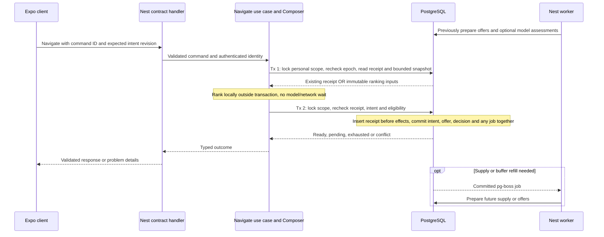

Transaction 1 makes no lasting intent change. It reads an authorised snapshot or returns a prior receipt. Ranking between transactions has no externally visible effect, so concurrent retries may repeat this cheap computation safely. Transaction 2 checks the receipt again before any effect and rechecks the expected intent revision. Only one committed result wins; a newer intent cannot be overwritten. A changed candidate gets a bounded rerank or a typed pending/conflict outcome.

An explicit topic or format request does not wait for Personal Planner. The command immediately affects selection or commits a private demand. Every required follow-up job is transactionally enqueued. No provisional HTTP command lease is needed just to protect a short atomic mutation; section 19 defines the receipt protocol.

## 8. Algorithm foundations

All following algorithms are **proposed v0 policies**. They describe how to implement the discussed behaviour; their numerical values are not empirical claims. Evaluate before freezing a launch policy. Keep equations in pure functions and parameters in versioned policy records.

### Three kinds of numbers

| Kind | Example | How it changes |
|---|---|---|
| Policy weight | Save bonus 1.5; horizontal continuity coefficient 0.45 | We choose, version and evaluate it. |
| Personal state | Asha's current attention-topic activity | Arithmetic projection of authorised evidence. |
| Learned parameter | A ranker's coefficient or an LLM weight | An explicit training process changes it. |

### Shared notation

`u` = person; `e` = encounter; `c` = candidate content; `t` = topic; `f` = format; `T` = current time. Ranking features are bounded to `[0,1]`. Missing measurements remain unknown; they do not automatically become negative examples.

### Evidence qualification

For a Reel:

\[
q_e = \frac{\text{unique visible media time}}{\text{duration}}
\]

For a Scroll, an initial approximation:

\[
q_e = 0.5\,\text{section coverage}
+ 0.5\min(1,\text{active dwell}/\text{estimated reading time})
\]

**Plain explanation:** measure actual visible coverage and active time. Automatic loops, buffering, background time and duplicate observations do not create additional unique coverage. A Scroll's sections should be weighted by meaningful content size, so passing several tiny headings does not dominate its coverage.

As an experimental starting classifier, a qualified encounter requires valid lineage and visibility, sufficient instrumentation, `q >= 0.6`, and for Scrolls at least 0.5 section coverage. These numbers are placeholders for testing, with content-length/read-size policies versioned explicitly. Very short clips and atypical interactive articles need separate calibration. Duration-cohort normalisation can later improve ranking comparisons; these fractions are not a validated unbiased estimator. [Counterfactual Watch Time](https://arxiv.org/abs/2406.07932)

If instrumentation is unavailable, record unknown qualification. A Save can still express an explicit preference, but it cannot substitute for qualified reading in a formation count.

### Positive activity and separate channels

\[
a_e = \min(3, q_e + 0.5L_e + 1.5B_e + 1.0S_e + 1.5H_e + 2.0R_e)
\]

`L` = Like; `B` = bookmark; `S` = confirmed share; `H` = deliberate horizontal continuation; `R` = deliberate separated return. Each indicator contributes at most once to the encounter. A return is a new, explicitly activated encounter after a configured separation; restoring a parked reader is not a return bonus.

**Plain explanation:** ordinary consumption contributes even without buttons. Deliberate actions contribute more. The cap limits one encounter's influence. Keep all original channels separately; the combined score is a routing convenience, not a replacement for evidence.

Example: Asha watches 42 of 50 seconds. `q = 0.84`. Continuing horizontally yields `a = min(3, 0.84 + 1.5) = 2.34`. Liking, saving and sharing repeatedly cannot raise that encounter above the cap. Until Share exists, its indicator is always zero.

Skips are a weak, separate dismissal channel. Explicit Hide/Not interested is a scope-specific routing constraint. Neither is a claim about belief. Unsave/Unlike adjusts current action state and its contribution through a new evidence revision rather than deleting the audit of the original command while it remains in retention.

### Topic attribution

\[
\sum_t r_{e,t} \leq 1, \qquad contribution_{e,t}=r_{e,t}a_e
\]

**Plain explanation:** divide an encounter's contribution across its relevant concepts. Attaching ten topic tags must not multiply its weight by ten. Formation uses genuinely covered primary/supporting concepts; incidental mentions do not qualify a new world.

### Personal interest and format fit

\[
A_{u,t}(T)=\sum_e r_{e,t}a_e\,2^{-(T-T_e)/h}
\qquad I_{u,t}=\frac{A_{u,t}}{1+A_{u,t}}
\]

**Plain explanation:** recency changes feed relevance. With an illustrative 14-day half-life, weight 2 contributes 1 after 14 days. Lifetime structural coverage is stored separately and does not decay this way. In implementation, update affected aggregates incrementally, including per-channel values; do not rescan lifetime history per request.

For topic-format response fit:

\[
F_{u,t,f}=\frac{1+Q_{u,t,f}}{2+O_{u,t,f}}
\]

`Q` counts qualified encounters and `O` counts encounters with usable qualification measurement. Unknown observations are excluded from both. A neutral initial value is 0.5. A person with 4 qualified responses among 5 measured ML Reels has `F = 5/7 ≈ 0.714`; among 1 qualified response in 2 measured ML Scrolls, `F = 2/4 = 0.5`.

**Plain explanation:** estimate response separately by topic and format while remaining conservative with few observations. These are observed response rates under our offering policy, not proof of innate format preference. Preserve uncertainty and exposure history; explicit format requests always win.

For late/corrected evidence, replace the old contribution with the revised contribution evaluated at the same current time. Example: revision 2 adds a continuation to revision 1; add the difference, not the entire encounter again. Retain distinct explanation-unit counts so a Reel and its Scroll twin do not double conceptual variety.

**Stored:** evidence revisions, channel values, topic statistics, format statistics and update checkpoints. **Produced:** ExperienceContext and ExplorationSnapshot. **LLM:** none in the arithmetic path.

## 9. Composer algorithm

### Eligibility before scoring

\[
\mathcal E = \{c:\ published(c)\land accessible(c)\land valid(c)
\land matchesExplicitIntent(c)\land allowedInMode(c)\}
\]

**Plain explanation:** an unpublished, withdrawn, inaccessible or wrong-format asset cannot win by scoring highly. An explicit series-next request resolves its declared next unit before general ranking. A related continuation is a different contract from Part 2.

Retrieve bounded candidates from exact topic/series matches, text, embeddings, admitted semantic neighbours and an exploration pool. Suggested initial caps are 100 retrieved, 15–25 optionally assessed and 2–3 buffered, to be load-tested.

### Mode-specific fit

\[
S_V(c)=0.35Intent+0.20Interest+0.15Format+0.15Novelty+0.15SemanticFit-0.25RecentRepetition
\]

\[
S_H(c)=0.45Continuity+0.25Intent+0.15Format+0.15SemanticFit-0.25RecentRepetition
\]

| Feature | Concrete meaning / initial computation |
|---|---|
| Intent | Match to the explicit topic/thread/format constraints; soft relevance among eligible items. |
| Interest | Candidate-topic-weighted personal activity, bounded using `A/(1+A)`. |
| Format | Topic-conditioned response estimate for the candidate format; explicit format override bypasses preference competition. |
| Novelty | New explanation unit/facet relative to recent and established exploration, not merely a new asset ID. |
| Semantic fit | Bounded assessment of relevance and explanatory appropriateness; optional Jev or baseline features. |
| Continuity | Strength of the admitted series/related link to the current step. |
| Recent repetition | Similarity to recently encountered explanations and repeated units. |

**Plain explanation:** vertical mode permits broader subject discovery. Horizontal mode stays in the current thread and values the next explanatory move. The same person can receive different rankings for the same candidate depending on what they are doing now.

Illustrative vertical candidate: intent .8, interest .6, format .7, novelty .9, semantic fit .8, repetition .1 gives `S = .735`. These inputs are measured/derived features, not model confidence about the person's identity.

### Buffer diversity

\[
c^*=\arg\max_{c\in\mathcal E\setminus B}
\left[S(c)-\lambda\max_{b\in B}sim(c,b)\right]
\]

For an empty buffer, the redundancy term is zero. Similarity is bounded and considers explanation identity as well as semantics. Use a versioned seed/stable tie-break for repeatable ordering.

**Plain explanation:** after choosing one item, prefer another useful item that does not repeat it. The recent-repetition penalty concerns past encounters; this penalty concerns the new buffer. The general relevance-versus-redundancy pattern is inspired by MMR, while our navigation constraints are product-specific. [MMR paper](https://www.cs.cmu.edu/afs/cs/Web/People/jgc/publication/MMR_DiversityBased_Reranking_SIGIR_1998.pdf)

### Exploration and Jev

Initially reserve a configurable fraction, such as 10%, of vertical slots for an eligible exploration pool. If that pool is empty, use ordinary ranking. Log the realised selection policy and probabilities where randomisation occurs. A later contextual bandit can learn exploration choices; do not train one without suitable data or present model confidence as a selection probability.

Jev can assess atomic criteria on a shortlist, with scores combined in code. It owns neither candidate access nor world formation. Pin model/prompt versions, use a bounded worker deadline to prepare assessments/buffers ahead of requests. HTTP ranking uses a valid stored assessment or deterministic fallback; it never waits for a provider. Provider failures are absence of assessment, not negative judgments. [TypeSafe composite scoring](https://docs.typesafe.ai/patterns/composite-scoring)

**Stored:** decision inputs, candidate features, versions, selected offers and exploration metadata within privacy retention. **Produced:** ready offers, honest exhaustion or a content demand. **LLM:** optional fast semantic assessment.

## 10. Personal Planner algorithm

\[
C_u=BuildContext(Evidence_u,Intent_u,ExistingPlan_u,InventoryCoverage)
\]

\[
P_{raw}\sim LLM_\theta(PlannerInstructions,C_u,PlanSchema)
\]

\[
P_u=Take_K(Diversify(Validate(P_{raw},C_u)))
\]

**Plain explanation:** assemble a small factual context, ask the model for a few useful next possibilities, validate them and keep a bounded varied set. `K = 3` is a reasonable experiment, not a permanent maximum for the product. This is an explicit application algorithm around a model; we are not claiming the model's internal semantic judgment has a simple hand-written equation.

The model may propose an example, mechanism, limitation, consequence, alternative perspective or supported connection. Each opportunity has topic/unit refs, thread eligibility, format preferences, evidence references, expiry and optional missing-supply specification. A valid proposal can still be uninteresting; evaluate content usefulness separately from schema validity.

Run after material evidence changes, a supply gap or a deliberate request needing reasoning. Coalesce ordinary observations into one desired revision and one active job per person/role. Direct content requests can go to Quartermaster immediately without waiting for Planner.

Example: Asha watched an attention mechanism and followed a contextual example. Planner proposes a limitation as a near continuation and inference costs as a later possibility. Composer can consider both; Quartermaster prepares missing content only after budget admission. Neither possibility adds evidence or forms a planet.

**Stored:** plan revisions, context/run refs, evidence references, unresolved opportunities and bounded role memory. **Produced:** opportunities plus admitted demand proposals. **LLM:** semantic planning and prioritisation. **Code:** authority, references, allowed moves, limits, diversity and admission.

## 11. Quartermaster and production algorithms

### Quartermaster

\[
\mathcal A=[Reuse,Join,Adapt,Create]
\]

\[
a^*=First\{a\in\mathcal A:Compatible(a,d)\land Permitted(a,d)\land WithinBudget(a,d)\}
\]

If the set is empty, return deferred or unavailable. A deadline may disqualify joining an existing slow job. Do not treat the ordering as permission to reuse a semantically inadequate asset merely because it is cheap.

**Plain explanation:** find an existing correct item, share existing work, adapt an existing explanation, or commission new content. Match explanation/angle/depth/format/language/freshness/continuity/rights, not just similar embeddings.

A shareable supply key includes the public canonical brief, format, language, freshness, continuity revision and rights class. Personal demand records contain the owner and private context; public jobs do not. Private chat-derived material stays scoped. A model can suggest compatible matches; code checks exact requirements.

Concurrent matching uses a unique active supply key. One global matching transaction chooses/creates the job. Binding the result to a person later rechecks that person's authority. Never hold a shared job lock while acquiring personal locks for several users. Cancellation can remove one waiter while a shared job continues for others.

**Stored:** demand status, matching decisions, shared/private job, waiter binding, budget and attempts. **Produced:** reused asset, shared production work or an honest result. **LLM:** optional semantic matching; no model needed for budget arithmetic or idempotency.

### Production

\[
Draft=LLM_\theta(Brief,EvidencePackage,FormatContract,ContinuityRequirements)
\]

\[
Publish=SchemaPass\land ContentReviewPass\land RightsPass\land RenderPass
\]

**Plain explanation:** create a good explanation first, then express it as the requested format and check it. Schema success says the renderer can interpret the structure; it does not prove the argument is true. Content review combines source support, coherence/limitation checks and human sampling/escalation according to risk and uncertainty.

Pipeline: retrieve authorised research → construct claim/evidence package → choose an angle and outline → compose prose/script → check factual and argumentative support → produce declarative Scroll or request Reel through Cutroom → validate rendering/media → publish an immutable revision. Preserve timestamps and correction lineage. Avoid generic paraphrase assembled solely from search snippets.

For a history explanation, distinguish a specific account of sacred legitimacy from a universal assertion that all religion was invented for political control. Useful content presents a lens and its limits naturally. Ordinary readers need not see the research process, but the system must be able to correct the resulting content.

A Scroll document supports approved blocks: title, prose, illustration, comparison, timeline, bounded diagram, parameterised simulation, disclosure and static code. Each interactive type has typed data, size bounds, accessibility text and gesture ownership. Model-written arbitrary JavaScript is outside the initial design.

**Stored:** research/evidence package, draft, checks, rights, attempts, assets and publication revisions. **Produced:** admitted content only. **LLM:** research synthesis, writing, scripts and semantic checks; code and review process retain publication authority.

## 12. Cartographer algorithm

### Propose organisation

\[
G_{proposed}\sim LLM_\theta(CartographerInstructions,QualifiedEvidence,CurrentGeography,AdmittedConcepts)
\]

For a proposed grouping `g`:

\[
N_g=|\{\text{distinct qualified explanation units supporting }g\}|
\]

\[
D_g=|\{\text{supported explanatory facets within }g\}|
\]

An illustrative formation rule:

\[
FormPlanet(g)=[N_g\geq3]\land[D_g\geq2]\land ValidGrouping(g)\land CurrentAuthority
\]

\[
G_{n+1}=ApplyValidatedChanges(G_n,G_{proposed})
\]

**Plain explanation:** the model proposes meaningful geography. Code checks the supporting encounters, variety, permitted parent/child relationships and current authority. Three versus five distinct units should be compared experimentally. No Like, quiz, required question or return visit is mandatory for the initial passive formation experiment.

A star/system rule can be different from a planet rule. For the worked example, two distinct qualified units with a coherent broad-topic grouping can establish a system and organising star before a three-unit planet. Dust can acknowledge the first qualified encounter. These are example thresholds, not an astronomical simulation or an established measure of meaning.

`ValidGrouping` checks references, membership, topic/facet support and allowed hierarchy. Semantic plausibility still comes from admitted concept relationships, model quality and correction/review; counting three arbitrary items cannot prove they form a useful topic. One heavily tagged article cannot manufacture ten regions without actual coverage.

### Persistence and change

Separate structure, activity and validity. Activity may decay. Structure persists. Validity changes if evidence or source relationships are corrected, removed or rejected.

\[
Activity_g(T)\downarrow\quad\text{does not imply}\quad Remove(g)
\]

**Plain explanation:** absence calms the place; it does not destroy it. This is hysteresis: creation and removal do not use the same threshold. Merges/splits require typed proposals, retained aliases and a legible transition. A label rewrite should not create a new planet ID or imply the person's belief changed.

Typed operations include `create_system`, `establish_star`, `form_planet`, `add_region`, `connect_route`, `revise_label`, `set_activity` and `withdraw_relation`. Apply all valid operations in a revision-checked transaction or reject the proposal; no arbitrary model JSON patch.

What-if encounters retain hypothetical status in their conceptual records. Exploring a counterfactual can enrich a region about that scenario; it cannot establish a hypothetical consequence as a shared fact about the real world.

**Stored:** proposals, decisions, stable geography, evidence refs and deltas. **Produced:** UniverseDelta. **LLM:** grouping, labels, semantic placement and proposed relationships. **Code:** formation eligibility, scope, revision checks and atomic application.

## 13. Scene generation algorithm

\[
Height(p)=BaseFamilyShape(p)+\sum_{i=0}^{m}a_i\,Noise(2^ip,seed)
\]

\[
Appearance=Render(SemanticRegions,VisualFamily,PersonalSeed,GeneratorVersion,Activity)
\]

**Plain explanation:** a common visual family supplies recognisable structure; a stable seed supplies personal variation; several noise scales add large terrain and fine detail. Shared meaning creates the resemblance. Hashing a user and topic into unrelated random values alone would not guarantee it.

Assign meaningful regions and routes before procedural decoration. Store object IDs, family/template version, opaque seed and layout anchors. Pin generator versions for established worlds; an app update must not accidentally remake every planet. Use bounded material/palette/atmosphere parameters and cache expensive outputs by descriptor/version/detail level.

The server stores semantic/visual descriptions; clients generate or load detail appropriate to the device. Support low detail, reduced motion and static fallback with the same navigation targets. A small visible animation must not block playback or depend on an LLM call per frame.

**Stored:** per-object descriptors and chunked manifests. **Produced:** renderable scene and transitions. **LLM:** unnecessary for ordinary terrain; optional bounded aesthetic suggestions can be evaluated later.

## 14. Shared Scenario Planner algorithm

Represent each thread-linked shared exploration as a directed acyclic graph. Initially each node has one parent; do not support branch merges until assumption compatibility is defined. An exploration is presented inline in the content thread, not as a mandatory separate workspace. Its origin may be the root encounter, a snippet or an authorised message in either a friend thread or an idea-room thread.

\[
G_s=(V,E),\qquad v_i=(parent,assumptions,brief,contentRefs,status)
\]

\[
A_{child}=ApplyChange(A_{parent},RequestedChange)
\]

\[
Candidates=LLM_\theta(SharedContext,A_{child},ScenarioContract)
\]

\[
Selected=Validate(MemberChoice(Candidates),Membership,ParentRevision,AssumptionConsistency)
\]

**Plain explanation:** a person changes an assumption, the model proposes a few coherent directions, and an explicit selection commissions the continuation. A request that already names the desired direction can skip a separate choice screen. Store inherited assumptions and explicit changes so branches remain understandable.

For `kind = perspective`, keep `A_child = A_parent` and store a named explanatory lens instead. This requests another way to examine the same subject, not an invented counterfactual or a declared next episode. A scenario below a hypothetical parent remains hypothetical even if its immediate move only changes perspective. Ordinary perspective moves do not need a hypothetical label unless they inherit or introduce changed assumptions.

The harness receives a bounded authorised thread window, selected message/snippet, source revision and branch ancestry. The LLM proposes options and conditional explanations; deterministic code checks parent revision, membership, source access, move kind, assumption lineage and budget. Choosing a suggestion or submitting a sufficiently complete request creates a durable receipt and demand. Merely opening the suggestion UI, a moderator pin or an unsolicited AI message does not commission content. Neither friend-selection ranking nor episode seen markers needs an LLM.

Example: start from model-serving costs; change traffic to ten times its previous value while keeping model and latency target fixed; compare batching versus more instances. If a branch changes the latency target too, record that as another explicit assumption change rather than silently altering the premise.

Only the selected branch generates expensive content. A small bounded preview or next-step buffer is optional; never generate every possible tree path. A node can hold a declared sequence of explanation units, each with Reel/Scroll variants. Branch relation, part order and format relation are three separate links.

The shared role sees conversation-visible context and selected content, not each participant's private personal model. Membership and content access are checked at every read/action. A scenario can remain private; private room/chat material cannot be promoted into public production by semantic matching.

**Stored:** scenario membership, assumption revisions, branch graph, proposals, choices and demands. **Produced:** selected content requests and navigable shared sequences. **LLM:** conditional reasoning and explanations. **Code:** membership, graph acyclicity, premise lineage, allowed operations and budget.

## 15. LLM harness, memory and fine-tuning

### How a role uses a model

\[
Context_r=Build(RoleInstructions_r,RelevantEvidence,AcceptedMemory_r,PreparedResearch_r)
\]

\[
Proposal_r=RunLLM(Context_r,Budget_r,OutputSchema_r)
\]

\[
Result_r=ValidateAndApply(Proposal_r,CurrentState)
\]

**Plain explanation:** the owning module decides what facts the model can see and what kind of proposal it may return. The harness carries out a bounded request. The module's validator decides whether the result is usable. Its applier checks current authority and records the accepted change. The model never directly writes a planet, message or production job.

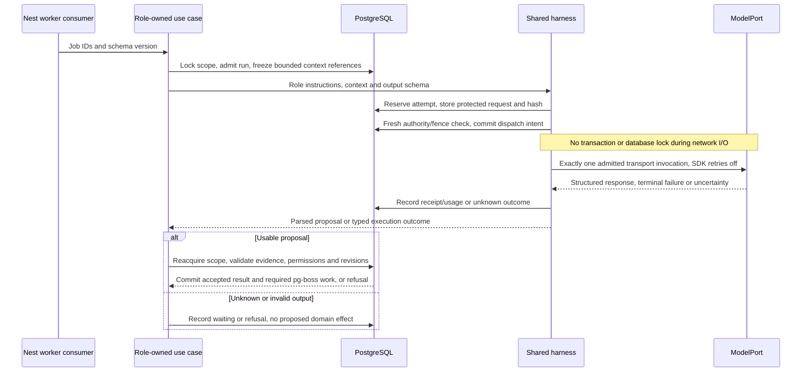

No model-directed tool loop in v1. Application code prepares permitted research and inventory inputs through explicit steps. A research pipeline can still have multiple stages: each stage has a named purpose, bounded inputs and its own admitted external attempts. The model does not choose unrestricted tools or continue spending until it declares itself finished.

### Shared engine, module-owned roles

| Role and owner | Prepared context | Structured output | Durable accepted memory |
|---|---|---|---|
| Personal Planner — `planning` | Relevant evidence, intent, inventory coverage, admitted neighbours | Exploration plan and demand proposals | Accepted plans, unresolved opportunities and evidence references |
| Cartographer — `geography` | Qualified units/facets, established objects and semantic edges | Cartography proposal | Accepted grouping/alias decisions and supporting evidence |
| Scenario Planner — `scenarios` | Authorised thread excerpts, selected root, explicit assumptions | Suggestions or selected continuation brief | Versioned shared premises and accepted nodes |
| Writer — `content` initially | Sanitised brief, prepared source package, canonical explanation | Draft and claim/evidence bindings | Job-local accepted outline/source references |
| Moderator — `rooms` | Room rules and authorised messages | Organisation/moderation proposal | Accepted room organisation within retention |
| AI inhabitant — `rooms` | Room-visible context and named perspective | Clearly AI-attributed contribution | Accepted room-local contributions within retention |

Each role owns instructions, context builder, output schema, semantic validator and applier under its module. Shared `reasoning/` owns only the execution machinery: admission integration, transport, parsing, limits, attempt tracking and provider adapters. It does not own geography or planning SQL.

### Three execution records with different lifetimes

| Record | Question answered | Example |
|---|---|---|
| Queue delivery | Which worker received this wake-up? | pg-boss delivers `cartography-run-8` twice after a restart. |
| Business run | What work are we trying to complete? | Reconsider the attention system using evidence through revision 12. |
| External attempt | Which particular provider invocation may have incurred cost? | Attempt 1 timed out after dispatch; reconcile it before another charge. |

A new queue delivery resumes the same run; it does not imply a new attempt. The attempt ledger applies to external/paid calls, with provider-specific terminal and retry semantics. Paid/model attempts always consult it, even when queue `retryLimit` is zero. Retries, worker expiry and crash recovery cannot override the ledger.

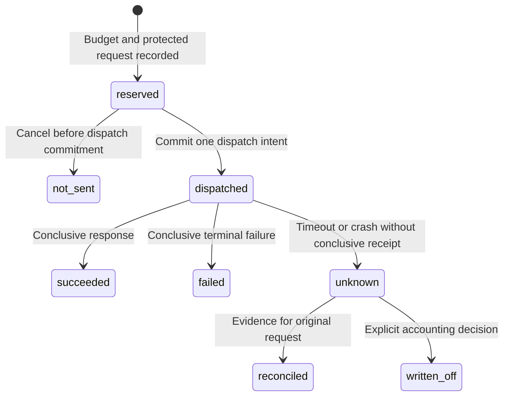

Here `dispatched` means **may have been sent**, not proof the remote provider received it. There is an unavoidable gap between committing dispatch intent and receiving a response. A lost commit acknowledgement must stop the sender; reading a dispatch intent later does not grant permission to resend. Unknown attempts are never automatically resent. Reconcile by provider request/task identity where supported. A write-off records unresolved liability; it does not prove remote work stopped, free uncertain remote capacity automatically, or authorise stale output.

Store the immutable request bytes/hash before dispatch in a protected artifact store when needed for the invocation contract, not in logs. Define access, encryption, size limits, expiry and erasure for those bytes. Keep minimal accounting identity separately so late usage can settle without restoring erased private context. Network errors, usage uncertainty and output eligibility are independent facts.

At most one output repair is allowed initially. It is a new admitted attempt with its own budget and causation, after the original call is conclusively complete; it cannot hide an automatic retry. SDK/provider retries must be explicitly disabled or bounded by a conformance-tested mechanism. A malformed response is recorded and rejected; do not guess a valid proposal from it.

### Memory and provider adapter

Facts and accepted proposals form durable role memory. Unaccepted output can exist briefly for validation/debugging but never becomes a personal fact merely by being stored. A role summary remains fallible, bounded and linked to evidence revisions; corrected or erased inputs invalidate it. Full transcripts are not the personal database and hidden chain-of-thought is not a required artifact.

Begin with a direct hosted-model `ModelPort`; evaluate MiniMax only after checking the actual product-use and personal-data terms for the chosen plan. Parse the provider's documented output fields, discard exposed thinking blocks rather than persisting them as memory, and strictly validate the structured proposal. Do not blindly remove arbitrary user text containing `<think>`: provider framing belongs in the adapter and needs fixtures.

Pi or an AI SDK may later implement the same port if it reduces work. Conformance must cover one admitted request, retry control, cancellation, usage/uncertainty, scope isolation, bounded output and strict parsing. No CLI session store or autonomous tool loop is inherited by default. Pi is unrelated to the excluded PIO workflow.

Role evaluation is a separate Vitest project using labelled synthetic/reviewed contexts: insufficient evidence, malicious retrieved text, source correction, privacy reset, duplicate delivery and good/rejected proposals. Schema acceptance is not a quality score. A live provider evaluation must be separately authorised and reported as such.

### Initial model specialisation is not fine-tuning

The same pretrained LLM can serve Planner and Cartographer with different instructions, examples, prepared context and output schemas. This does not change its parameters. The application specialises its use.

Initially: hosted pretrained model + tested role profiles + evidence retrieval + deterministic application. No self-hosted GPU or custom training pipeline is required.

### Later fine-tuning

\[
\theta^*=\arg\min_\theta\left[-\sum_{(x,y)\in D}\log P_\theta(y\mid x)\right]
\]

**Plain explanation:** collect reviewed contexts `x` and high-quality target proposals `y`; train the model to produce responses more like them. Use permitted data, remove unnecessary personal details, retain a training-data provenance/deletion policy and keep a held-out evaluation set.

Planner training examples teach useful, varied directions, restraint about generation and respect for intent. Cartographer examples teach supported grouping, stable identities and appropriate refusal when evidence is insufficient. Scenario examples teach explicit assumptions, consistent conditional reasoning and honest uncertainty. Include sparse data, rejected proposals, corrected sources and malicious retrieved instructions. Accepted-by-schema is not synonymous with high quality and must not automatically label a training example as good.

A compatible open model can use LoRA:

\[
W_{adapted}=W_{base}+BA
\]

**Plain explanation:** freeze the large base weights and train smaller additional matrices. Availability, quality and compute depend on the selected model and training setup; this is a possible future approach, not a claim that Jev or any chosen hosted model exposes fine-tuning. [LoRA paper](https://arxiv.org/abs/2106.09685)

Require measurable improvement over prompting alone, including unsupported grouping rate, useful proposal quality, valid-reference rate, stale-result handling, latency and cost. Fine-tuning never removes validators or grants access to more data.

### Later learned recommendation model

\[
\hat p_k=\sigma(w_k^Tx+b_k)
\]

\[
L=-\sum_i m_i[y_i\log\hat p_i+(1-y_i)\log(1-\hat p_i)]+\lambda\|w\|^2
\]

**Plain explanation:** a small model predicts a particular outcome from content/session features. `m` excludes missing/unusable labels. Train separate outcomes such as qualified consumption, continuation, saving and dismissal. Combine their predictions with explicit product priorities instead of allowing one engagement proxy to silently become the objective.

Split evaluation by time and appropriate user/content groups to reduce leakage. Record exposure policy and randomisation where used. Historical actions reveal what happened under the old offers; they do not reveal responses to unseen alternatives. Do not optimise universe size or raw watching time as proof of self-discovery.

## 16. Asha's complete journey

This is a hypothetical worked example. IDs connect the stages; they are not runtime receipts. Asha is signed in with recording enabled. Starter content has actually been admitted in the imagined system.

### How the loops connect across this journey

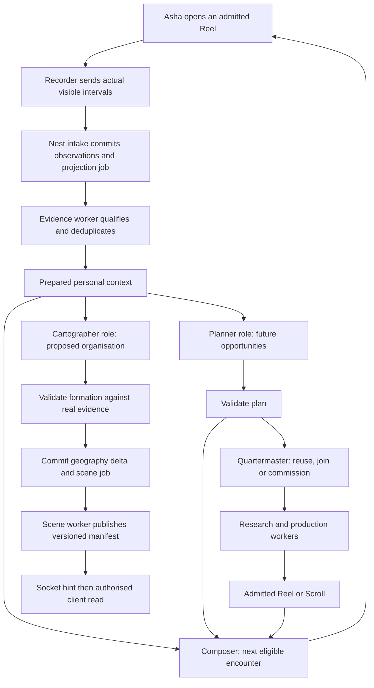

The arrows after intake represent durable jobs or typed module calls, not an untracked chain of callbacks. Planner, Cartographer and the writer can call the shared harness from workers. Evidence qualification, formation gates and scene generation remain deterministic. Scene appearance never feeds back as proof of interest.

| Loop | Reads | Stores | Produces |
|---|---|---|---|
| Recorder/intake | Visibility, asset/exposure lineage | Deduplicated observations and intake acknowledgement | Projection job and accepted watermark |
| Evidence/context | New observations and prior evidence revision | Qualified evidence, contribution deltas, bounded topic/format views | Versioned inputs for Composer, Planner and Cartographer |
| Composer | Current intent, eligible inventory, prepared context/offers | Decision, eligible offer, policy version and receipt | Ready/pending/exhausted encounter response |
| Personal Planner | Evidence snapshot and available supply | Run, proposal outcome and accepted plan | Future opportunities and admitted private demands |
| Quartermaster | Explicit/accepted demands and eligible supply | Reuse/join/create decision and private waiter bindings | Existing asset or production work |
| Production | Canonical brief and prepared research | Attempts, draft, checks and immutable asset revision | Admitted Reel/Scroll or explicit failure |
| Cartographer | Actual evidence and current structure | Run, proposal/validation result and accepted delta | Geography changes and scene job |
| Scene projection | Accepted structure and stable seeds | Versioned scene chunks and watermark | Renderable manifest |
| Scenario Planner | Shared thread and selected assumptions | Scoped run, proposal and accepted branch brief | Shared continuation demand, never personal evidence |

Every personal loop checks the current privacy epoch before application. Each prepared view names how far it has processed. A lagging view is allowed; pretending every loop has already caught up is not.


### First session: ready content, then actual evidence

| Step and visible experience | Who acts | What is stored | What is produced / next |
|---|---|---|---|
| Asha opens dimensional TV | API + Composer | Session `s1`, intent revision 1, selection `d1` | Buffer of three eligible offers. No personal topic yet. |
| Attention Reel becomes visible | Client + intake | Exposure `e1`, asset `attention-reel@3`, visibility observation | Subsequent playback can be attributed correctly. |
| She watches 42/50 visible seconds | Evidence processor | `evidence-e1@1`, `q=.84`, explanation unit `attention-mechanism` | Context revision 1, one qualified unit, small topic activity. |
| She continues horizontally | API + Composer | Command `continue-2`, intent revision 2, decision `d2`; `evidence-e1@2` | Declared Part 2 offer; continuation adds the difference in evidence. |
| She watches the contextual example | Evidence processor | `e2`, unit `context-example`, qualified evidence | Two distinct units; more current-thread relevance. |

A buffered history Scroll she never sees adds nothing to her universe. A retry of the playback batch or continuation command does not count again.

### Planner and Cartographer respond independently

Planner run `p1` reads those evidence refs and inventory coverage. It proposes a limitations continuation and a later inference-cost connection. Its validated plan goes to Composer; a missing deployment explanation can become a low-priority demand. The proposed content adds no exploration credit.

Cartographer run `c1` reads the same facts plus admitted concepts. It proposes an ML grouping. Under the illustrative two-unit star policy, code applies delta `g1`: ML system and organising star. The attention planet remains ineligible at two units. Scene `scene1` displays the new star using Asha's stable variation. No narration says she learned ML.

### Same explanation, another format

Asha returns to the parked first Reel and requests Scroll. This creates command `format-3` and demand `demand3`. Quartermaster finds no existing or in-flight compatible Scroll and admits shared supply `supply3` from a public canonical brief. It does not include Asha's private history in that brief.

Production writes and checks `attention-scroll@1`, expressing `attention-mechanism`. Publication makes it inventory. The demand becomes ready; the client can show it without interrupting a different active encounter. Only when Asha opens it does exposure `e3` begin. Reading evidence affects ML×Scroll response fit but does not add a third distinct explanation unit.

Inside the Scroll, vertical movement reads the article; dragging its diagram stays in the diagram. Going back restores the reading anchor. The source/reasoning machinery is not a mandatory panel.

### An immediate football detour

Asha asks for football. Command `topic4` changes current intent immediately, overriding the ML plan for this request. Composer offers a football Reel. A brief glance records limited evidence, not a formed football world. Her established ML star remains. Background ML work can be deprioritised before dispatch, while an already shared production job may continue for other users.

### The next day: a planet forms

She opens the ML system and watches a limitations explanation as `e5`, unit `attention-limits`. Cartographer now sees three qualified units and facets covering mechanism, example and limitation. A validated proposal produces delta `g2`: form the attention planet and its supported regions. Scene revision 2 expresses it as a new place with stable identity.

No Like was required. The exact thresholds are illustrative. If the model proposal arrives after a correction removes supporting evidence, application rechecks and refuses the stale formation.

### Sharing with Ravi and Meera

Asha taps Share on an admitted inference-cost Reel. She chooses **Explore with friends**, searches/selects Ravi and Meera, then presses **Create thread · 2 friends**. Visibility-approved availability can help her choose; it reveals no watched topics. Command `thread6` creates the content-thread root and scoped invitations with a durable receipt. Retrying returns that same thread. Asha can start discussing immediately; invited friends join asynchronously. An ordinary **Send to a conversation** remains available without creating a thread.

Ravi accepts and opens the thread. The Experience API returns a bounded `ThreadView`: root/episode strip, messages, inline branch cards and Ravi’s own resume state. Root sharing does not share Asha’s ML system or history. Ravi’s actual playback starts his own activation/exposure lineage; accepting the invitation or receiving the card creates no consumption evidence.

### A snippet starts a shared what-if

Asha selects `00:18–00:31` and sends “Does this still work when traffic spikes?” Command `snippet7` validates the range against the exact Reel revision and records a snippet reference; message `message7` links it into the thread. No new video file is generated. Ravi opens that range, then returns to the same message and conversation position. Visible playback is attributed to the original explanation unit; overlapping replay does not create a new conceptual unit.

Ravi taps **What if…** on that snippet and asks, “What if traffic increases tenfold while the model and latency target stay the same?” Scenario Planner runs through the shared harness with authorised thread context and proposes batching versus adding instances. These are inline suggestion cards, not already-produced episodes. Ravi selects batching; a complete direct request could have skipped this suggestion step.

The selected node stores inherited premises, the traffic change, parent revision, origin snippet and request receipt. Quartermaster reuses compatible admitted supply or commissions the selected continuation. Production/publication validates the output; a committed revision hint prompts a fresh read that changes the branch card from Preparing to Ready; reconnect/catch-up recovers a missed hint. An admitted Reel is Part 1; a later Scroll is Part 2 only if it adds a distinct sequential explanation. A Scroll of the same explanation remains its format variant.

Asha opens the batching sequence and shares a Scroll passage or diagram configuration back into the conversation. Ravi explicitly selects a more-instances alternative later. Their choices are shared contributions, but their current branches, seen markers, selected episodes and playback positions remain private. The UI does not announce “Ravi is watching Part 1.” Each returns to their own position; only actual personal encounters feed that person’s evidence and Cartographer.

### The shared What-if, from tap to worker to ready episode

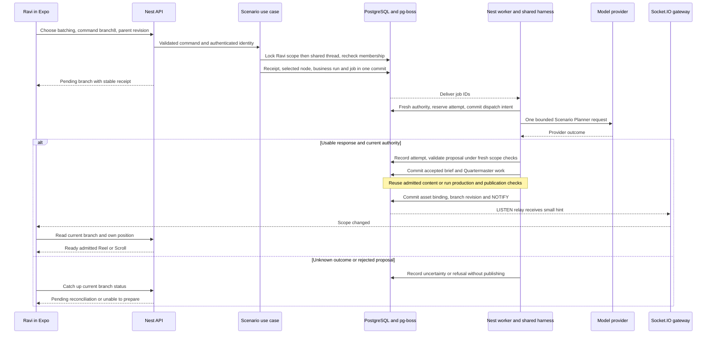

The diagram compresses the supply stages; research, writing and Cutroom each have separate attempts when invoked. No database lock spans any of those calls. Production may be shared, while the requesting bindings and each participant's encounter history remain separately scoped.

| Moment | Durable record | What a retry or crash does |
|---|---|---|
| Ravi submits `branch8` | Request hash, receipt, selected node and queued job commit together | Same key/body returns the same branch; no duplicate generation request. |
| Worker starts scenario work | Business run plus one admitted attempt | A second queue delivery checks this state before doing anything. |
| Provider times out | Attempt becomes unknown; branch remains pending/reconciling | Do not resend automatically or invent a successful episode. |
| Branch becomes ready | Asset binding and branch revision | A missed socket hint is repaired by the next catch-up read. |
| Asha opens the result | Asha's own exposure and subsequent observations | Ravi's actions do not become Asha's personal evidence. |
| Membership or epoch changes | New authority state and withdrawn output rights where applicable | Late output cannot publish into the old scope; minimal usage accounting can still settle. |

The UI shows simple Preparing, Ready or Unable to prepare states. Provider attempts, internal reasoning and lock details are for operators, not consumer labels.

### The same thread inside an idea room

After genuine exploration in ML and backend, a shared model-serving room can appear between Asha’s systems. She opens a discussion and starts a content thread from a shared Reel or message. The room thread uses the same episode strip, snippets, discussion and What-if controls. Room members can participate under the room’s access rules; no friend invitation is required for already-authorised participation. A branch belongs to this discussion, not to a global current topic for the entire room.

The moderator can organise or pin the thread. A labelled AI inhabitant may suggest a different assumption or counterexample, but a person explicitly chooses whether to commission a continuation. Room messages and pins remain conversation, not Reel/Scroll evidence. The harness cannot use private friend conversations to enrich room content.

When Asha is away, her planets remain. Motion can settle. A privacy reset invalidates old personal work; a late model completion cannot resurrect the old map.

## 17. Sharing, chat, scenarios and rooms

### One integrated content thread

The selected product flow is **Share → select friends → content thread → snippet → What if → continuation → discussion**. A content thread brings the encounter and its conversation together. It can start with one Reel, one Scroll or an existing declared series. It does not require a series or a separate scenario setup before people can talk.

On mobile the thread contains a header/participants, horizontal episode navigator, collapsible encounter area, messages, inline exploration cards and message composer. A full-screen encounter is available with an exact return to the thread. On desktop, encounter and discussion can sit side by side. Only one player is active. The detailed branch map is a secondary view for complex explorations, not an entry requirement.

The same components and application use cases serve friend conversations and idea-room discussion threads. Parent scope changes authority and visibility; it does not require a second scenario engine.

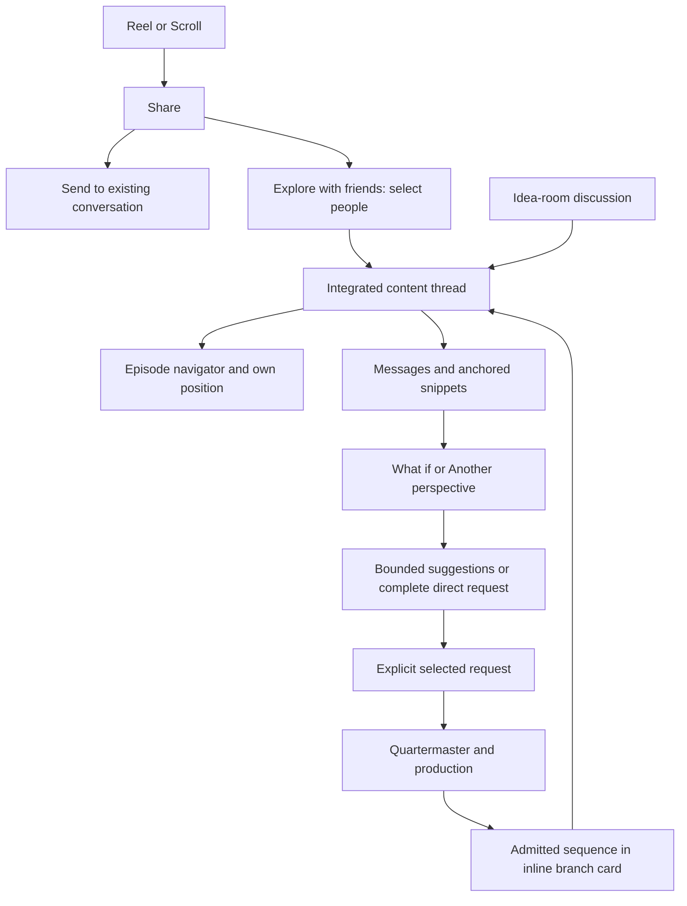

### Sharing and friend selection

The same Share action exists on Reel and Scroll. Its menu offers **Send to a conversation**, **Explore with friends**, **Copy link** and platform sharing. Explore with friends opens search, recent conversations/friends, checkboxes, selected-person chips and **Create thread · N friends**. Existing authorised conversation participants need no redundant invitation to a branch; new participants receive a scope-aware join invitation. Opening a normal share link alone never silently joins a content thread.

Friend availability is optional, visibility-controlled metadata: Online, Recently active or unknown/hidden. It must not expose watched topics, episodes or branch positions. Socket.IO presence expires after missed heartbeats; connection loss cannot leave someone indefinitely online. Sort recent contacts from actual communication history, not invented social activity. Selecting friends or seeing availability supplies no personal exploration evidence.

A share link resolves server-side to a current access decision. Public previews contain only public metadata; private previews reveal no title/body before permission is checked. Corrected/withdrawn content shows an honest updated/unavailable state. Distinguish sheet-open, link-copy and confirmed in-app send; external delivery is not reliably observable. Include block, report and revoke controls without automatic address-book upload. Managed access can be revoked; external copies cannot be recalled.

### Episode navigation and independent positions

Every declared episode has a stable unit/series revision, ordinal, distinct thumbnail, title, format availability and supply/access state. The horizontal navigator reflects the current sequence, including the selected branch’s sequence when applicable.

| Navigator state | Meaning and behaviour |
|---|---|
| Viewed marker | The caller’s own playback/reading history under a documented coverage policy; never a learning grade and never another member’s history. Missing observation coverage remains unknown. |
| Current | The episode selected on this client; full-colour/focus treatment. Selecting it is not proof of consumption. |
| Upcoming and ready | An existing admitted episode not yet visited by the caller; quieter thumbnail, still selectable. It is not locked behind earlier parts. |
| Preparing | Explicitly selected supply is in progress; display a preparation state, not a dim thumbnail pretending content exists. |
| Suggested branch | A proposed direction, separately labelled; no episode number or generated-content claim before commissioning/publication. |
| Corrected / unavailable | Explain the current asset state and preserve a truthful return path. Never silently substitute another explanation. |

Seen markers and resume anchors belong to the caller. Shared contribution history may say “Ravi requested More instances”; it must not imply “Ravi is currently watching Part 1.” Online availability is separate from playback presence. There is no synchronised co-watching or shared playback cursor in the initial version.

Scrolling the episode strip owns that gesture. Scroll article reading, diagram dragging and message-list scrolling retain their own gestures too. Opening a snippet parks the prior encounter position; closing it restores the thread message anchor and previous episode context. Returning from the full player resumes paused. Define platform Back for these nested surfaces instead of letting a thread gesture swallow the system back edge.

### Snippets are anchored references

| Kind | Required reference | Initial interaction |
|---|---|---|
| Reel moment/range | Exact asset revision plus start/end milliseconds within its duration | Share moment, adjust bounded range, add a message; play the range on demand with an option to open the full Reel. |
| Scroll passage | Exact article revision, stable block ID and validated text range | Select text and share a passage card; open at that passage. |
| Interactive block | Article revision, block ID/type version and optional validated parameter snapshot | Share the block, optionally including the chosen slider/toggle configuration; label whether this state is included. |

Initial snippets point into the original admitted asset; they do not require video re-encoding or become a third consumption format. Any cached excerpt/poster inherits its source permissions, retention and correction rules. The server validates ranges, quoted text and allowlisted parameter values; no executable code or arbitrary private state enters a card. Another user’s draft or hidden block data is not shared by accident.

Opening a snippet checks destination membership and current source access. Withdrawal/revocation disables managed preview/playback. A corrected source either maps the anchor through an explicit compatible mapping or explains that the original moment is no longer available; it never moves the reference silently. Receiving or expanding a snippet card is not a qualified encounter. Actual visible playback/reading uses the original unit and revision, with interval overlap deduplication and the existing per-unit contribution caps. Retrying the same send cannot duplicate a share signal.

### Separate records behind the unified surface

A conversation or room owns membership and messages. A content thread identifies a scoped root and discussion within that parent. An exploration stores its thread reference, premises, branch graph and explicit contributions. A person’s resume/seen state stays private even though these objects appear together in the interface.

| Owner | Stores | Produces |
|---|---|---|
| Social/thread application use cases | Thread root, invitations, attributed messages, snippet links and receipts | Permission-filtered ThreadView, message pages and committed-change notices. |
| Scenario Planner through harness | Scoped context references, proposal, assumptions/lens, parent revision and selected move | Validated exploration node and selected ContentDemand. |
| Quartermaster/production | Demand, compatible supply match, job attempts and admitted asset binding | Honest preparing/ready/failed state and published Reel/Scroll sequence. |
| Experience/evidence | Caller-only anchors, activations, visible intervals and checked encounter evidence | Resume/seen projection and that person’s context updates; no shared profile. |
| Cartographer/scene | Independently eligible personal geography changes | Personal UniverseDelta and scene, never a room-wide shared universe. |

Create-thread, send-snippet and choose-branch are idempotent authenticated HTTP commands with receipts. Socket.IO carries permitted notifications, typing and optional availability; durable messages and branch state are recoverable through cursor/revision reads. A notification cannot create a second branch or provider attempt. Recheck thread/parent authority and revision before model tool access and again before applying output; removed membership cancels delivery/access even if a model finishes later. Room participation cannot widen access to a private source asset.

### Four continuation relationships

| Relationship | Example | UI expression |
|---|---|---|
| Series step | Part 1 mechanism → Part 2 worked example | Part labels only for declared sequence positions; preparation is explicitly distinguished from available content. |
| Format variant | Mechanism Reel → mechanism Scroll | Reel/Scroll switch preserving explanation identity. |
| Related perspective | Serving costs → a different lens on the same premises | Another perspective, with a named lens; no artificial next-part number. |
| Scenario branch | Original traffic → tenfold traffic | What if, with changed/inherited assumptions and hypothetical status. |

Do not collapse these into an ambiguous parent link. A branch may contain a series of units, and each unit may have format variants. A changed viewpoint alone is not a counterfactual. Speculation, such as imagining black holes as portals, must be explicitly framed as a hypothetical premise rather than an established alternative theory. A scenario derived from hypothetical premises retains that status throughout its continuations.

### Example exploration graph

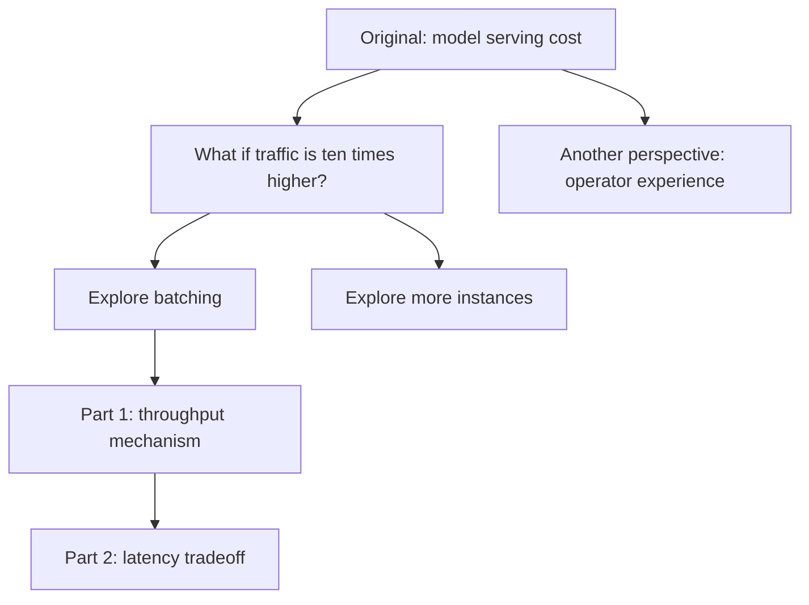

A person can ask What if or Another perspective from the root, a snippet or a message. The model can suggest a few directions; only an explicit selected request commissions content. A complete request skips an unnecessary choice screen. The chosen branch appears inline with current preparation status. No participant’s player moves when someone else selects a branch. Optional clarification inside this deliberately entered activity does not introduce compulsory questions into the main feed. Watching a generated consequence never promotes it to a fact about the real world.

### Idea rooms use the same exploration model

A room belongs to its topic/community and membership rules, not to one person’s map coordinates. Personal maps link to the same room ID. Multiple room discussions can host separate content threads and explorations without changing a global room topic or moving other people’s players.

An authorised member can start a thread from shared content or a discussion message, share a snippet, and select a What-if continuation. The moderator organises, moderates and pins useful discussions; labelled AI inhabitants may suggest assumptions, perspectives or counterexamples. Neither a pin nor an AI suggestion automatically starts expensive production. AI activity is bounded and does not fabricate human activity. Optional polls/quizzes remain room activities, never prerequisites for world formation.

Only the authorised discussion window and permitted content enter the shared harness. Private friend-thread context never flows into a room merely because topics match. A room may request a Scroll summarising its discussion under the same reuse/permission checks. Reading the admitted result supplies personal evidence; joining, chatting, pinning and requesting alone do not.

### Design and future implementation acceptance

Demonstrate one integrated path: select two friends → create thread → one joins later → navigate episodes independently → send/open a Reel range → return to the same message → share a Scroll passage/block state → select a What-if → wait for admitted content → explore an alternative → resume independently. Repeat the core path inside one room discussion while a second room discussion remains unaffected.

Also verify duplicate create/send/choose retries, stale membership, blocked participants, private-source denial, corrected snippet anchors, preparing versus ready episodes, socket catch-up, hidden/expired availability and absence of peer playback fields. These are future verification requirements, not claims that this design export or application implements them.

## 18. Complete UI specification

This is the scope to hand to a future UI session. These are proposed interactions and states, not visual mockup approval. The UI should feel familiar and low effort while the universe feels unusually rich. Do not expose scoring formulas, model transcripts, research logs or learning claims as ordinary product surfaces.

### Navigation map

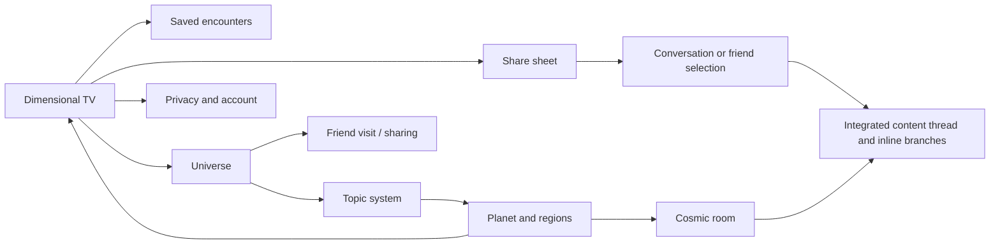

Recommend three persistent top-level destinations on small screens: Explore, Universe and Conversations. Saved items and account/privacy remain consistently reachable. Desktop can show a conversation or map beside an encounter without creating a second active playback session. Final navigation placement needs mockup review.

### Screen-by-screen contract

| Surface | Visible controls and content | States and backend connection |
|---|---|---|
| Entry/sign-in | Simple account access; no personality questionnaire | Loading, signed out, expired session, recovery. Guest browsing is optional scope, not an assumed persisted identity. |
| Dimensional TV / Reel | Full encounter, title/captions, play/pause, Like, Save, Share, format switch, Continue, next-subject control | Loading, playing, paused, buffering, ended, unavailable, offline. Record visibility separately from prefetch. |
| Scroll reader | Readable article, approved interactive blocks, same core actions, clear continuation and format control | Preserve anchor and interactive state; incomplete download and render fallback; no accidental departure at end-of-scroll momentum. |
| Ask/change topic | Optional text/voice input only if implemented; explicit topic and format intent | Command accepted, ready, pending, unavailable; no mandatory follow-up quiz. Voice is optional and outside initial dependency requirements. |
| Horizontal thread | Current item, back to visited steps, available next move, real series position | Ready continuation, requested missing part, exhausted thread, corrected prior content. Preserve each visited anchor. |
| Format switch | Reel/Scroll with equal status | Existing sibling opens promptly; missing sibling becomes a demand. Do not silently choose unrelated content. |
| Supply status | Quiet progress attached to the request | Requested, preparing, ready, unavailable, cancelled. Avoid invented percentages or generation completion times. |
| Saved encounters | Content cards and resume/open action | Empty, loading, unavailable/corrected items. A saved-history restoration does not secretly fabricate fresh consumption. |
| Universe overview | Personal worlds, navigable systems, optional return focus | Empty environment, emerging objects, stable map, stale scene refresh, low-detail fallback. No topic scores or mastery levels. |
| System view | Organising star, related planets, routes and room stations | Forming, established, calm activity; pending scene chunk; hidden/private boundaries. |
| Planet interior | Regions and paths into actual encounters | Region selection, supported routes, return to map, reduced-detail option. Decorative surfaces do not imply additional evidence. |
| Formation transition | Dust/gathering/terrain reveal after an applied delta | Play once per transition ID where appropriate; skip/reduced-motion option; reconnect can show final state directly. |
| Share sheet / friend selection | Send to conversation, Explore with friends, Copy link/external share; search, recent contacts, checkboxes and Create thread | Visibility-controlled availability, selected count, invitation/commit state; no delivery inference from sheet-open. |
| Share landing | Public preview or private invitation | Unauthenticated, authorised, expired/revoked, withdrawn; no private metadata leakage. |
| Conversations list | Real conversations, last authorised message and chosen notification state | Empty/loading/offline; no fake human activity; clear AI attribution where relevant. |
| Conversation detail / content thread | Messages, root Reel/Scroll, horizontal episode strip, collapsible player, snippets and inline What-if/perspective cards | Sending/sent/failed, exact return, own seen/current markers, ready versus preparing, membership loss and withdrawn references. |
| Explore invitation | Root content and participation scope | Pending, accepted, declined, revoked. Joining does not merge personal universes. |
| Scenario input | Optional what-if request and current assumptions | Draft, sent, clarification-needed, unavailable. Explicitly entered activity can ask for missing assumptions. |
| Branch choices | A few concrete alternatives and what changes | Suggested, chosen, generating, ready, failed. A complete text request can directly choose the move. |
| Shared sequence player | Actual Reel/Scroll inside the integrated thread or full-screen with exact return; snippet range and branch context | Caller-only episode/playback state; no peer position broadcast, forced navigation or simultaneous second player. |
| Branch history | Root, ancestry, changed assumptions and sibling paths | Lazy-load large graphs; clear current branch; no implication every suggested node has generated content. |
| Cosmic room | Human discussion, scoped content threads with the same snippet/What-if controls, separate moderator and labelled AI inhabitants | Membership, isolated simultaneous discussion branches, send/retry, moderation/report and bounded optional activities. |
| Friend visit | Only deliberately shared worlds and routes | Revoked/private/expired state; permission-filtered descriptors and content. |
| Privacy/account | Recording, history/export, reset/delete, sharing visibility, sessions | Explicit scopes and retryable receipts; failure never reports deletion complete prematurely. |
| Content feedback | Hide/not interested, report error, report abuse | Scoped effect and acknowledgement; no demand that the user justify a preference. |

### Gesture arbitration

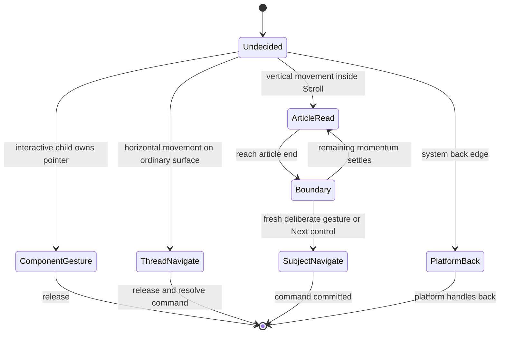

Lock the axis once a gesture is claimed. Preserve the interactive child's ownership through release. Provide keyboard and assistive equivalents for every swipe action. Horizontal navigation inside a chart must not steal a slider drag. Vertical reading must not emit a next-subject command. Test both landscape and portrait, platform back edges, larger text and interrupted gestures on real devices.

### Scroll rendering contract

An article document contains immutable block IDs, versioned block types, semantic content and bounded parameters. The renderer maps block type to an implemented component registry. All blocks expose accessibility text and declare whether they capture gestures. Persist state by article revision + block ID; a new revision can require an explicit compatible state migration.

No arbitrary model HTML/JavaScript execution. Rich visual feel comes from excellent templates, illustration/media and a growing approved component library. Invalid blocks get a safe readable fallback and an internal diagnostic. Do not silently remove a central argument or show a blank interactive area as if rendering succeeded.

### Client state ownership

| State | Owner |
|---|---|
| Authoritative saved status, memberships, demand status, worlds | Server; client caches keyed by account/scope/revision. |
| Scroll anchor, paused playback position, gesture ownership | Client session state, synchronised only when deliberately needed. |
| Pending command queue | Client with stable request IDs and bounded retention. |
| Telemetry summaries | Client accumulator until acknowledged; no raw pointer/frame logging by default. |
| Scenario graph | Server; client renders a permitted version and maintains its own position. |
| Permanent topic scores or planet eligibility | Server only; never calculated independently by the UI. |

An `AccountScope` provider keyed by `(accountId, privacyEpoch)` owns the QueryClient, socket, recorder and local stores. On logout, account switch or reset: stop old subscriptions, cancel/fence in-flight callbacks, purge old scoped storage, then mount the new scope. Purge tests include a late successful HTTP response so old data cannot repopulate a new account's cache.

URLs contain stable identity: asset revision, content anchor, thread/node IDs. Local resume records contain scroll/playhead positions. Do not persist the entire navigator state. API-rendered `/s/:token` previews expose only the permitted title/image and link, with private/revoked cases handled explicitly.

TanStack Query owns fetching/caching server state; reset and scope its caches on account/privacy changes. Gesture Handler/Reanimated platform adapters decide gesture ownership on the UI thread; reducers and selectively XState observe/commit semantic reader transitions, not animation frames. One Expo app shares components and behaviour; `.web.tsx` / `.native.tsx` implementations handle necessary platform differences. [TanStack Query overview](https://tanstack.com/query/latest/docs/framework/react/overview)

### Platform plan

The owner selected one Expo application, with React Native on Android/iOS and React Native Web in the browser. Share screens, components, design tokens, content schemas, interaction recording and scene descriptors. Use Expo Router for universal navigation/deep links, with explicit platform files for reader, media, sharing and canvas differences. There is no initial separate Next.js or Vite product app. Expo supports universal web development; this is a capability, not proof of KnowScroll parity. [Expo web](https://docs.expo.dev/workflow/web/)

Keep a per-interaction parity matrix for Scroll reading boundaries, diagram dragging, horizontal continuation, vertical exit, keyboard/back behaviour, text selection and playback. Do not assume React Native Web emits the same momentum events as native ScrollView. Web end-of-article handling uses its own verified boundary detector and an explicit accessible navigation fallback.

Build each core journey for web and native together. The browser may accelerate design iteration, but it is not acceptance of native playback, nested gestures, back navigation or memory usage. Evaluate expo-video with the chosen Expo version. [expo-video](https://docs.expo.dev/versions/latest/sdk/video/)

Decide 2D/canvas versus 3D after the agentic design study. Keep actual world identity, formation and interaction semantics independent of rendering technology. A 2D presentation may express depth through layers, lighting, texture and camera movement. Keep article text and ordinary controls in accessible UI components rather than drawing all UI into a canvas. Skia and Three.js/R3F are optional candidates, not mandatory dependencies. Both scene styles need a navigable reduced-motion/low-detail fallback.

### Shared interaction recorder

Put the recorder in `packages/client-core`, with web/native lifecycle and durable-buffer adapters. Components call typed methods rather than scattering ad-hoc analytics calls. Record the meaningful completed action and observations separately from gesture animation.

| Source | Record | Do not mistake for |
|---|---|---|
| Reel player | Unique media intervals, active visible time, pause/buffer/background changes | Prefetch, automatic looping or background time as fresh consumption |
| Scroll reader | Stable block IDs, weighted section coverage, active dwell, deliberate block interaction | Scrolling past a heading as understanding |
| Navigation | Committed vertical/horizontal move and actual origin/target | An interrupted swipe or slider drag |
| Share/thread UI | Sheet opened/cancelled, copied link, confirmed send, thread/episode selection and snippet open as distinct events | External intent as delivery; selecting/viewing a card as qualified content consumption |
| Scenario UI | Selected assumption/branch command and each participant's own encounter | Another member's activity as this user's exploration |
| Universe | Open/select/return and optional rendering diagnostics | Decorative movement or a map visit as qualified content evidence |

Envelope: schemaVersion, eventId, exposureId/encounterId when applicable, contentRevisionId, device-local sequence, client occurrence time, monotonic duration and typed payload. The server supplies/checks authenticated ownership, receive time, epoch and lineage. Client timestamps or trace headers never establish authority.

The web observation buffer is explicitly lossy across eviction/crash/unload; absence is unknown, never inferred consumption. Native persistence has its own tested guarantees. The recorder aggregates callbacks locally, stores bounded batches, retries with the same event IDs, and removes them after durable intake acknowledgement. Batch count/byte limits and flush intervals are versioned settings; flush on encounter transition and best-effort backgrounding, while periodically persisting so correctness never depends on an unload callback. Missing intervals remain unknown. Account switch, sign-out and privacy reset purge/fence scoped buffers. Never silently evict a pending durable command from the observation buffer: commands have their own receipts/retry state.

Commands such as Save/send/choose-branch use prompt authenticated HTTP requests; their committed server events are authoritative. An optional UI tap observation must not double-count the action. The normaliser deduplicates and creates evidence revisions before personal loops consume them. SQL intake acknowledgement means stored, not fully projected. General diagnostics and domain evidence use separate channels and retention; no blanket text/keystroke/pointer capture.

### What the UI team must deliver

For each surface: ready, empty, loading, pending, offline, denied/revoked, corrected/unavailable and error/retry states where applicable; focus/keyboard/accessibility behaviour; narrow and wide layout; emitted semantic actions; observation definitions; return/restore behaviour; and actual backend contract references. A polished static screen is not completion of a user journey.

The visual language should communicate topic family and personal variation consistently. Avoid numbers that invite people to compare how much they have consumed. Natural stopping boundaries, saved return paths and calm absence states are part of the design, not optional refinements.

## 19. Events, consistency and privacy

### Commands and observations have different acknowledgement boundaries

A Save, message send, branch request or content request needs a durable command outcome. Commit its state and receipt together. Enqueue required work with pg-boss in that transaction; emit only disposable NOTIFY live hints. An observation can be batched into durable intake and projected later; acknowledgement says it was accepted, not that every derived view has caught up.

With Kafka, partition by a privacy-scoped opaque owner handle. Partition order is append order, not universal client-time order. Deduplicate in the database transaction that writes the effect, then acknowledge the broker. Kafka transactions alone do not make an external database write atomic with a consumer offset. [Kafka design, version 4.1 reference](https://kafka.apache.org/41/design/design/)

Never dual-write a command to a database and broker with no recovery boundary. For SQL-first intake, persist intake + pg-boss projection work transactionally. For Kafka-first intake, wait for the configured durable acknowledgement and make evidence consumers idempotent. A broker outage can leave observations queued while normal database commands still work.

### Late events and partial state

Include event ID, device sequence, event/receive times, exposure lineage and policy version. Merge intervals and correct the affected evidence revision. Do not let an old offline topic request overwrite a newer session intent. Composer may use a bounded provisional observation tail for immediate response, excluding already-projected IDs; that provisional tail never forms planets.

Return separate revisions/watermarks for personal context, geography and scenes. A scene may lag a committed planet briefly. The client shows the last valid scene and catches up; it does not create a duplicate object because a notice arrived twice.

### Authority and locking

Build one `withPersonalScope` helper. It begins a transaction, locks the universe row with `FOR NO KEY UPDATE`, rechecks current status/epoch and caller authority after waiting, and gives the callback a branded `PersonalScopeTx`. Personal-write ports require this capability. The brand is a compile-time aid; the actual row lock and runtime checks establish authority.

Lock order is personal root → session/domain/run rows → at most one shared root → canonical subordinate rows. Do not acquire another person's root from inside the callback. Multi-person delivery uses one transaction per recipient, with fresh access checks. A shared-only maintenance operation has its own declared shared-root protocol and must not later acquire personal roots. The shared-root helper is available only after the personal root for person-initiated mutations. Define membership-revocation operations under the same ordering.

For operations requiring several shared roots, split the workflow into explicit durable steps with revision checks instead of inventing a new lock order. No network call or queue-consumer transaction may span these domain locks. Nest guards are an early filter, not the final authority check.

Runtime transaction markers detect nested transaction entry and guard our model/research/media/provider network adapters. This does not magically intercept arbitrary Node network I/O: import restrictions ban bypass clients in use cases and tests exercise the guard. Always pass the transaction explicitly; no implicit CLS transaction.

### Command receipts and concurrent retries

The personal receipt identity is `(universe_id, command_id)`; shared commands additionally bind actor, destination scope and operation in a canonical request fingerprint, or use an equivalent explicitly scoped key. The API derives owner/actor from authentication. Hash the validated canonical request, including relevant revisions; raw JSON property order must not make identical commands different.

Inside the protected transaction:

1. Lock the personal root and any declared shared root in the required order; recheck authority.
2. Look up the command key. An authorised identical replay returns its stored outcome. Different content under the same key returns stable `COMMAND_KEY_REUSED` problem details, mapped to 422.
3. Insert the new receipt before domain effects, then write changes and any required pg-boss job.
4. Store the outcome and commit everything together. A failure before commit rolls back all of it.

Concurrent conflicting inserts can wait for the original transaction to finish; PostgreSQL's uniqueness checks account for uncommitted conflicting rows. A bounded lock timeout can return a retryable busy response, but it is not evidence of a durable in-flight lease. Do not add a second command-lease subsystem for these short atomic operations. [PostgreSQL uniqueness checks](https://www.postgresql.org/docs/current/index-unique-checks.html)

Asynchronous commands commit a **pending/accepted** receipt with the stable branch/demand ID. That receipt remains the original command result; reading the branch/demand returns its evolving status. Business-run fences and queue leases govern background execution separately. Replays after lost access must not disclose old private results. Privacy-operation replay has its own minimal receipt/epoch contract, preserving the protections described in ADR-0010 without importing the old runtime schema.

### Durable work and disposable notices

`boss.send(..., { db: fromKysely(tx) })` is the selected transaction integration. Hide this infrastructure call behind a small job port that requires the current transaction capability. The adapter uses the same underlying Kysely transaction, never a fresh connection. A rollback removes both the business effect and its new work. [pg-boss transaction adapters](https://pgboss.io/api/adapters)

No generic work-outbox table is added. Domain evidence and decision history still exist because they answer product questions; they are not duplicate transport queues. Each consumer records its applied identity/revision with its effects so redelivery is harmless. Job payloads contain a version and necessary IDs, not prompts or chat bodies. Each queue explicitly declares concurrency, timeout/expiry, retry/backoff, retention and dead-job handling.

Use non-transactional pg-boss consumers for domain jobs: the handler opens our short transactions as needed. Every paid execution consults its attempt ledger, regardless of `retryLimit`. A retry setting cannot prove exactly-once remote execution. Queue retention is not the audit/history retention policy.

The NOTIFY relay and client catch-up protocol are in section 4. pg-boss guarantees recoverable work through its persisted queue; NOTIFY only accelerates discovery of already committed state. Keep this distinction in diagrams, names and tests.

### Privacy controls for the new product

| Control | Proposed scope to explain in UI |
|---|---|
| Pause personal recording | Stop new durable personal encounter evidence and derived personal growth. Explicit requested commands still need their own necessary records; disclose that distinction. |
| Remove an encounter / correct a record | Remove/retract its contribution where supported; revise affected projections and objects rather than silently retaining derived interest. |
| Clear exploration history | Recommended default: erase encounter observations/evidence, personal interest projections, geography and personal role memory; preserve account, explicitly saved items and conversation membership. State these effects before confirmation. |
| Reset personal universe | Use the same clear-exploration operation above in the initial UI; avoid a second control whose surviving evidence immediately rebuilds the supposedly reset map. |
| Revoke share / leave exploration | Remove future access or participation according to scope; do not claim recall of external copies. |
| Account deletion | Remove account-owned data and personal links according to a complete lifecycle policy; handle shared messages and shared content explicitly. |
| Export | Permission-scoped portable data without other participants' private information or provider secrets. |

These new scopes are proposed defaults for review before implementation; do not inherit an old control name with an expanded hidden meaning. Preserved Save records remain explicit saved-item references and must not regenerate erased interest or geography. A subsequent fresh encounter can contribute new evidence under the new epoch.

For account deletion, the recommended initial shared-data policy is: remove account identity and private bindings; remove authored private message bodies/attachments and leave a minimal unavailable-message marker where continuity requires it; revoke private shares; invalidate scenario nodes and dependent content that contain the deleted private material until a scoped revalidation establishes what can remain; retain independently sourced public canonical content with no personal commissioning attribution. Other people's independent messages and evidence remain theirs. Do not silently delete an entire shared conversation or retain deleted private text inside a generated summary. Backups and external-provider copies follow their explicitly disclosed deletion lifecycle; successful completion must describe which stores have actually been cleared. These choices need product review because collaborative ownership has consequences beyond the personal map.

Epoch changes prevent stale results from applying but do not erase data. Erasure covers observations, evidence, projections, demand bindings, role memory, private context artifacts, caches and other scoped copies. A retained transcript or embedding can still contain personal information. Backups, external-provider retention and key recovery must be accounted for explicitly; do not promise instant physical erasure beyond what the selected system can deliver.

Kafka-first intake is conditional on an acceptable per-person erasure design, potentially scoped payload encryption with key lifecycle controls and short retention. That design must consider cached keys, recoverable backups, metadata and dead-letter storage; a tombstone or an epoch fence alone is insufficient. If those requirements cannot be satisfied, use SQL intake and payload-free broker notices.

### Authentication and content access

Use an established identity integration rather than inventing a password system. Choose the provider at implementation planning. Web sessions should use appropriate secure cookie/session handling and CSRF protection for cookie-authenticated mutations; native sign-in should use an appropriate authorisation flow with PKCE and platform secure storage. Apply current OAuth guidance to the selected integration. [OAuth security best current practice](https://www.rfc-editor.org/rfc/rfc9700.html)

Authorise content and conversation access on every relevant request, not just when a link was created. Private media URLs should be short-lived and scoped. A cached image, title, manifest count or link target can leak a hidden object, so visitor and share projections must be built server-side with the correct visibility scope.

### Retention and replay

Choose explicit retention for raw observations, command receipts, evidence, model diagnostics and private objects. Short-lived observations can be compacted into retained evidence, but then exact raw-event reconstruction is no longer available. A checkpoint cannot preserve data the user asked to erase.

Historical reconstruction answers what happened. Derived-state rebuild recomputes from surviving evidence under a defined policy. Counterfactual evaluation estimates another policy under assumptions and needs exposure/randomisation information. These are separate capabilities; none reveals certain responses to unseen content.

## 20. Capacity, performance and cost

Use workload assumptions instead of selecting Kafka or GPUs by intuition. An illustrative starting workload is 1,000 daily users, 30 minutes each and six aggregated observation records per minute: 180,000/day, about 2.1/second on average. A 50-times burst is about 104/second. At 1 KB each, raw payload is about 180 MB/day before indexes, replicas, backups and media. This is an estimate, not a load test or a fixed instrumentation cadence.

Batch on encounter changes and a bounded periodic cadence rather than every frame. Keep queues bounded; offline overflow has an explicit discard/summary policy and does not fabricate missing events. Media/research traffic can dominate telemetry by orders of magnitude and needs separate budgets.

Provisional objectives: deterministic ready-content navigation p95 under 250 ms server time; fast-model assessment subject to a bounded deadline; ordinary evidence projection within seconds; planning/cartography typically within tens of seconds; generation returns a pending receipt promptly while content takes longer. All require measurement. Failed optional model assessment must not leave the feed waiting indefinitely.

No self-hosted recommender or GPU is required for v0. Topic arithmetic and ranking run on CPU. Use hosted embeddings/models initially or evaluate a small CPU embedding model separately. A candidate prototype budget is one modest API/worker host and a separately provisioned database, but exact vCPU/RAM sizing depends on concurrency, corpus, renderer assets and provider latency. Do not treat that as production capacity proof.

Calculate provider cost from real usage:

\[
Cost_{day}=\sum_r Runs_r\,(InputTokens_r\,PriceIn_r+OutputTokens_r\,PriceOut_r)+MediaCost+ResearchCost
\]

**Plain explanation:** budgets must cover how often roles run, not only how cheap one call is. Coalesce evidence, reuse canonical supply, cache public content features and generate selected branches. Keep user, role, provider and global cost ceilings; reserve before dispatch and reconcile actual usage after it.

Operational measurements: ready-navigation latency, candidate count, SQL query count/rows, observation and projection lag, duplicate/conflict rate, model attempt state, rejected/stale proposal rate, supply reuse rate, generation success/quality, queue age and cost. Product measurements: voluntary continuation/return, explicit rejection, content usefulness and whether people recognise their exploration in the map. No compulsory learning tests are introduced.

## 21. Failure cases and evaluation

| Scenario | Required result |
|---|---|
| Phone retries a playback batch | One evidence effect; same IDs do not add weight again. |
| Save/message/branch command response is lost | Retry same request returns its existing result. |
| A user requests football during an ML planning run | Current request serves football; old plan cannot override explicit intent. |
| A Reel/Scroll pair expresses one unit | Two encounter records, one distinct unit for conceptual variety. |
| User reads without pressing buttons | Qualified evidence can meet formation rules. |
| Model invents an exposure or unsupported ID | Reject proposal; do not create the missing fact. |
| Model returns beautiful but unsupported grouping | Fail evidence checks or semantic review; preserve the last valid map. |
| Provider timeout after dispatch | Mark unknown and reconcile; do not blindly repeat the charge. |
| Shared job finishes after one user cancels | Other valid waiters can receive it; cancelled user does not get a forced result. |
| Scenario participant revokes membership | Fresh reads/tools/delivery fail appropriately; no private context leak. |
| New article revision changes block IDs | Preserve only compatible reader state; show correct content revision. |
| GPU rendering fails | Same semantic destinations remain navigable through fallback. |
| Pause/reset happens during model execution | Old work cannot apply; scoped retained data is handled by the privacy contract. |
| Generated scenario looks factual | Conditional assumptions and truth status remain attached through rendering and future retrieval. |

Later implementation verification should include pure rule cases, disposable real-database concurrency tests, provider adapter contract checks, browser journeys and physical-device gestures/media tests. Label fixtures clearly. A fake provider can prove wiring but not real generation, content quality or provider accounting. Review representative content and universe changes with people; automated schema checks cannot decide whether a Scroll is engaging.

Track numerical policies as experiments. Compare three versus five-unit formation, qualification sensitivity, format response estimates, exploration proportion and visual readability. Avoid optimising for planet count: that would reward the system for producing its own apparent success.

## 22. Code organisation for the new repository

This is the selected **future layout**, not a description of installed files. Retain the larger directory-organised monorepo. Package boundaries represent things we share or build separately; backend module folders represent business ownership. Do not collapse this into three packages or flatten all feature files.

```text
knowscroll/
  apps/
    api/src/
      main.ts                     Start Nest HTTP application
      app.module.ts               API composition root
      modules/                    Explicit feature wiring for this app
      http/                       Contract controllers, auth, problem mapping
      realtime/                   Socket.IO gateway and LISTEN lifecycle
      routes.ts                   Explicit route index
    worker/src/
      main.ts                     Start Nest application context
      worker.module.ts            Worker composition root
      jobs.ts                     Explicit queue/consumer registry
      lifecycle/                  Stop claims, drain, close resources
    client/
      app/                        Expo Router routes and deep links
      features/                   Encounter, universe, social, account
      providers/account-scope.tsx Account/epoch resource ownership
      platform/                   Web/native gesture, player, storage adapters

  packages/
    contracts/src/                JSON-native wire schemas only
      experience.ts               Requests/responses and public IDs
      interactions.ts             InteractionEnvelope and intake response
      sharing.ts                  Thread views and anchored snippets
      scenarios.ts                Public branch commands/views
      rooms.ts
      socket.ts                   Subscription and revision hints
      problems.ts                 Stable public problem-code catalogue
      content.ts                  Public assets; re-export ScrollDocument
      scene.ts                    Re-export SceneManifest
    backend/src/
      modules/
        identity/
        experience/
        evidence/
        personal-context/
        composer/
        planning/                 Personal Planner role lives here
        supply/                   Quartermaster and private demand bindings
        content/                  Inventory, writer and production initially
        geography/                Cartographer role lives here
        scenes/
        social/
        scenarios/                Scenario Planner role lives here
        rooms/                    Moderator and inhabitant roles
      reasoning/                  Shared execution engine, no role ownership
        application/              Admission, attempts, parsing coordination
        domain/                   Attempt/run invariants and outcomes
        adapters/                 ModelPort implementations
      infrastructure/
        postgres/                 Pools and guarded transaction facility
        jobs/                     pg-boss adapter and configuration
        notices/                  Transactional NOTIFY adapter
        media-store/              VPS adapter; S3 later
        observability/            Typed events, Pino, OTel, sanitisation
        erasure/                  Explicit registry and store inventory
    client-core/                  Typed clients, recorder core, scoped buffers
    ui/                           Accessible shared UI primitives
    scroll-model/                 Canonical declarative document schema
    scene-core/                   Canonical scene schema and seeded math
    design-tokens/                Colour, typography, spacing and motion

  migrations/                     Static registry; reviewed SQL by owner
  ops/observability/              Tier 0 dashboards and journal limits
  scripts/                        Journey inspector and verification commands
  tests/integration/              Real PostgreSQL, races and failpoints
  tests/journeys/                 Web/native integrated journeys
  docs/                           Decisions, module maps and operation guides
```

Add files as an authorised journey needs them; the diagram is not a request to generate empty scaffolding. A separate `production` module remains a possible later extraction if content's responsibilities become too large. Initially writer/production ownership is explicitly in `content`, so no implementation session has to guess.

### Onion architecture inside a feature

```text
modules/geography/
  README.md                       Owned tables, operations, jobs and erasure
  public.ts                       Small framework-free cross-module surface
  events.ts                       Internal events and job schemas
  domain/
    model.ts                      Geography types and invariants
    formation-policy.ts           Pure threshold/variety rules
    validate-proposal.ts           Pure evidence and proposal checks
  application/
    ports.ts                      Named storage/model/job capabilities
    request-cartography.ts        Admit/coalesce a business run
    run-cartography.ts            Prepare context; invoke shared harness
    apply-cartography-proposal.ts Recheck authority and commit allowed delta
    queries.ts                    Bounded read use cases
    roles/cartographer/
      instructions.ts             Versioned role instructions
      build-context.ts            Bounded context through explicit read ports
      output-schema.ts            Backend-local model output schema
  adapters/
    postgres-store.ts             Implements geography-owned storage ports
    nest-providers.ts             Reusable outer wiring, token bindings
  formation-policy.test.ts        Consequential pure-rule checks
```

The role's validator is the domain function; its applier is the application use case. The role configuration connects these existing functions rather than copying their rules. Planner and Scenario Planner use the same pattern in their own modules.

A port is simply a small typed capability that the operation needs. For example, `loadFormationEvidence`, `saveFormationDecision` and `enqueueSceneProjection`. The application receives these functions; the PostgreSQL adapter implements their SQL. Application code does not import its own Kysely adapter directly. This resolves the review's open choice in favour of the accepted onion boundary without introducing a generic repository hierarchy.

### Dependency and composition diagram

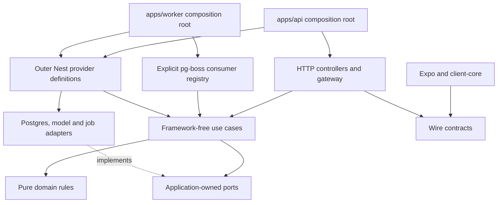

Arrows show imports/construction; a port is not an extra network hop. Nest creates the objects once, then a use case calls an ordinary function. Only app composition roots may import a module's explicitly published outer wiring entry. Ordinary cross-module calls use `public.ts`, never another module's adapters. Reusable provider declarations are allowed in backend adapters, but there is no shared backend composition root that starts both applications.

Enforce with dependency-cruiser:

- `domain/` imports domain code, permitted public ID types and Zod only; no infrastructure.
- `application/` imports its domain, local ports, local role definitions and approved framework-free public operations. No `@nestjs/*`, Kysely, provider SDK or app imports.
- Adapters implement ports; only composition roots select concrete implementations.
- Clients never import `backend`; apps never import each other; cross-module cycles fail CI.
- No generic `shared`, `utils`, `lib` or `common` package. Name reusable facilities by their actual purpose.

Keep each module README short: owned tables, public use cases/queries, jobs/notices, lock order, invariants, erasure and one worked operation. Maintain a small explicit export/operation manifest so CI can check README entries against `public.ts` without guessing prose. Use one verb/noun stem across the contract, handler, operation, job and test where they represent the same action. Do not make one name cover different actions just for consistency.

### An example of Nest wiring without Nest in the core

```ts
// Documentation sketch only; these identifiers are not implemented.
// application/request-cartography.ts — no Nest imports
export function makeRequestCartography(deps: CartographyPorts) {
  return async function requestCartography(input: CartographyCommand) {
    return deps.withPersonalScope(input.authority, async (tx) => {
      return admitCartographyCommand(tx, input, deps);
    });
  };
}

// adapters/nest-providers.ts — framework boundary
export const requestCartographyProvider = {
  provide: REQUEST_CARTOGRAPHY,
  inject: [CARTOGRAPHY_PORTS],
  useFactory: (ports: CartographyPorts) => makeRequestCartography(ports),
};
```

A controller injects `REQUEST_CARTOGRAPHY` by token, validates the request and calls it. A worker injects the appropriate background operation through the same style of wiring. Tests can call the factory with focused dependencies without starting Nest; an integration test separately proves the real Nest bindings/build.

### Content-thread implementation boundary

Expo's social feature composes `ContentThreadView`, `EpisodeNavigator`, `SnippetCard`, `ExplorationCard` and the shared encounter player. Conversation and room parents reuse these components with different authorised scopes. There is one recorder/player implementation per platform, not a second social playback engine.

Backend operations include `createContentThread`, `sendSnippet`, `chooseExplorationMove` and `readThreadView`. Social owns conversations/messages; scenarios owns branch semantics; content owns admitted assets; geography owns private worlds. A prepared thread view combines bounded public queries, not cross-module SQL hidden in a controller. One UI surface does not imply one giant database aggregate or service class.

## 23. How we will write the code

### Pattern 1: pure rules with explicit inputs

The heart of an algorithm is a function of data and policy:

```ts
// Architectural signatures; not implemented code.
declare function qualifyEncounter(
  observations: readonly NormalizedObservation[],
  asset: AssetMeasurementMetadata,
  policy: QualificationPolicy,
): EncounterQualification;

declare function rankCandidates(
  context: ExperienceContext,
  candidates: readonly EligibleCandidate[],
  policy: ComposerPolicy,
): CompositionDecision;

declare function evaluateFormation(
  current: GeographySnapshot,
  evidence: readonly QualifiedUnitEvidence[],
  proposal: CartographyProposal,
  policy: FormationPolicy,
): FormationDecision;
```

These functions have no hidden database reads, model calls, wall-clock access or global randomness. Pass the clock/seed where needed. Given the same relevant inputs and policy, they produce the same result. That makes algorithm changes inspectable and repeatable without pretending an LLM itself is deterministic.

### Pattern 2: explicit use cases around those rules

A use case performs one meaningful action, such as `requestFormatVariant`, `sendContentShare`, `chooseScenarioBranch` or `applyCartographyProposal`. It accepts authenticated scope, a typed command and named dependencies. It returns a typed outcome. HTTP and job adapters translate transport details at the boundary.

```ts
// Illustrative control flow only. The called functions are not implemented here.
async function runCartographyJob(jobId: JobId) {
  const admitted = await admitCartographyRun(jobId);
  const proposal = await harness.propose({
    role: "cartographer",
    context: admitted.context,
    limits: admitted.limits,
  });
  return applyCartographyProposal({
    admission: admitted,
    proposal,
  });
}
```

Admission discovers the job without locking its row first, acquires the personal scope lock, rechecks authority, then leases/reserves the relevant domain work. The harness runs after that transaction ends. Application reacquires the scope lock and rechecks authority, fence, evidence and revisions. Never infer that the first check remains valid after a network call.

Do not have the harness directly update planet rows. Its proposal is input to a use case. Do not have a database function secretly call an LLM; transaction and network boundaries must be visible to a reviewer.

### Pattern 3: typed outcomes instead of ambiguous booleans

```ts
// Proposed contract shapes; runtime schemas must validate external data.
type ContentRequestResult =
  | { kind: "ready"; asset: AssetRef; receiptId: ReceiptId }
  | { kind: "pending"; demandId: DemandId; receiptId: ReceiptId }
  | { kind: "unavailable"; reason: UnavailableReason; receiptId: ReceiptId };

type ProposalApplication =
  | { kind: "applied"; deltaId: DeltaId; structureRevision: number }
  | { kind: "rejected"; reasons: readonly ProposalRejection[] }
  | { kind: "stale"; requiredRevision: number };
```

One boundary maps expected outcomes to HTTP statuses and RFC 9457 problem details with stable codes. Use the same safe reason-code catalogue in diagnostics. Map named database constraints centrally to known refusals; unknown exceptions become sanitised 5xx errors and are logged once at the owning boundary, with deduplication across adapters. Do not expose raw database/provider messages. A 5xx logging requirement is a tested handling rule, not a claim that a process crash can always flush a log.

The caller handles each outcome explicitly. Avoid combinations such as `ready: true`, `asset: null`, `stillGenerating: true`. Expected business outcomes use typed results; unexpected programmer/infrastructure faults use the error boundary and structured diagnostics.

Use opaque/branded IDs where they prevent mixing an asset ID with an exposure or conversation ID. Prefer specific names over generic `data`, `manager` and `process`. Keep nullable fields meaningful; absence, unknown and explicitly removed are different states when the product needs to distinguish them.

### Pattern 4: schema-first boundaries

Define canonical request/response/event schemas once and derive TypeScript types. Keep public schemas JSON-native and transform parsed data explicitly in adapters; internal job/model schemas remain module-local. Validate model outputs, requests, broker inputs, persisted JSON payload versions and renderer inputs at the appropriate boundary. Zod supports TypeScript-first validation and type inference; its schema facilities are a suitable starting point. [Zod](https://zod.dev/)

TypeScript types alone do not validate network data. Schema validity alone does not establish authority or semantic truth. Keep those checks separate so error handling can identify malformed input, denied access, stale state and unsupported content correctly.

Use strict compiler settings, avoid unexplained `any` and unsafe type assertions, and keep side effects out of module imports. Define configuration once at process startup and validate it. Environment values and credentials never enter client bundles or logs.

### Pattern 5: prepared views and explicit query functions

A query should say what the caller needs, not expose the whole database. Examples: `loadExperienceContext`, `findEligibleContinuations`, `loadCartographyInputs`, `findCompatibleSupply`, `readScenarioBranchForMember`.

```ts
// Query shape illustration; call only with a currently authorised scope.
const context = await db
  .selectFrom("personal_context.context_view")
  .select(["revision", "payload", "built_at"])
  .where("universe_id", "=", scope.universeId)
  .where("privacy_epoch", "=", scope.privacyEpoch)
  .executeTakeFirst();
```

Selecting a context view should not secretly trigger traversal of every past encounter. Apply size limits and explicit pagination. Do not hide SQL behind a generic repository whose callers request arbitrary relations; that merely moves complexity away from where it can be reviewed.

Each migration proposal lists: owner, authoritative/derived role, main query shapes, indexes/constraints, expected growth, retention, correction and erasure, and how older clients/workers behave during rollout. Use foreign keys/uniqueness where they enforce real invariants. A JSON blob should still have a schema version and size bound.

### Pattern 6: transactional pg-boss work and idempotent consumers

Commit state, receipt and required pg-boss work together using the current transaction. On redelivery, the consumer checks its durable applied revision and records any new effect in the same transaction as advancing that revision. No generic outbox table or in-memory event emitter substitutes for required work.

NOTIFY and Socket.IO accelerate UI refresh; they do not carry the only copy of a message or branch result. A missed notice is recovered by cursor/revision catch-up. External calls use the separate attempt protocol in section 15. Queue delivery, business run and paid attempt must never become one overloaded `status` field.

### Pattern 7: explicit policies and proposal history

Version qualification, action weights, decay, formation thresholds, candidate limits, exploration and visual generators. Store the versions used by decisions. A new policy may improve future routing without silently rewriting historical explanation of an old decision. Derived-state rebuilds must name the chosen policy and surviving evidence.

Store concise proposal inputs/outputs and validation outcomes within retention. Do not store hidden chain-of-thought as a requirement. Useful traceability is “this proposed region used these evidence IDs under this policy,” not an unrestricted private narrative about the person.

### Pattern 8: small replaceable adapters

Use adapters at actual external seams: database, observation transport, job delivery, model provider, research provider, media storage, Cutroom and platform rendering. Keep domain contracts stable enough to replace Nest adapters or a model SDK without rewriting all algorithms.

Do not claim that changing PostgreSQL to MongoDB is free because both implement an interface. Transaction semantics, queries and indexes need a real redesign and verification. The adapter boundary contains that work; it does not eliminate it.

### Pattern 9: readable frontend state machines

Keep navigation, player/reader, telemetry and rendering responsibilities separate. The UI emits `continue_thread`, `next_subject`, `request_format`, `send_share` or `choose_branch`; it does not send raw gestures as domain meaning. A content-card component cannot create a permanent personal interest update on its own.

Use reducers/state machines where transitions matter, and ordinary component state where they do not. Avoid one global store containing every server record, every gesture and every animation frame. Per-frame animation state should not cause the entire application tree to rerender.

### Pattern 10: verification at the right boundary

Pure checks cover math and invariants. Real disposable database integration checks transactions, dedupe, locks and corrections. Harness adapter checks cover actual attempt accounting and cancellation. Browser/native journeys exercise gestures, playback, sharing, scenario state and real rendering. Content review checks whether generated explanations are supported and worth reading.

Do not write tests that merely reproduce an implementation formula without testing a useful property. Valuable properties include duplicate-invariance, bounded contribution, no formation from unviewed assets, no stale application after reset, correct variant deduplication and separate participant evidence. Use fixtures only where clearly labelled; require live-provider and device evidence for claims about those paths.

### Reuse established libraries at infrastructure boundaries

| Responsibility | Selected library/tool | What remains our code |
|---|---|---|
| Application framework | NestJS with Express adapter | Plain use cases, module ownership, scope authority |
| Contract integration | Zod and oRPC/@orpc/nest | Canonical wire schemas, one error pipeline, compatibility tests |
| Persistence | Kysely, kysely-codegen, squawk | Explicit SQL, constraints, migration registry and access patterns |
| Durable jobs | pg-boss | Queue registry, domain dedupe, admission and uncertain-attempt recovery |
| Live delivery | Socket.IO | Authorised subscriptions, revision hints, catch-up and revocation |
| Client data | TanStack Query | AccountScope, purge and optimistic-command rules |
| Gesture/animation | Gesture Handler and Reanimated | Platform boundary behaviour, semantic navigation and accessibility |
| Complex lifecycles | XState when justified | At most three initial machines; ordinary state remains reducers |
| Architecture checks | dependency-cruiser and knip | Explicit import graph and intentional public surface |
| Backend tests/evals | Vitest and fast-check | Useful properties, role fixtures and real database failure cases |
| RN component tests | jest-expo and React Native Testing Library | Expo-compatible runtime and behaviour assertions |
| Journey tests | Playwright, Maestro and physical-device checks | Real integrated playback, gestures, privacy and social flows |
| Wire simulations | MSW | Labelled fixtures only; not provider/device evidence |
| Diagnostics | Pino and in-process OpenTelemetry | Typed events, sanitisation, retention and useful span boundaries |

Keep one typed-lint engine with rules including no-floating-promises, no-misused-promises, await-thenable, consistent type imports and exhaustive outcome handling. Verify the selected engine actually enforces the equivalent rules. Compiler/lint upgrades happen through a tested compatibility matrix; do not force a TypeScript major merely because the report names it.

Backend and pure packages use Vitest. RN components use the Expo/Jest setup rather than trying to run them in the backend test environment. Database integration uses the actual production PostgreSQL major with an isolated template-derived database per test file. Include two-connection lock tests and crash failpoints. No test touches the owner's database or clears owner history.

Do not wrap entire library APIs in new names. A job port exposes the handful of operations the domain needs; it is not a second queue framework. Open-source reuse should remove infrastructure work while leaving product behaviour visible.

### Coding conventions to put in the fresh repository

- One domain responsibility per module/file; split when a file becomes difficult to understand, not to satisfy an arbitrary line count.
- Prefer functions and data over inheritance-heavy designs. Use classes for real lifecycle/stateful adapters when helpful.
- All important effects are awaited; no untracked background promise for a durable action.
- Inject clock, ID/seed generation and external boundaries where repeatability matters.
- Comments explain a non-obvious invariant or tradeoff; names and types explain routine operations.
- No provider credentials, personal payloads or raw prompts in general logs. Trace using scoped IDs and redacted outcome codes.
- Start with a few deployable processes. Split a service only for demonstrated scaling, ownership or failure-isolation needs.
- Keep architecture rules enforceable through imports, schemas and checks. Do not rely on a future LLM remembering a paragraph.

## 24. Implementation planning and future-session handoff

This blueprint is architecture and coding guidance. It does not approve an implementation plan, new repository creation, deployments, provider spend or data migration. The requested code layout and examples explain the style; they are not an instruction to start coding. The owner retired the Software Factory skill; further work follows direct requests rather than its approval gates.

### Candidate delivery order for later planning

| Journey | Why first / proof needed |
|---|---|
| Open actual starter Reel/Scroll → visible encounter → durable evidence | Establish a real end-to-end spine before adding intelligence. |
| Vertical/horizontal navigation → recorded Composer decision → stable return | Prove semantics, not just swipe animations. |
| Qualified passive evidence → one validated world → rendered scene | Prove a person who uses no buttons can grow a meaningful map. |
| Explicit format request → reuse or real production → admitted content | Prove Quartermaster and supply status, including uncertain provider outcomes. |
| Planner and Cartographer through the shared harness | Prove bounded context, proposals, admission and stale-result refusal. |
| Share → authorised content card → recipient encounter | Prove sharing is a real capability with separate evidence. |
| Shared what-if → branch → generated continuation → independent participant positions | Prove assumptions, permissions and supply connect across the whole journey. |
| Rooms, friend visits and richer procedural detail | Extend an already truthful product loop; do not fake social activity. |
| Native parity, device performance, privacy/export/deletion and operational readiness | Required delivery work, not implied by web or unit-test success. Privacy foundations are introduced with the first relevant data, not postponed until this final review. |

Each later slice needs an explicit scope, contracts, implementation locations, assertions, failure paths and observable acceptance. Do not build all storage first, then all APIs, then all UI. Prove one user-visible path, then extend it.

### Decision register

| Decision | Status |
|---|---|
| Fresh codebase, TypeScript-owned application code, no PIO | Explicit owner direction. |
| Fast intent / cautious lasting meaning; no compulsory learning UX | Agreed product direction. |
| Composer, personal Planner, global supply, personal Cartographer and shared harness | Agreed architectural direction; exact implementation pending. |
| Sharing/chat and collaborative what-if sequences | Requested product scope; detailed UI and privacy contracts need review. |
| NestJS + Express adapter; framework-free core | Explicitly selected by owner after coding review; API and worker have separate composition roots. |
| PostgreSQL/JSONB + Kysely + pg-boss | Selected; schema per module, raw-SQL Kysely migration registry, transactional queue enqueue. |
| Zod + oRPC/@orpc/nest | Selected preferred direction; one compatibility spike, OpenAPI-first fallback. |
| Command/queue/run/attempt separation | Selected with universe-first receipts, no automatic short-command lease, mandatory paid-attempt ledger. |
| Tier 0 observability | Selected: journald, durable decisions, allowlisted ops views, read-only Grafana and journey CLI; larger log/trace deployment deferred. |
| MongoDB alternative | Comparison retained as rationale; PostgreSQL selected, no second primary store. |
| Expo + React Native Web | Explicitly selected: one application for Android, iOS and browser, with shared UI and platform adapters. |
| pnpm, Socket.IO, focused open-source libraries | Selected direction; see sections 4 and 23. |
| VPS media first / S3 later | Owner preference adopted through a MediaStore port; migration still requires copying/verifying assets. |
| Onion organisation | Accepted: domain modules, application-owned ports, explicit wiring and infrastructure adapters. |
| Logging and debugging | Owner requirement accepted; section 26 specifies the design, operational defaults remain proposals. |
| 2D/canvas versus 3D | Deferred until visual design and platform evaluation; Three.js is optional. |
| Kafka-first observation intake | Conditional on measured need and accepted erasure semantics; SQL intake recommended initially. |
| Weights, half-lives, three/five-unit formation and star thresholds | Experimental parameters, not established optimal values. |
| Model transport and roles | Direct ModelPort initially; MiniMax subject to plan/data approval, optional conforming SDK; no model-driven tool loop in v1 or fine-tuning required. |
| Degree of free-form personal grouping by Cartographer | Open within the shared-ID/personal-grouping proposal. |
| Mockups, signatures, schemas and delivery sequencing | Design prompt prepared separately; no implementation claimed. Software Factory gates are retired. |

### Compatibility spike before a full implementation programme

When implementation is separately authorised, prove one connected path: HTTP branch command → transactional receipt/job → worker → admitted model boundary → validated result → committed revision → socket hint → catch-up read. Include the production Nest build, oRPC validation/problem response, a Vitest integration and a fixture-labelled worker adapter. This is an integration proof, not permission to claim generated content without an actual provider.

Then cover focused risks through the same journey where possible: scope-lock races; production-major test databases; offer-buffer latency; job rollback and relay restart; uncertain provider billing; Scroll gestures on devices; expo-video/recorder recovery; erasure registry; diagnostics secret canary and shutdown. A real MiniMax probe remains separately authorised and bounded. Do not spend weeks building disconnected scaffolds before checking the path a person uses.

### Remaining implementation choices

- Exact Node/TypeScript/Nest/oRPC/Expo/gesture/test versions and PostgreSQL major; tests must match production.
- Identity provider and web cookie/bearer strategy, with the corresponding CSRF/token protections.
- MiniMax product-use plan, provider data policy and real latency/quality/cost.
- Which optional resume positions are server-synchronised; initial position privacy remains caller-only.
- Shared-branch budget owner and precise deletion of shared authored material.
- Receipt retention, JSON/document bounds, diagnostic quotas and privacy completion SLA.
- Renderer and physical-device gesture/media acceptance.

Schema-per-module and Kysely raw-SQL migrations are now the initial defaults. Production starts under content; extract only for a demonstrated ownership need. None of these remaining details reopens the owner's choice of Nest, pnpm, PostgreSQL or the shared Expo application.

### Instructions for a future LLM session

Read this blueprint and its status before acting. State whether the task is architecture revision, program design or implementation. Do not assume an empty target repository has already been created. Inspect the authorised destination and preserve existing work/data. If implementation is authorised, pin dependencies, write narrow contracts and build the first approved vertical journey with visible evidence.

Use the new design rather than copying old package structure or treating old migration numbers as current. If a decision is missing, identify the smallest affected choice and propose it clearly. Record accepted changes in the new project's decision log. Never manufacture provider output, content provenance, social participation, world formation or runtime verification.

The existing codebase remains intact. Importing any old user data, content or keys would be a separate scoped decision with provenance, rights and privacy checks; a fresh implementation does not authorise erasing or silently migrating history.

## 25. Research basis and limits

Research was checked against primary documentation and original papers on 18 October 2026, with platform, realtime, Nest/oRPC, PostgreSQL notification and pg-boss integration sources refreshed on 19 October. The owner-supplied coding review informed this revision; source checks and architectural decisions are distinct from runtime verification. Source links appear next to the claims they support. Framework capabilities are documented facts; their suitability for KnowScroll is our design judgment. The algorithms, weights, UI, deployment shape and capacity examples are proposals.

| Source | What it informs | What it does not prove |
|---|---|---|
| Nest, oRPC and Express documentation | Application contexts, wiring and HTTP integration seams | Correct KnowScroll authority, production-build compatibility or endpoint performance. |
| MongoDB modelling/transactions/limits | Document design and atomicity options | That changing database eliminates domain complexity. |
| PostgreSQL JSON documentation | Hybrid relational/document storage | That one huge JSON row is efficient. |
| Kysely / pg-boss | Candidate TypeScript persistence and job tools | Exactly-once external provider effects. |
| Expo / expo-video / React Three Fiber | Candidate client/rendering facilities | Our scene's real-device frame rate or gesture quality. |
| Zod / TanStack Query | Contract validation and client server-state tools | Runtime authority or semantic correctness. |
| TypeSafe composite scoring | Criterion-based semantic assessment | Calibrated personal-interest probabilities or a complete recommender. |
| Counterfactual Watch Time / MMR | Duration bias and relevance/diversity ideas | Validation of our hand-selected initial weights. |
| Pi agent runtime / SDK | Replaceable model-loop integration seams | Durable privacy, application memory or provider accounting by default. |
| LoRA | A possible later parameter-efficient training method | That training is needed before launch or improves our tasks without evaluation. |
| Kafka design | Event transport and delivery boundaries | Immediate per-user deletion or atomicity with our database. |
| OAuth security guidance | Authentication integration requirements | A chosen provider or implemented identity system. |

Open evidence: complete UI mockups, algorithm calibration, content review, real provider quality/latency/cost, native rendering, privacy lifecycle verification, load tests and integrated user journeys. These remain explicit work for later approved stages.

## 26. Observability and debugging

The owner wants to inspect what happened later and debug individual journeys. Make every consequential operation traceable: what triggered it, which version ran, what it read, what it decided, what was committed, what failed and what can be retried. This is comprehensive lifecycle coverage, not an unrestricted recording of every private payload or animation frame. A crash can leave an attempted operation without a completion record; display that gap honestly.

### Four related records with different jobs

| Record | Example | Authority and storage |
|---|---|---|
| Domain receipt/history | Evidence revision accepted; proposal rejected; message committed | PostgreSQL, written with the corresponding state transition; privacy-scoped and not probabilistically sampled |
| Structured diagnostic log | Worker attempt timed out; media range read failed | Typed logEvent through Pino to bounded journal/sanitised sinks; operational metadata, not the source of truth |
| Trace | HTTP admission → queue wait → harness call → apply transaction | In-process OpenTelemetry instrumentation; a retained trace viewer is a later deployment, not a Tier 0 claim |
| Metric | Queue age, error rate, provider latency, ingestion lag | Aggregated counters/histograms; never an individual user's interest score |

A log saying `planet.applied` is not proof unless its durable domain record exists. Emit success after transaction commit; write durable transition metadata in the transaction. Diagnostics may be lost during a crash; the domain record still explains the committed outcome. No business effect depends on a logger or dashboard acknowledging it.

### Correlation contract

One typed `logEvent` catalogue is the only application logging path. Adapt Nest/framework/library diagnostics through sanitised boundary adapters; do not pass request objects, provider errors or automatic HTTP serializers straight to a sink. Every expected application 5xx has a safe error event; CI canary fixtures inject secrets into nested causes, URLs, headers, prompts and chat bodies to detect leakage. Disable/redact independent library loggers so they cannot bypass the policy.

Every application diagnostic record has a schema version, event name, severity, timestamp, service/module, environment, build revision and outcome. Add relevant IDs from this bounded vocabulary: operationId, requestId, commandId, eventId, causationId, correlationId, encounterId, exposureId, decisionId, demandId, jobId, runId, attemptId, proposalId, deltaId, receiptId and contentRevisionId. Include traceId/spanId where available. Operation and correlation identity are required for scoped operations; causation is present only when there is an actual prior trigger, attemptId only for a provider attempt, and trace IDs only for recorded tracing context. A process-start event has process identity rather than a fabricated command or attempt. Never invent five IDs to satisfy a blanket logging rule. Record policy/model/prompt/tool/schema versions, state revision/watermark and duration where relevant.

An operation ID identifies one application operation. Causation identifies its actual trigger. A trace records one execution, while durable IDs join several attempts across restarts and long waits. Reuse the command identity for a retry; assign a new attempt identity. Do not infer causation from timestamp order. One shared production job can have several private requesting operations: retain those links in scoped records, not a public user list in logs.

General logs use opaque scoped references where needed, never email/phone/handle or raw account/session credentials. Even opaque IDs can be personal metadata: their mappings, indexes and retained copies participate in erasure/access control. Keep account lookup and private evidence inspection inside an authenticated operator query, not a public log label. Trace headers from clients are untrusted correlation hints; generate/validate server correlation and never use them for permissions. Do not forward internal traceparent/baggage to third-party providers by default; enable only reviewed destinations. Record route templates, not raw URLs or sensitive query strings.

Illustrative diagnostic record, with fictional IDs only:

```json
{
  "schemaVersion": "diagnostic.v1",
  "time": "2026-10-19T10:00:00.000Z",
  "level": "info",
  "service": "background-worker",
  "module": "geography",
  "event": "cartography.proposal_rejected",
  "operationId": "op_example_17",
  "jobId": "job_example_8",
  "attemptId": "attempt_example_2",
  "proposalId": "proposal_example_4",
  "causationId": "evidence_revision_example_11",
  "outcome": "stale",
  "reasonCode": "EVIDENCE_REVISION_CHANGED",
  "policyVersion": "formation.v0",
  "durationMs": 24
}
```

### Coverage by component

| Component | Required lifecycle information |
|---|---|
| Client recorder | Buffer size, batch ID, acknowledged range, retry/drop reason, lifecycle/visibility quality; no raw chat text or keystroke capture |
| Experience API | Request admitted/refused, route template, safe result code, duration, command/receipt IDs; no sensitive query strings or request bodies |
| Normaliser | Observations accepted/rejected/duplicated, evidence revision, eligibility flags, unknown measurements and correction lineage |
| Composer | Candidate IDs and bounded feature values in a private decision record; policy/seed, eligibility exclusions, chosen offer, exploration propensity when applicable, fallback cause |
| Personal Planner | Context manifest/revisions, role and prompt version, proposed opportunities, validator outcome and resulting demands |
| Quartermaster | Reuse/join/adapt/create decision, scoped binding IDs, budget reservation, compatible inventory and refusal reason |
| Production/harness | Job admission, step and attempt IDs, tool/provider versions, timeout/cancel/unknown outcome, reported usage versus estimate, publication validation |
| Cartographer | Evidence IDs/revisions, proposal operations, formation checks, stale/refused/applied outcome and resulting delta |
| Scene projection | Input geography revision, generator version/seed reference, scene revision, fallback and client render error |
| Social/scenarios | Committed message/branch IDs, membership revision, receipt, delivery/reconnect cursor; no message body in general logs |
| Privacy | Operation admitted, epoch advanced, affected-store purge status and minimal completion receipt; never an erased-record snapshot |
| Infrastructure | Queue backlog/age, database pool pressure/slow query identifier, disk usage, media read failures, exporter lag and process restarts |

Begin/end/outcome records cover expensive or consequential steps, not every function. Unexpected failures include a sanitised error class/code and stack; expected refusals are typed outcomes, not noisy exception stacks. Error causes must be sanitised too: a provider SDK may embed a prompt or signed URL in an error message. Sensitive SQL bind values and generated query bodies stay out of logs; use query identifiers and timing.

### LLM inspection without unrestricted transcripts

Keep a versioned context manifest, evidence references, prompt-template version, tool names, allowed parameter summaries, model/provider configuration, structured proposal and validator result. Record concise application reason codes. Do not require or attempt to extract hidden chain-of-thought.

Full prompt/response artifacts are disabled in general logging. If a specific development investigation needs them, use an explicitly scoped, time-limited diagnostic capture with sanitisation, encryption/access control, an owner, retention and deletion propagation. Store artifact references in diagnostics, not full bodies. Model outputs already needed as product proposals live in their authorised domain store and are inspectable only with matching permissions. Unknown usage/cost remains unknown, distinct from an estimate or a provider-reported value.

### Tier 0 viewing and operational stack

The initial VPS deployment uses **persistent journald with a target 14-day retention and explicit disk quotas**, PostgreSQL decision records, an `ops` schema of allowlisted views, private Grafana with a SELECT-only role, and a proposed `pnpm journey <id>` inspector. Journald size pressure can shorten retained history; report the actual oldest available record rather than promising 14 days unconditionally.

Pino emits structured safe events. OpenTelemetry instruments process boundaries without requiring a retained trace backend on day one. This means Tier 0 can explain a journey from durable IDs and decisions, but must not claim complete searchable distributed traces. [Pino](https://github.com/pinojs/pino) · [OpenTelemetry JavaScript](https://opentelemetry.io/docs/languages/js/)

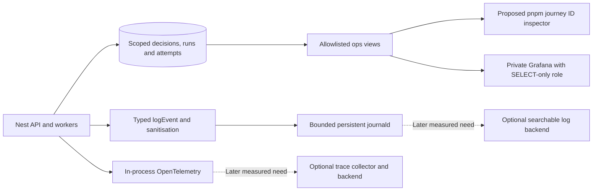

`ops` views expose status, timing, safe reason codes and scoped identifiers only. Grafana cannot read raw chat, prompts, credentials or arbitrary domain tables. The journey inspector authorises access, pages bounded records and shows missing/expired/erased stages. It is an operations command, not a consumer feature or a custom logging platform. Dashboards, view definitions and limits live in source control.

Start without Loki/Tempo/Alloy. Add them when a named need justifies their operational cost: investigations repeatedly require cross-service log search; retained timing traces are needed to diagnose latency; or a multi-host deployment makes local collection insufficient. Size the proposed deployment with actual measurements. Do not treat a documentation sizing example as a universal hardware minimum or assume every filesystem-backed deployment is impossible.

### Logging retention and erasure must agree

Journald is not a per-person database with selective row deletion. Therefore the initial general journal should contain operational events without user-linked command/attempt/evidence IDs; rich correlated personal details live in erasable, access-controlled decision/diagnostic records. The typed event builder can produce different allowlisted sink projections. Unscoped infrastructure incidents still have safe process/incident correlation.

If a later deployment retains personally linkable IDs in its journal or trace backend, its deletion/retention policy must explicitly account for that store before launch. A 14-day expiry is not immediate erasure, and replacing a name with an opaque ID does not automatically anonymise it. Test both sink projections and exported copies. Domain receipts and provider payloads retain their own purposes, permissions and deletion rules.

### What the owner can inspect

1. **System overview:** service health, queue wait, ingestion/projection lag, request latency, provider failure/unknown rates, media disk and exporter health.
2. **Journey search:** paste operation/receipt/encounter/demand ID, select time range, see linked operations and outcomes; an account search requires separate authorised resolution.
3. **Content production:** why reuse failed, which job was joined, where generation waited, provider usage/cost status and publication checks.
4. **Universe change:** supporting evidence revisions, proposed operations, validator reasons, committed delta and scene projection state. No psychological interpretation panel.
5. **Realtime delivery:** committed message/cursor, relay health, socket hint and catch-up state, plus membership refusals; no private bodies or fabricated per-hint delivery proof.
6. **Privacy and diagnostics health:** scoped erasure completion, remaining store obligations, retention jobs, dropped diagnostics and known gaps.

Example: Asha requests a Scroll and it never appears. Search its receipt. See `demand.admitted` → `supply.joined` → `provider.attempt_sent` → `provider.outcome_unknown`. The domain record says reconciliation is pending; there is no `asset.published`. A later delivery retry must not blindly issue a second paid generation. If publication succeeded but the client stayed pending, follow the committed branch revision, relay health, socket reconnect cursor and TanStack cache refresh instead. A missing disposable hint need not have a retained per-hint history. The investigation should be possible without seeing Asha's private request text.

### Retention, sampling and failures

Proposed initial diagnostic defaults: protected debug captures up to 48 hours when explicitly enabled; unlinked operational journal target 14 days within disk limits; no retained trace store required initially. A later trace backend can start with a separately reviewed seven-day retention. Tune capacity and purpose before launch. Domain evidence, decision receipts and personal memory follow their own explicit product retention and erasure policy; these diagnostic durations do not override it. Rotated files, indexes, trace backends, dead-letter material and exports must be included in deletion handling. Backups have a separately disclosed lifecycle. Hashing identifiers alone is not erasure.

Never sample durable committed-transition records. Successful high-volume diagnostic spans may be sampled with the sampling policy recorded; error capture is a target subject to collection limits, not a promise that all crashes are observed. The viewer must show sampled, unavailable, expired and erased data distinctly. Privacy deletion takes precedence over historical reconstruction; do not reconstruct erased content from logs.

Use bounded asynchronous diagnostic delivery, rotation and disk quotas. If collection fails, domain commands continue when their own database requirements are satisfied; retain locally within limits and surface a health alarm. If local diagnostic buffers overflow, count/report the loss. If the required domain receipt cannot commit, the corresponding mutation cannot report success. On crash/restart, reconcile started-but-unfinished domain attempts; do not fabricate an end event.

Initial operational verification must exercise: one correlated encounter-to-world journey through durable decision records; duplicate command retry; provider timeout with unknown outcome; stale proposal after reset; socket disconnect/catch-up; Grafana/inspector outage; disk quota; and privacy removal across all diagnostic stores. Confirm that fixture secrets, signed URLs, prompt text and chat bodies never appear in general logs. Historical reconstruction, derived-state rebuild and counterfactual policy evaluation remain separate capabilities. No logging tool makes an LLM rerun reproducible.

## 27. Design handoff and visual continuity

The next design exercise creates a complete editable screen system and clickable journeys before choosing the universe renderer. Use [the design brief](03-design-brief.md), [the copyable Claude prompt](04-claude-design-prompt.md) and [the reference guide](design-references/README.md). The brief maps all product surfaces to frame IDs and explicitly distinguishes approved style references, current implementation captures and rejected examples.

Current source inspection supports two coordinated visual registers: Hybrid Set poster content (cream/ink/cobalt/yellow/teal, strong editorial headings and rich blocks) and spacious Cosmos/Living Atlas geography (deep blue space, teal planets, angular land, light orbit rings and restrained cream controls). Iterate this existing identity; do not treat every historical screen's copy or old interaction rule as current scope. The new product rules and this blueprint take precedence over old reference behaviours.

The design artifact should include components/variants, responsive frames, accessible interactions, all normal and exceptional states, formation transitions and complete sharing/scenario/room journeys. Static illustrative people/content/worlds must be labelled as design data in the handoff; they are not implemented runtime. Sources and internal model/debug explanations stay out of ordinary consumer screens. Operator observability uses existing tools and a separate requirements appendix, not new consumer dashboard chrome.
